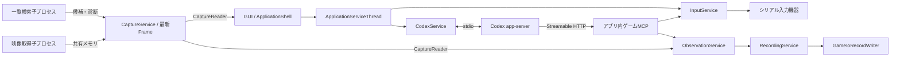

# アーキテクチャ

GIGASはPySide6のGUI、アプリ内のゲームI/O、別プロセスのCodex app-serverを組み合わせる。攻略の判断と会話管理はCodexへ委ね、GIGASは映像・入力機器と対話画面を接続する。

## 全体構成

図は主な呼出し・データの流れを示す。ゲームMCPからの入力は会話側の受付判定を経由し、操作結果と観測・記録を組み合わせる。入力サービス自体には会話や記録先を持たせていない。

## 責務と配置

| 配置 | 主な責務 |
|---|---|
| `app/` | 起動、画面とサービスの組立て、設定の保存・適用、会話選択・プロジェクト管理・映像表示の調整、終了 |
| `ui/` | ウィジェット、操作の受付、会話・状態・映像の表示 |
| `services/application.py` | GUIからの要求の配送、Codexと入力サービスの寿命、停止・入力接続変更の連携 |
| `services/codex.py` と会話関連の内部モジュール | Codex接続、会話選択と実行、Goal、作業場所・記録・MCPの準備と解放 |
| `runtime/codex/` | app-serverの起動、stdio通信、公開APIの要求・応答・通知をアプリの値へ変換 |
| `game_io/` と入力・観測サービス | 映像取得、入力状態と通信形式、有限操作列・手動入力、観測画像の生成 |
| `mcp/` | ループバックHTTPでのゲームツール公開、引数・結果のMCP形式への変換 |
| `storage/` と `services/recording.py` | 設定・ゲームI/O記録の永続化、非同期保存の順序と完了待ち |

`ApplicationServiceThread`が`CodexService`と`InputService`を並列に所有し、Codex側へ入力サービスを貸し出す。Codex接続を閉じても入力機器の接続は残り、手動操作に使える。入力接続の変更時は、必要ならCodexの実行を止めてから設定を適用する。

`CodexService`はQtオブジェクトを持たず、呼出し元のasyncioループとコールバックで動く。Qtへの通知は`ApplicationServiceThread`が担う。映像の所有は`VideoController`にあり、Codexの接続・会話の切替と映像取得の寿命を分けている。

## プロセスとスレッド

| 実行場所 | 担当 |
|---|---|
| GIGASのGUIスレッド | Qtイベントループ、画面操作、最新Frameの取り出しと描画 |
| Markdown解析ワーカー | UI所有の専用QThreadPoolを最大1本で使用。変更した応答を解析・書式付与し、GUIへ文書の所有を移して渡す |
| 設定I/O用のQThread | `SettingsWorker`による設定ファイルの読込・保存 |
| `ApplicationServiceThread`のQThread | 一つのasyncioループでCodex接続、会話、入力、ゲームMCP、観測・保存の受付を実行 |
| 映像監視スレッド | `CaptureService`が取得子プロセスの状態・期限を監視し、最新Frameを保持 |
| 診断ログの保存スレッド | `QueueListener`が共通診断ログをJSON整形・認証情報除外・サイズ回転して保存 |
| 一覧検索子プロセス | 検索1回で候補と診断を返して終了。映像取得中は独立に起動・監視し、一覧を更新する |
| 映像取得子プロセス | OpenCV によるカメラ列挙・接続、または ponkan による New Nintendo 3DS XL の取得。取得中は最大一つの子プロセスが機器を所有 |
| Codex app-serverプロセス | モデル実行、会話・Project・Goal・標準自動記憶の管理 |

PNG符号化や保存、ポート列挙などの同期処理は`asyncio.to_thread()`で実行する。シリアル通信は`SerialInput`の単一ワーカーに送り、書込とcloseの順序を維持する。

診断ログは`app/diagnostics.py`が起動と通知を接続し、`storage/diagnostics.py`がキュー・ファイル・保持を所有する。入力停止と機器・会話資源の解放後、専用の終了スレッドでログの保存待ちを回収してQtの終了へ進む。記録範囲と制約は[診断ログ仕様](design/data/diagnostics.md)に記載する。

## 映像とゲーム操作の経路

映像取得子プロセスから共有メモリを通じて受け取った画像を、ホスト側の`FrameStore`が最新の不変な`Frame`として保持する。プレビューと観測はそれぞれ`CaptureReader`を使い、同じ取得元を参照する。

GUIの`VideoController`はタイマーで状態と最新画像を取り出す。取得した全フレームをGUIへの通知キューに積まず、表示頻度を設定に合わせて制限する。

MCPの`observe`は最新キャッシュを取り出し、`ObservationService`が出力解像度に合わせてPNGへ変換する。`act_and_observe`は、有限の入力列が正常終了してから最新キャッシュを観測する。どちらも観測のたびに映像機器を開き直す構成ではない。

ゲームMCPはGIGASと同じプロセス・サービスループ上で動き、会話の実行資源としてlocalhostのHTTPリスナーを持つ。Codexには接続先と認証ヘッダーを渡し、`observe`、`act_and_observe`、`dispatch`、`poll`、`cancel`を公開する。呼出しの契約は[ゲームI/O仕様](design/functions/game-io.md)と[MCP仕様](design/interfaces/observation-mcp.md)を参照。

## 会話と保存の境界

CodexはGIGAS用の専用homeで起動する。Project・会話履歴・Goal・標準自動記憶はapp-serverのAPIで管理し、履歴の閲覧と会話の実行再開を分ける。

`ProjectController`は管理メニュー・編集・確認と結果の表示を担う。`CodexService`は管理更新を直列化し、`ProjectManagement`へ全所属の取得・追従・最終確認を委ねる。管理用の読取り専用resumeと、次の明示実行の準備を分け、ファイル移動や独自Project台帳を保存部品へ持ち込まない。

GIGASの会話資源は、作業フォルダー、会話IDに対応する`records/<thread-id>/`、ゲームMCP、観測・保存サービスを束ねる。作業フォルダーの選択と記録先の決定は呼出し側が行い、`GameIoRecordWriter`は渡された保存先のファイルと整合を扱う。

観測画像、入力イベント、提出本文・確定本文の保存は`RecordingService`へ渡す。一つのwriterへの保存は直列化するが、画像の応答や入力操作は保存完了を待たない。後から起きた保存失敗は通知として扱い、既に返した観測結果や送信した入力を取り消さない。具体的な形式と所有範囲は[データと保存](design/data/storage.md)を参照。

## 停止と終了

共通停止ではCodexの実行停止と入力の取消し・中立入力の送信を連携させる。通常の停止では、映像や入力機器の接続を保つ。Codex切断時は有限操作を回収し、会話のMCP・観測・保存資源を閉じる。

アプリ終了では新しい要求を止め、Codex、入力機器、映像取得、設定I/O、Markdown解析の終了を待つ。解析の未送出分は破棄し、実行中の解析は完了を非同期に確認する。観測符号化と受付済みの保存を回収してからwriterとサービスループを閉じる。GUIの終了要求と資源の解放完了は別であり、終了待ちの間もGUIイベントループは動作する。

## 実装の入口

- [ApplicationShell](../src/gigas/app/shell.py)、[ApplicationServiceThread](../src/gigas/services/application.py)：組立て・配送・寿命
- [CaptureService](../src/gigas/game_io/capture/service.py)、[VideoController](../src/gigas/app/video.py)：映像取得と表示
- [ConversationResources](../src/gigas/services/_conversation_resources.py)：会話、MCP、観測・保存の接続

機能上の意味は[会話と実行](design/functions/conversations.md)、画面の配置と操作は[デスクトップUI](design/ui/desktop.md)、今後の改善は[開発計画](roadmap.md)を参照。
