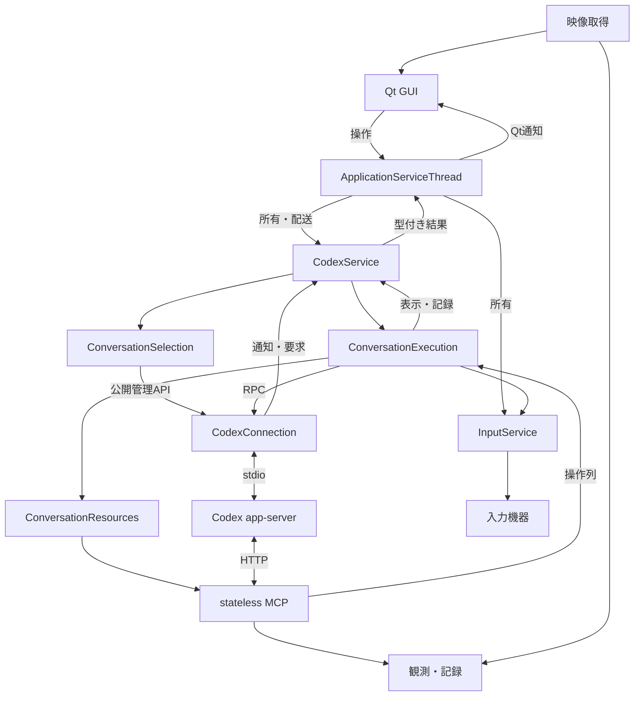

# 02-runtime.md — 全体構成・実行管理

[文書一覧](README.md)

通常指示と追加指示の開始・介入、Goalによる自律継続はapp-serverへ任せます。GIGASはユーザー操作の配送、公開状態の表示、限定した本文とゲームI/Oの記録、ゲームI/O、明示停止を担います。共通契約は[unit_061](../../complete/unit_061/CONVERSATION_EXECUTION_MODEL.md)、Goal固有の契約は[unit_062](../../complete/unit_062/GOAL_EXECUTION_MODEL.md)を正本とし、操作画面は[10](10-ui-interaction.md)、処理順は[09](09-control-flows.md)に示します。

以下はU08で採用する管理・保存・再接続を含む設計です。実装・受入状況は[U08親仕様](../../complete/unit_013/RESUME.md)に集約します。公開APIの成立条件は[08](08-sdk-compatibility.md)、製品経路で確認する条件は[07](07-verification.md)に定めます。

## 実行単位と責務

| 所有者 | 保持する情報・処理と寿命 |
| --- | --- |
| GUI | 下書き、表示内容、Qt配送結果待ち。接続と会話の通知から活性を導出する |
| `ApplicationServiceThread` | Qt操作の配送、要求世代の発行、同一ループ上のCodexService・InputServiceの寿命。終了時は両サービスの回収を待つ |
| `CodexService` | 接続・認証、会話部品の組立、Codex操作taskと結果解釈。入力サービスを借用し、入力接続の生成・終了は所有しない |
| `CodexConnection` | stdio、認証、モデル候補と確定選択、Windows実行環境、受信処理。一接続の寿命 |
| `ConversationSelection` | 新規会話の所属、または保存済みID・cwd・所属の不変値、閲覧metadata・Goalと取得中task。選択は接続を跨いで保持し、履歴ページの全文を蓄積しない |
| `ConversationExecution` | 最新Goal、現在turn、送信task、停止taskと実行準備。一接続の現在対象に一つ。切替時には旧実行を回収して交換し、turn内容と要求は個別の所有者へ委譲する |
| `ThreadPreparation` | 通知を受けるthread IDと、start/resumeの返却検査が成功した事実。新規・既存の作業場所、記録先、現在設定を結合する。実行対象とともに回収する |
| `GoalTracker` | Goalの公開値と一件の変更要求・通知の相関。閲覧と実行の各所有者で同じ処理を使い、現在の所有者だけが通知を適用する |
| `HumanRequests` / `TurnContent` | 未回答要求は解決・対象turn終端まで、配送開始済みtaskは要求が消えても配送結果確定まで所有する。本文は対象turn終端で確定する |
| `ConversationResources` | MCP、観測・記録サービス、writer。MCP・writerは現在の実行資源として取得・回収する。履歴を選ぶだけでは取得しない |
| `InputService` | 一つの機器接続、使用可否、一件の操作task。taskは解除まで、正常な機器接続はCodex切断後も保持する |
| MCP | HTTP入口、認証、形式検査、応答変換。会話や機器の状態を複製しない |

会話の状態は`ConversationStatus(thread_id, turn_id, goal, sending, stopping, waiting_for_answer)`へ投影します。`sending`と`stopping`はtaskの存在、回答待ちは元要求から導き、独立した実行phase・再受付許可・停止済みフラグを保存しません。Goal状態とturn状態の組合せを列挙型へ展開しません。機器入力にrun、Grant、入力世代を持たせません。Qtの古いイベントを識別する接続世代は維持します。

会話選択ではapp-serverから得たthread IDを表示対象として保持し、実行管理は接続中の対象thread IDを保持します。会話の永続管理の正本はapp-serverで、GIGAS独自の会話ID台帳は作りません。再起動後は公開一覧・readからIDとcwdを取得します。保存部品へは解決済みの記録先を渡し、会話の選択・再解決を委ねません。

新規startで検査した実IDはrecordsの結合前に選択へ渡します。結合失敗や切断でも新規扱いへ戻さず、再接続後の明示操作に使います。閲覧Goalは実行状態へ合成せず、閲覧だけの会話を停止・終了で休止しません。追加履歴と閲覧Goalの配送には取得時の選択参照を付け、接続世代と参照の同一性で照合します。同じ会話を選び直した場合も以前の取得結果を採用しません。

要求パラメーターの組立・応答検証は状態を持たない関数に置きます。会話実行へ機器通信、画像加工、保存、認証、モデル一覧、全文の表示処理を集めません。資源取得・停止中だけ必要な待ち合わせは、そのtask内の値として保持します。

## 並行処理と資源の寿命

Qtのメインスレッドは表示と操作受付、サービス用QThreadの一つのasyncioループはCodex、MCP、入力・観測・保存の調整を担当します。通知の反映処理は送信や停止の完了を待ちません。GUIへはqueued signalで更新を返し、長い同期待ちやワーカーからのウィジェット操作を行いません。

映像ドライバーの列挙・open/read/releaseは専用子プロセスが所有し、監視スレッドが最新一枚と状態を読みます。期限付き終了と回収は取得側が管理し、異常終了した共有資源を次の接続へ再利用しません。入力の同期シリアル呼出しは単一workerへ直列化します。操作列の取消しは待ち行列へ積まず、実行中taskへ届けます。開始済みwriteを回収してから実行部がneutralを送出し、別経路から解除bytesを割り込ませません。

入力taskは解除まで一件だけです。`InputService.start()`は同期的にtaskを登録し、処理中はBUSYを返します。`stop()`は現在のtaskへ取消しを要求してそのtaskを返します。停止所有者は捕捉したtaskの解除結果を回収し、後から始まった別の操作を取り消しません。画像加工・保存は入力枠から外し、停止完了のために画像完成を待ちません。

手動保持もInputServiceの同じ操作枠を使います。ApplicationServiceThreadはCodexの開始準備・turn・active Goal・回答待ち・停止と、入力側の接続・所有・終了要求を確認して配送します。GUIは通知された受付可否を表示に使い、実受付はサービスループで再確認します。会話実行の既存送信taskが、開始を伴う要求だけ手動解除を待ってから準備・RPCへ進みます。小窓の開閉はCodexへ通知せず、手動保持の終了だけを入力側へ依頼します。Codex切断は開始時に捕捉した有限操作を回収し、後続の手動操作を待ちません。

観測は最新キャッシュを一度採用し、要求後の新フレームを待ちません。操作後の観測でも同じ契約を使い、画像の選択前に次の入力が始まる場合があります。符号化中の別観測はBUSYですが、保存中であることを理由に次の観測を拒否しません。開始済み符号化・保存は要求取消し後も各所有者が回収します。

共通のRecordingServiceがwriterへの追記を直列化します。入力・観測・会話の記録は非同期に提出し、保存完了を送信・入力・停止の条件にしません。終了時は入力・要求・符号化を回収し、保存をdrainしてからwriterを閉じます。記録先は実thread IDで分け、入力結果はoperation_id・observation_idで対応付けます。行ごとのthread IDやturn IDは重複保存しません。ユーザー指示やturnへの帰属を推定しません。

## 認証・モデル・実行環境

`SessionStatus`は接続・認証を扱い、phaseは`connecting / login_required / authenticating / ready / error / closed`です。認証はGIGAS専用のCODEX_HOMEで管理し、開発用homeの資格情報を複製・同期しません。Codex接続成功を設定へ保存し、次回起動時に一度接続します。明示切断成功で記憶を解除し、通常終了・通信障害では保持します。起動だけでログイン・会話実行・Goal再開は行わず、切断もログアウトへ変換しません。APIキー認証は初期版対象外です。

保存するモデル・推論レベルは次の接続の既定値です。無効でも認証は維持し、公開候補から選び直せます。選択変更は送信taskと共通の枠で扱い、実行用にロード済みの会話では`thread/settings/update`の受理後に確定値を通知します。現在turnは書き換えず、次の通常指示と設定受理後の自律turnへ反映します。無効値を別候補へ自動置換しません。

新規入力中や保存済み会話の閲覧中は、公開候補に対して検証したモデル・推論レベルを現在の入力欄の選択として保持します。thread IDが存在しても、閲覧だけの会話へsettings/updateやresumeを送りません。選択値は明示実行時のthread/start・thread/resumeのモデル指定・configへ渡し、Goalによる推論も始まる前に適用します。会話ごとの選択値台帳は設けず、設定画面の保存既定値とも分けます。

Windows実行環境は接続後に認証と独立して取得します。設定画面の準備操作は開始受付ではなく、完了通知とreadinessの再取得まで待ちます。成功後も非readyなら明示再接続を求め、受付不明なら再送せず待ちます。待機中の切断は可能ですが、Windows側の処理取消しは保証しません。

通常指示とGoalの作成・目的編集・再開は、接続・認証、有効なモデルと推論レベル、実行環境readyを要求します。送信または停止処理中は新しい送信を受け付けません。turn実行中、質問待ち、機器未接続、映像未取得、利用枠表示だけでは拒否しません。モデル選択は無効値からの復旧にも使うため、現在選択やsandboxの準備を前提にしません。回答は元要求の有効性、接続、停止状態で判断し、通常送信の枠には並べません。

## 初回準備と通常指示

新規会話の最初の通常送信またはGoal作成で作業場所を解決します。Project所属では公開Project情報の唯一のroot、未所属ではこの時点で作成する会話別フォルダーを使います。cwd・runtimeWorkspaceRootsはその作業フォルダーとし、固定memory/に限定しません。thread/startの応答で実IDを保持してから`records/<thread-id>/`のwriterを開き、MCPの保存呼出し先へ結合します。thread作成から資源結合までの間にturn/start・thread/goal/setを送らず、ゲーム入力を開始しません。Codexへは[04](04-agent-memory.md)の保存構造と原記録の扱いを案内し、正確な記録先の案内を開始条件にしません。パスを伝えるための追加API・指示差替え・MCP結果の拡張は行いません。

接続・認証、表示中の会話、実行用にロードした会話を区別します。会話選択はthread/read・履歴ページ・goal/getによる表示だけとし、resume・記録先作成・ゲーム操作を行いません。既存会話へ明示送信する場合は、作業場所の存在を確認して現在のMCP・記録先・指示・設定を準備し、thread/resumeから通常送信またはGoalの目的編集・再開へ渡します。Goal削除はこの実行準備を通しません。履歴・Plan・質問承認の表示範囲は[10](10-ui-interaction.md)に従います。

保存済みIDの通知受付と記録先はresume送信前に結合します。IDが既知でも現在設定での再開成功とはせず、返却検査が終わってから本文・Goal操作へ進みます。送信済みresumeのtaskは本文の提出と分けて所有し、応答待ちの停止では早期turnとGoalも共通停止で回収します。準備開始時に設定を捕捉し、その途中の設定変更で要求内容を組み替えません。

切替は利用者が共通停止を完了してから行います。旧threadの購読解除、未回答要求の失効、旧MCP閉鎖と保存drainを経て資源を解放します。購読解除だけを停止・アンロードの保証にはしません。採用版では購読者のないidle threadに変更設定を指定してresumeすると再構築される経路を使えます。停止・購読解除が成立しない場合は送信せず、既存の失敗・明示切断経路を使います。毎ターンのunsubscribe/resumeは行いません。

候補の初回取得と切替は一件だけを受け付けます。旧MCPの受付を閉じてから回答配送・保存の完了を待ち、同じcwdへの切替でも旧入力呼出し先を使い回しません。取得・解放に失敗した場合は選択を保持しますが、解放済みの実行状態を表示しません。通知はサービスが現在の所有者へ配送し、接続開始時の実行インスタンスに固定しません。

書込みはworkspace-write、承認条件はon-request、承認者はauto_review（既定）またはuserです。追加書込先を増やさず、一時領域除外とシェルのnetwork_access=falseを維持します。応答のcwd・roots・承認・sandboxを検査し、準備不足でreadOnlyになった状態を黙って採用しません。標準の指示・Skillsを読み、ゲームMCP以外の外部MCP導入経路は設けません。MCP認証値をプロンプト・表示・recordsへ複製しません。

通常指示と追加指示はどちらも`turn/start`へ一度配送します。既存turnへの介入か新turnの開始かはapp-serverが決めます。特定turnだけへの指示、turn終端までの保留配送、本文の意図分類、自動再送を設けません。送信中に編集した下書きや失敗・受付不明の下書きは保持します。

現在turnは開始・終端通知から更新し、受付応答だけで実行中へ戻しません。送信taskは受付応答と対象turnの開始または既観測終端を回収して終了し、応答だけ先着した間の停止でも中断対象を取り逃しません。既知の現在turnへの追加では新たな開始通知を要求しません。本文・Plan・公開推論要約・activityはturn終端で締め、履歴を残します。遅い同turn更新を再照会で補わず、毎turnのPlan・要約出力を要求しません。追加指示・質問待ち・自然終端・turn失敗だけで機器入力を止めません。

## Goalと質問・承認

Goalなしの作成はobjectiveとactive、既存Goalの編集はobjectiveだけ、再開はactiveだけを`thread/goal/set(origin=user)`へ送ります。目的更新後の介入・継続開始はサーバーに任せ、通常指示を重ねません。completeの編集も状態・利用量を維持し、別Goalとして始める場合は削除してから作成します。

Goal削除は目的の取り下げです。接続・認証と選択対象の保存済みthread IDを使い、閲覧中でもthread/goal/clearを直接送ります。モデル選択、実行環境ready、作業フォルダーの存在、MCP・writer準備、thread/resumeを前提にしません。送信・停止・切断処理中の重複操作は共通の枠で防ぎます。現在turn・操作列・質問を中断せず、記憶や原記録も削除しません。Goalのcomplete・paused・blocked・制限状態の通知は表示へ反映し、明示停止へ変換しません。非activeのGoalがあっても通常指示でゲームを操作できます。「再開して」という本文はGoalをactiveへ変える特別な操作にしません。

Goal変更は対応通知を処理するまで同じ送信taskで扱います。無変化の応答とclearの`cleared=false`では追加通知を待ちません。表示の正本は通知で、遅い応答を使って後続状態を巻き戻しません。通知受領をサーバー内の実行反映完了とはみなさず、停止ではturn終端も確認します。再開拒否または制限状態維持の応答ではその状態を保ち、処理終了後に再開ボタンを再び有効にします。予算を変更したり利用量を初期化したりして補いません。

質問・承認は元要求IDへ一度返し、通常指示と混同しません。複数質問は要求と質問IDごとに下書きを保持し、一つのanswers応答で返します。秘密入力指定を含む質問は全体を未対応として返します。承認条件に達した処理の審査先は設定に従います。人へ届いた要求は提示された判断を元要求へ返し、通常本文やGIGAS独自の自動acceptで許可しません。詳細な対応範囲は[接続API](../../../docs/design/interfaces/codex-api.md)に示します。

要求解決・turn終端・停止・切断で未送信の回答を失効させ、配送開始済みの回答は別に結果を回収します。`RequestResolved`は受付終了であって配送成功ではありません。通信への書込完了を許可対象の実行成功とせず、不明な結果を自動再送しません。

## 明示停止と切断

共通停止は送信枠に並ばず割り込み、一つのtaskで所有します。その間の新しい指示・Goal操作・回答・機器入力は拒否し、繰り返し停止は同じtaskへ合流します。入力列の取消し・開始済みwriteの回収・neutral送出はサーバー待ちと独立して進めます。未提出の送信は取り消し、提出済み送信・回答は決着を確認します。

既知turnには直ちに中断を送り、Goal変更待ちで遅らせません。送信済みGoal操作の結果と通知を処理した後、最新Goalがactiveならpausedを要求し、非activeの達成・制限理由は維持します。停止中に新しい自律turnが始まっても同じ停止taskで中断します。対象ごとの中断応答と終端通知、Goalの継続停止、捕捉した操作列の解除・回収を確認して成功を返します。

正常停止が完了すれば通常受付へ戻ります。再受付専用の状態・手順は追加しません。Goalの明示再開は自律継続を要求する操作であり、機器受付の再許可ではありません。停止はゲーム内セーブや任意のバックグラウンド処理の全終了を保証せず、端末一覧の取得・一括終了は行いません。

入力解除だけの失敗は機器を使用不能にして停止失敗を返し、サーバー側停止を確認した会話は維持します。サーバー側の停止失敗はサービス所有の終了taskへ合流し、接続・MCPを閉じてローカル処理を回収した後に失敗を返します。終端や通知待ちが続く間も明示切断できます。

サービスの終了taskは接続・MCP・送信・回答・入力・観測・保存を回収します。発端となった停止taskやQt操作taskは待たず、相互待機を作りません。切断時は通知待ちを失敗として解き、Goal休止の永続化・最終応答・任意の子孫プロセス終了は保証しません。正常な入力接続と映像取得はCodex切断だけでは閉じません。アプリ終了ではそれぞれの所有者が解放します。

入力設定の変更は必要な共通停止と並行して、旧列の解除・回収後に機器を切り替えます。提出済み設定適用は停止で取り消しません。MCPは共通形式を公開し、入力サービスが現在の機器能力で列全体を検査するため、機器切替で会話や入口を作り直しません。観測解像度だけの変更は次の観測から反映し、入力を止めません。

## 障害と初期版の範囲

| 事象 | GIGASの処理 |
| --- | --- |
| Goal状態・利用枠・turn失敗の通知 | 公開値を表示する。共通停止や自動再開へ変換しない |
| 通信切断・app-server終了 | 共通の資源終了を開始し、入力を取り消して理由を表示する。自動再接続しない |
| 入力故障 | 解除・回収を試み、確認できた結果を返す。明示的な機器接続の適用で復旧する |
| 観測・保存失敗 | 入力結果と分けて返す・記録する。成立した入力を失敗へ書き換えず、後続入力を止めない |
| 通知が来ない | 受信済み情報を保持する。時間経過から停滞推定・再取得・自動修復をしない |

PCプロセス自体の異常終了後の押下解除はソフトウェアのfinallyだけでは保証できません。機器のACK・最悪停止時間を未確認のまま保証しません。

同一接続内のGoal再開は目的文を変えないactive要求です。app-serverの保存済み履歴の取得、アプリ・接続再起動後の再接続は[U08](../../complete/unit_013/RESUME.md)の対象で、過去操作の自動再生や攻略の自動開始は行いません。起動済みゲームの画面から扱い、HOME画面から任意ソフトを起動する機能を必須にしません。

専用の計画的終了[U07](05-implementation.md#u07-retired)は独立工程を廃止しました。「保存して終えて」も通常指示として配送し、区切りと作業順はモデルに任せます。専用の終了turn・権限・Goal休止からの自動停止やセーブ成功判定を追加しません。

別ランタイムへの変更では通信部と会話機能の対応を見直します。MCP・ゲームI/O・保存形式の継続利用を狙いますが、Goalや会話復元の完全互換、汎用ランタイム登録基盤は初期版の要件にしません。
