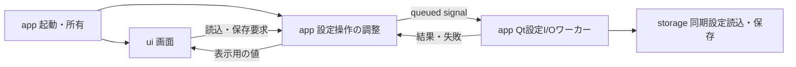

# U01 M0 全体構成との接続・依存選定

## 1. 概要

### 1.1 目的と状態

[U01親仕様](../unit_001/APP_STARTUP.md)を実装する前に、初期設計の責務・並行処理へU01を接続し、直接依存と検証条件を選定する。2026-11-10に調査・設計を完了した。製品コードと依存定義はM1以降で変更する計画とした。

本書は独立した作業仕様unit_002。親が工程全体を束ね、本書がM0の判断・根拠・結果を所有する。後続の子仕様も各unitに1ファイルで置く。

後続判断（2026-11-10、M1レビュー）: グローバル設定は互換性を担保せず、版管理・移行・旧キー対応を設けない方針となった。本書がM1へ渡した外部変更検出も、アプリ終了中の手編集へ範囲を絞るため採用を撤回した。TOML Kit、元文書のコメント保持、UI非依存のstorageとI/O所有者の判断は維持する。現在の契約は[unit_003](../unit_003/GLOBAL_SETTINGS.md)を参照。

### 1.2 起点と関連文書

ユーザーの2026-11-10依頼、[02-runtime.md](../../initial/02-runtime.md)、[05-implementation.md](../../initial/05-implementation.md)、[06-repository.md](../../initial/06-repository.md)を起点とする。保存と指示は[04](../../initial/04-agent-memory.md)、配布確認は[07のT20](../../initial/07-verification.md)、Codex接続のリスクは[08](../../initial/08-sdk-compatibility.md)を参照する。

### 1.3 利用場面

| 利用者 | 必要な判断 | 本書から得る結果 |
|---|---|---|
| 設定実装者 | TOML編集と型境界 | TOML Kitの採用版、保持できる範囲、UI非依存の保存部品 |
| GUI実装者 | I/Oと画面・終了の関係 | 所有者、通知、未終了の扱い、Qt試験の採用版 |
| 配布実装者 | リソースとPython対応 | 同梱・読込方式、検証版、配布物で残す確認 |

## 2. 対象範囲

U01の起動・設定I/O・終了の責務、後続サービスループへの接続、Pythonと直接依存の選定、公開資料・採用版ソースの確認、隔離環境の限定的な動作確認を含む。

## 3. 対象外

製品の設定・GUI実装、機器・認証・課金を伴う確認、Codex/MCPの採用版固定、全クラスの先行実装は行わない。今回の依存確認コードは試験条件の調査用で、製品の原型や回帰試験の代わりにしない。

## 4. 全体構成への接続

図はU01で実際に使う部品のみ。後続のruntime・MCP・game_ioは02の構成を維持し、U01では生成しない。storageはQt型やSDK型を受け取らず、設定値と保存結果をPythonの値で返す。TOMLDocumentをuiへ公開しない。Qtに依存する通知の橋渡しはappへ閉じ込める。

M3レビューでの更新（2026-11-10）: 指示は同梱資材とし、M3の配布検査から標準のimportlib.resourcesで読む。未使用の専用取得APIとappからの接続は作らず、製品側での利用はU06で追加する。図から先行していたapp → promptsを除いた。同梱・読込方式の採用判断は維持する。

appが設定操作の調整役、QThread、ワーカー、画面の寿命を所有する。画面自身にスレッドの作成や保存先判断を置かない。設定I/Oは一度に1件とし、無制限な要求キューを作らない。読み込んだ文書、編集値、保存成功後の値を区別する。将来の接続設定には保存成功後の値のコピーを渡し、実行中接続を設定保存だけで変更しない。

U01は同期ファイルI/OをQtワーカーへ隔離する。サービス用asyncioループはMCP等の実利用が始まる工程で導入し、その時はappの呼出し側を接続し直す。同じ同期storage処理を使い、Qt保存ワーカーとasyncio側が同じファイルへ並行して書く構成にはしない。サービス化の際にQtワーカーを維持するか実行器へ移すかは実際の呼出し元に合わせて判断し、storageの契約は維持する。

qasync等によるQtとasyncioのイベントループ統合は採用しない。初期設計02はループを別スレッドに分離しており、U01にはasyncio利用処理がないため。後続でスレッドをまたぐasyncio呼出しには標準のthread-safeな投入経路を使い、GUIでFuture.resultを同期的に待たない（[Python公式資料](https://docs.python.org/3.13/library/asyncio-dev.html#concurrency-and-multithreading)）。

## 5. 振る舞い仕様・決定事項

### 5.1 起動と寿命

起動時にGUIとappの調整役を作り、読込中の画面を表示して設定I/Oを要求する。ファイルI/O中にウィジェットを操作しない。QObjectワーカーをQThreadへ移し、結果はqueued signalでメインスレッドへ返す。QThreadのサブクラスのslotに仕事を置く方式は採らない。

終了要求時は新規I/O受付を閉じる。実行中のI/Oは結果を待ち、結果に応じて未保存確認または終了へ進む。終了可能になったらquit、finished通知、終了確認の順に進める。メインスレッドで長時間のwait/joinをしない。finished後の非ブロック確認が必要ならwait(0)を使い、未終了ならイベント処理へ戻る。ワーカーはfinishedからdeleteLaterへ接続し、実行中のQThreadを破棄しない。

保存が戻らない場合もGUIは応答し、対象の保存先と「終了未完」を表示する。終了要求を取り消して画面へ戻れるが、処理中の保存に重なるI/Oは許可しない。QThread.terminate、強制的なスレッド破棄、タイムアウトを保存成功へ変換する処理は採用しない。OSによるプロセス強制終了まで安全な保存を保証するものではない。待機時間の数値保証は置かず、未終了表示へ切り替える時間はM2のUI方針として決める。

根拠は[QThread公式API](https://doc.qt.io/qtforpython-6/PySide6/QtCore/QThread.html)と[Qt 6.12.0 qthread.cpp](https://code.qt.io/cgit/qt/qtbase.git/tree/src/corelib/thread/qthread.cpp?h=v6.12.0)。finishedによる通知とterminateの危険性を確認した。[PySide 6.12.0 binding定義](https://code.qt.io/cgit/pyside/pyside-setup.git/tree/sources/pyside6/PySide6/QtCore/typesystem_core_common.xml?h=v6.12.0)のQThread、run、exec、waitの公開経路も確認した。ファイルI/O停止不能の実故障試験は未実施。

### 5.2 採用する依存

採用は実装時に追加する版の決定を指し、ルートの依存へ追加済みという意味ではない。

| 用途 | 採用判断 | 根拠・代案との比較 |
|---|---|---|
| Python | 開発推奨3.13系、最低3.12を維持 | 3.12.10/3.13.5で候補依存の限定試験に成功。最低版を引き上げる機能上の理由がない |
| Qt | PySide6-Essentials 6.12.0を直接依存にする | QtCore/QtGui/QtWidgets/QtTestを利用できる。PySide6全体が追加するAddons/WebEngine/PdfはU01では不要 |
| TOML | tomlkit 0.15.2 | 解析文書を保持して値を更新できる。tomllib単独は書込不可、単純な辞書の再直列化ではコメントを失う |
| GUI試験 | pytest-qt 4.5.0を開発依存にする | qt_api=pyside6を明示。qtbot.waitSignal/waitUntilで順序と終了を観測できる |
| ビルド | 現行uv_build >=0.11.25,<0.12を維持 | 0.11.25ソースを確認。今回のために最新系列へ更新する理由はない |
| リソース | 標準importlib.resources | files(...).joinpath(...).read_text(encoding='utf-8')で作業ディレクトリに依存しない |

PySide6-EssentialsのPyPIメタデータはPython >=3.10,<3.16で、win_amd64用cp310-abi3 wheelとshiboken6==6.12.0依存を持つ。U01の初回Qt追加時にプロジェクトのrequires-pythonを>=3.12,<3.16へ揃え、未対応のPython 3.16以降まで解決対象に含めない。ruff/tyは最低対応版3.12を維持し、Windows CIは3.12と3.13へ拡張する。3.14/3.15は依存の許容範囲だが本調査では実行未確認。Windows x64をU01の検証対象とし、ARM64は未検証。

PySide6という技術選定を変えたのではなく、直接インストールする公式配布をEssentialsへ絞った。将来追加モジュールが必要になれば、使うモジュールと同一Qt版の配布を再選定する。shiboken6を重複して直接指定しない。pytest-qtが要求するtyping_extensionsは推移依存として受け入れ、アプリが互換用の直接依存を追加する理由にはしない。

実装時の追加はM1で`uv add tomlkit==0.15.2`、M2で`uv add PySide6-Essentials==6.12.0`と`uv add --dev pytest-qt==4.5.0`。各変更でuv lockを実行する。既存開発ツールを一括更新する指示ではない。解決されたpytestの調査版は9.2.0であり、既存lockとの差分は実装時に確認する。

### 5.3 TOMLの保持範囲とリソース

TOML Kitのparse/dumpsとContainerの更新処理を0.15.2配布物のソースで確認した。parseした文書を保持して既知値だけ更新する。通常のdictへ変換して文書全体を再生成しない。単純な値更新ではコメント・未編集の表・順序を保持できたが、キー削除は同じ行のコメントも削除した。M1では未設定への変更時にもコメントを残す処理を明示的に試験する。全TOML構文のバイト単位保持を保証せず、変更しない利用者の情報を失わないことを契約とする。

指示はsrc/gigas/promptsへ置く。uv_build 0.11.25のwheel.rsはモジュール配下を再帰的に収録し、lib.rsの配布試験には非Pythonファイルpi.txtが含まれる。追加のMANIFEST.inや大きなglob指定は現時点では不要と判断する。実指示がwheelとsdistへ入り、再ビルドした配布物から読めることはM3で検証する。

## 6. TDD Test List

M0は製品実装を含まないため製品TDDはnot applicable。以下の依存の特性確認を実施した。M1/M2の本実装ができたら同じ観測点を回帰試験へ引き継ぎ、今回の試験だけで完了にしない。

| 確認 | 結果 | 後続の試験 |
|---|---|---|
| TOMLのmodelだけ更新し、コメント・未知表・順序が変わらない | 3.12/3.13で成功 | M1の本保存処理で再確認 |
| キー削除で同行コメントが失われる | 両版で再現 | M1でコメント保持処理を追加 |
| EssentialsだけでQLabel生成とpytest-qt利用 | 両版で成功、offscreen | M2の実画面・可視Windows確認 |
| ワーカーの結果がメインスレッドへ届き、thread.finished後に終了する | 両版で成功 | M2の保存成功・失敗・終了要求の試験 |

## 7. 全体に影響する未確認事項

[公式Codex SDK資料](https://learn.chatgpt.com/docs/codex-sdk)でPython SDKと固定ランタイム依存の方針を再確認した。[app-server資料](https://learn.chatgpt.com/docs/app-server)でthread/goal/set・get・clearと質問・承認要求の公開経路を確認した。Python SDK採用版での成立性はこれだけでは確定しない。

| 項目 | 未確認と影響 | 判断を終える工程 |
|---|---|---|
| Goal・pause後の通常ターン | 08の固定コミットの制約が採用版でどうなるか未検証 | U06の接続設計前。U07の終了処理実装前に実行確認 |
| 質問・承認の保留と取消し | 単一受信のままGUI回答待ち・停止を扱えるか未検証 | U06。M2はSDK型に依存しないため先行可能 |
| MCPの画像と世代更新 | SDKからの設定・更新と画像応答の実接続が未検証 | U05/U06。設定と配布経路には依存しない |
| SDK・ランタイムとPythonの版 | U01のQt依存との全組合せは未解決 | U06の初回依存追加前。非公開APIで補わず制約を記録 |

既存08のソース監査を全面的にやり直したものではない。独立したU01を止める新しい根拠は今回見つからなかったが、接続成立を保証する判断でもない。

## 8. 対象ファイル・根拠

変更対象は本書、親とM1〜M3の独立仕様、初期設計02・05・06。調査生成物はgit対象外のtmp/m0に置き、製品コード・依存定義へ取り込まない。

| 根拠 | 確認した内容 |
|---|---|
| [PySide6-Essentials 6.12.0 metadata](https://pypi.org/pypi/PySide6-Essentials/6.12.0/json)、[PySide6 6.12.0 metadata](https://pypi.org/pypi/PySide6/6.12.0/json) | Python範囲、Windows wheel、直接・推移依存 |
| [tomlkit 0.15.2 metadata](https://pypi.org/pypi/tomlkit/0.15.2/json) | 配布版を固定。wheel内api.pyのparse/dumps、container.pyの__setitem__/_replace_atを読取 |
| [pytest-qt 4.5.0 metadata](https://pypi.org/pypi/pytest-qt/4.5.0/json)、[waitSignal資料](https://pytest-qt.readthedocs.io/en/latest/signals.html) | wheel内qt_compat.pyのPySide6読込、qtbot.pyの待機APIを確認 |
| [uv 0.11.25 wheel.rs](https://github.com/astral-sh/uv/blob/0.11.25/crates/uv-build-backend/src/wheel.rs)、[lib.rs](https://github.com/astral-sh/uv/blob/0.11.25/crates/uv-build-backend/src/lib.rs) | モジュール走査と非Pythonファイルの配布試験を読取。上流試験自体は未実行 |
| [uv build backend資料](https://docs.astral.sh/uv/concepts/build-backend/)、[Python resources資料](https://docs.python.org/3.13/library/importlib.resources.html) | 同梱と読込の公開契約 |

Qtの根拠は5.1を参照。公式Web資料は随時更新されるため、採用版の配布物・タグ付きソースと実行結果を区別した。GitHub連携取得はエラーとなり、ソースは公式配布物、code.qt.io、公式リポジトリのraw URLで確認した。

## 9. 検証結果

環境はWindows 11 build 26200 x64、uv 0.11.21、CPython 3.13.5と3.12.10。可視画面ではなくQT_QPA_PLATFORM=offscreenを使った。

| コマンド・確認 | 結果 | 限界 |
|---|---|---|
| uv pip compile pyproject.toml tmp/m0/requirements.in --group dev --python-version 3.13 --python-platform x86_64-pc-windows-msvc --only-binary :all: --output-file tmp/m0/resolved-313.txt | pass、39 packages | 候補3依存と既存devの解決。既存lockを更新していない |
| 同コマンドのPython版を3.12、出力をresolved-312.txtへ変更 | pass | 指定環境の解決であり実機I/Oの試験ではない |
| uv lock --project tmp/m0/resolution | pass、45 packages | pyprojectのコピーへ候補依存と>=3.12,<3.16を適用。実行器は3.14.6、製品コードは動かしていない |
| uv venv tmp/m0/venv --python 3.13、uv pip install --python tmp/m0/venv/Scripts/python.exe --link-mode copy -r tmp/m0/requirements.in pytest==9.2.0 uv_build==0.11.25 | pass | repoの.venvとは別環境 |
| uv run --no-project --python tmp/m0/venv/Scripts/python.exe python -m pytest -c tmp/m0/pytest.ini tmp/m0/test_dependencies.py --basetemp=tmp/m0/pytest -q | 4 passed、0.11秒 | 第6節の限定確認、製品回帰試験ではない |
| venv312を--python 3.12で作成し同依存を導入、上記試験の実行器とbasetempを変更 | 4 passed、0.20秒 | 3.12.10で同じ4項目 |
| 製品のunit/integration、ruff、ty、uv build | not run | 製品コード・依存未変更。M1〜M3で実施 |
| skill validator | not applicable | skill未変更 |

requirements.inの内容はPySide6-Essentials==6.12.0、tomlkit==0.15.2、pytest-qt==4.5.0。pytest.iniはqt_api=pyside6。試験は第6節の条件を固定し、waitSignal/waitUntilの待機上限を3000msにした（製品の時間保証ではない）。初回uv run --isolatedは一時領域のWindows PEリソース更新でアクセス拒否となった。TEMP/TMPをtmp/m0へ向け、workspace内venvとcopyで再実行して成功した。自動承認レビューの拒否ではない。

文書の最終リンク・空白検査は親仕様の今回の検証記録へ集約する。

## 10. 先送り事項

[unit_003](../unit_003/GLOBAL_SETTINGS.md)で保存・コメント保持を確認した。[unit_004](../unit_004/APPLICATION_SHELL.md)で可視GUIの代表例・保存中終了・長いI/Oを確認した。未確認の表示条件は同仕様9.3節へ記録した。[unit_005](../unit_005/PACKAGE_RESOURCES.md)で実配布物とリポジトリ外実行を確認した。外部変更検出の先送りはM1レビューで撤回した。未検証OS/Python版、実機、SDKは各工程の根拠が揃うまで対応確認済みと記載しない。

## 11. 完了チェックリスト

- [x] U01の責務・所有・通知・終了と後続への接続を決めた
- [x] 依存を選定し公開資料・採用版ソース・限定実行の根拠を分けた
- [x] 全体の未確認事項とU01への影響を仕分けた
- [x] 後続の独立仕様へ契約と未検証事項を引き継いだ
- [x] 調査完了と製品動作の未検証を区別した
