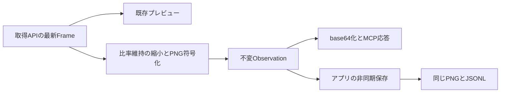

# U04 チャット・観測出力・永続化の契約見直し

## 1. 目的・状態・起点

状態: complete（仕様整理完了）。2026-11-12の利用者指示により、取得API・MCPツール・永続化を分離し、保存完了をMCP応答の前提から外した。[U04親](../../complete/unit_009/RECORDED_OBSERVATION.md)のM2前の設計見直しであり、本書の完了時点では製品実装・実接続は未着手だった。その後の実装・実接続・実機受入は[M2子仕様](../unit_035/MCP_OBSERVATION_INTEGRATION.md)へ記録している。

開始時はcodex/u04-m0-observation-design、HEAD 23855e0。メニューと前回選択復元に関する未コミット文書7件を引き継いだ。既存資材を削除せず、コード・テスト・依存は変更しない。

## 2. 対象範囲・対象外

対象は永続化要件の由来、完全な出力の引渡し、保存時点の比較、失敗・取消し・終了、プロジェクト未選択時の会話と原記録、ephemeral撤去の影響と後続工程の条件。

対象外はMCP製品実装、実Codexターン、実機検証、履歴ブラウザー、チャット移動・削除UI、保存先の自動整理、汎用イベントバス・永続キュー、PR・コミット。今回の子の完了は設計作業の完了を示す。

## 3. 関連文書と現在の事実

[01 要求](../../initial/01-overview.md)、[04 記憶・原記録](../../initial/04-agent-memory.md)、[M0](../../complete/unit_031/RECORDED_OBSERVATION_DESIGN.md)、[M1](../../complete/unit_032/RECORDED_OBSERVATION_IMPLEMENTATION.md)、[M1レビュー](../../complete/unit_033/OBSERVATION_STORAGE_REVIEW.md)、[U06](../../planned/unit_011/GOAL_EXECUTION.md)、[U08](../../planned/unit_013/RESUME.md)を参照する。

- U03のCaptureReader.snapshotは取得中の最新Frameを読める。取得APIは保存先・Codexを知らない。
- Observation.from_frameは画像を一度PNGへ符号化し、IDを発行する。未保存でも生成できる。
- 現ObservationServiceは符号化→writer.record→返却の順である。今回採用する非同期記録は未実装。ProjectWriterの画像・JSONL保全処理は再利用候補である。
- 現CodexConnectionはthread/startにephemeral: trueを渡し、接続ごとに新threadを作る。thread IDはメモリにだけ保持する。cwdは設定ディレクトリ配下のruntime、CODEX_HOMEは既定の認証を使う。
- 採用0.167.0の同梱schema生成でThreadStartParamsのephemeral/cwd/config、ThreadResumeParamsのthreadId/config/cwd、ThreadReadParamsのthreadId/includeTurnsを確認した。API形状の確認であり、保存・再読込・MCP再設定の動作確認ではない。

## 4. 永続化要件の由来と保証の変更

| 根拠 | 必要なこと | 必ずしも必要ではないこと |
|---|---|---|
| 01の記憶・JSONL・観測画像、04のコンテキストと再開 | コンテキストから消えた後にも同じ観測を参照できる | プレビュー全フレームの記録、応答前fsync |
| 04の原記録と記憶の区別 | Codexの解釈とは別に元画像・取得時刻・IDを残す | 解釈が終わるまで原画像を保存しないこと |
| 04の他ランタイムへの引継ぎ | 画像・公開トランスクリプトを独立したファイルで残す | Codex内部の全状態や内部推論の複製 |
| U04の同じ画像・IDという到達点 | 保存に成功した画像とツール結果が一致する | 観測成功と保存成功を一つの成功にすること |

旧M0/M1の「保存完了後だけ成功応答」は、応答済みIDの即時参照を強める設計判断だった。今回は応答遅延と保存への依存を下げるため撤回する。代償として、応答直後のファイル参照はまだ失敗し得る。異常終了・電源断では、応答済みでも未保存の画像を失い得る。記録先障害時に全観測を残せる保証もしない。

## 5. 加工済みObservationと責務

2026-11-12の追加合意により、Observationを「agentへ渡す画像として確定した値」とする。元FrameやMCP結果オブジェクトではなく、加工・符号化済み画像を保存と応答の共通境界にする。現M1のFrame保持・原寸PNG・保存待ちは実装履歴であり、本節はM2で実装する契約である。

| 部品 | 所有するもの | 所有しないもの |
|---|---|---|
| 取得API | 最新の不変Frame、取得状態 | MCP、保存先、会話履歴、観測用縮小 |
| 観測処理 | snapshot採用、縮小、一回のPNG符号化、観測ID生成 | writer、MCP型、保存成功の判定 |
| MCP公開部 | Observationの画像をbase64化し、image/textへ包装 | 追加の画像加工、保存先、writer |
| アプリの記録処理 | Observationの引受け、記録先、非同期書込、失敗報告と終了回収 | 元Frame本体、再取得・再加工・再符号化、Codexの解釈 |

Observationは不変値とし、観測ID、PNG bytes、画像形式（今回はimage/png固定）、出力幅・高さ、元Frameの取得UTC・世代・連番・幅・高さを持つ。元Frame本体・BGR bytes・単調時計は保持しない。世代・連番は取得サービス寿命内の補助情報であり、永続識別には観測IDを使う。変換は全画面の比率維持縮小のみなので、元寸法と出力寸法で縮小の有無と座標対応を説明できる。汎用の変換リストや常にidentityとなる欄を追加しない。

原記録は「agentへ渡す観測画像の原本」を指し、無加工の取得画像を別途保管するという意味ではない。縮小時の元解像度画像の別保存、全フレーム保存、元Frameからの後日再生成は対象外。originalを選んだ場合は、MCPへ渡す観測画像自体が元寸法なので、その一枚だけを保存する。同じPNG bytesをファイルへ書き、MCPではbase64化するだけにする。MCP結果全体・HTTPヘッダー・Bearerを記録する必要はない。MCP配送・Codex解釈の成功も、この分岐では証明しない。

### 縮小と設定

4K取得・高解像度プレビューを維持しつつagent向け画像の量を減らすため、共通設定を一項目だけ追加する。既存TOMLの新しい`[observation]`に`resolution = "full_hd"`を置き、値は`original`（元寸法）、`full_hd`（1920×1080の枠、既定）、`hd`（1280×720の枠）の三つ。省略時はfull_hd、未知値は既存設定読込エラーの扱いにする。これはモデルの最適解像度を実測した値ではなく、今回の用途から選ぶ初期値であり、文字の判別・配送時間はM2で確認する。

M2は既存設定画面のI/Oタブの映像入力グループへ「観測解像度」の選択を一つ追加し、既存の適用・取消し・TOML保存経路を使う。観測専用画面・診断ラベル・説明文は増やさない。観測設定だけの変更では取得元やCodexを再接続しない。適用済みの値を各観測の開始時に一度読み、その観測の加工中に変更しない。以後の観測から反映し、過去の画像や記録は変更しない。プロジェクトごとの設定とMCP呼出しごとの引数は設けず、observe()は引数なしを維持する。

originalは元寸法のまま符号化する。FullHD/HDでは元幅W・高さHと設定上限Bw・Bhから`s = min(1, Bw/W, Bh/H)`を求め、出力は`max(1, floor(W*s))`×`max(1, floor(H*s))`とする。整数化による一画素未満の丸めを許容し、全画面を残す。小さい入力は拡大しない。4K→FullHDは1920×1080、4K→HDは1280×720、HD→FullHD設定は1280×720のまま。黒帯・切抜き・引伸ばし・回転・JPEG選択・任意サイズ指定は対象外。

縮小には既存OpenCVのINTER_AREAを使う方針で、新しい画像ライブラリや変換パイプラインを導入しない。縮小不要ならリサイズを行わず、一度PNGへ符号化する。取得の対応寸法はU03のまま。符号化後32 MiBの既存上限を安全限界として維持し、超過時に暗黙の再縮小や再圧縮はせず観測エラーにする。この容量はCodexの受信上限の保証ではない。

### 保存形式への影響

JSONLは観測ID・取得時刻・画像パス・source_frameに加え、出力画像の形式と寸法を記録する。設定値の履歴そのものではなく、その観測に実際に適用した結果を残す。MCPの付随JSONにも元寸法・出力寸法を同じObservationから渡し、将来の入力座標を元Frameの座標と混同させない。MCP側での追加加工は禁止する。

U04は未完成ユニットなので、保存形式は新しいObservationの契約へ直接変更する。旧形式の識別・移行・開発途中データの互換性維持を設けず、その検討をM2の前提にしない。これは既存資材の削除・上書きを許可する意味ではない。読込時の現行形式の検証と部分失敗時の保全は維持する。

## 6. 保存を観測から独立させる

Observation完成後、アプリの記録処理へ同じ値の参照を非待機で渡し、MCP応答を作る。保存開始・完了・進行状況によってMCP応答や次の観測を待たせない。HTTP配送完了を保存開始の条件にもしない。引受けの時点で記録先を固定し、次の観測や設定変更で差し替えない。完成したMCP結果から復号して保存する方式も可能だが、今回は画像を包装前に共有できるため、SDKのmiddlewareへの依存もbase64の復号も不要となる。

**保存中でも次の観測を取得・縮小・符号化して返せる。保存処理の進行・失敗・滞留をobserveのBUSY理由にしない。** 取得・符号化そのものの同時処理枠は既存の一件を維持できるが、Observationの確定と引渡し試行が終わったら解放し、保存やHTTP配送の完了まで保持しない。

保存の直列／並列は実装上の選択であり、本仕様では固定しない。プロジェクトのプロセスロックは別プロセスの書込所有者を排他するもので、同じアプリ内の画像ごとの並列書込を禁止しない。共有JSONLの採番・追記は整合性を守り、行の混在や採番の衝突を起こさない。各画像の確定後に対応する記録行を追記する。現M1のwriter内の操作ロックはプロセスロックとは別の実装であり、M2の並列性を決める要件ではない。

保存見送り・キュー・保持上限を先に仕様化しない。大量要求や滞留を仮定した仕組みを追加せず、実際の必要性が確認された場合に判断する。通常の非同期保存と終了時の回収に必要な所有だけを持ち、段階別状態表・監視・自動復旧・再配送を要求しない。

| 場面 | 結果と扱い |
|---|---|
| 取得・縮小・符号化失敗 | 画像のないツールエラー。保存するObservationはない |
| 保存処理の開始失敗・PNG/JSONL失敗 | 観測成功を変更しない。ID・保存先・理由を既存通知と再確認できる詳細へ出す。失敗通知自体の永続化までは保証しない |
| JSONL追記結果が不明 | 原本を保全し、writerは明示reloadまで追記を止める。次の観測は継続でき、保存不可を隠さない。自動復旧・再試行しない |
| MCP配送失敗・取消し | 引受け済みObservationの保存を続ける。保存成功は配送・解釈成功の証拠ではない |
| 切断・通常終了・保存先切替 | 新要求を閉じ、進行中の観測と引受け済み保存を回収してからwriter/loopを閉じる。保存を一括cancelせず、別チャットへ記録を混ぜない |
| 終了待ちの取消し・I/O停滞 | 実書込の終了を確認できるまで所有を保持し、終了成功とは表示しない。既存の終了未確認・エラー詳細を使う |
| 強制終了・電源断 | 未保存の応答済み画像が失われ得る。途中JSONLや未参照PNGは既存保全規則に従い、自動で修復・削除しない |

保存失敗が確定した処理は回収済みとして終了できる。drain完了と保存成功を区別する。応答時点で観測IDに対応するファイルが存在するとは約束せず、savedフラグ・専用保存待機ツールは追加しない。stateless HTTPは維持し、保存先・会話との対応はアプリが持つ。U05の物理入力前の記録要件へ、この非待機化を無断で適用しない。

## 7. 保存をさらに遅らせる案との比較

| 時点 | 利点 | 失う保証・追加責務 | 判断 |
|---|---|---|---|
| 応答前に保存完了 | 応答済みIDが直ちにファイル参照できる | I/O遅延・故障が観測を妨げる | 旧案。撤回 |
| 完全な出力の引渡し直後に非同期保存 | 元画像を早く残し、応答の保存待ちをなくす | 未保存期間、進行中の保存の所有と独立した失敗通知が必要 | 採用 |
| MCP配送完了・Codexの受信通知後 | 配送されなかった画像の保存を減らせる | 配送成功の境界確認、通知欠落、完全画像の保留が必要。モデルの解釈成功は分からない | 不採用 |
| Codex解釈・ターン完了後 | 解釈とまとめて保存でき、必要な画像だけを選べる | 一ターンの複数画像を保持。解釈が返らない・中断・失敗した観測ほど失われる。画像の保持量と欠損条件が増える | 原画像の保存条件には不採用 |

解釈を待つ案は、画像を先に耐久的な場所へ退避するなら損失を減らせるが、それは既に原画像の永続化であり、別の一時保存・正式化を増やす。解釈後に追加すべきものは画像の意味・公開応答・観測IDとの関係であって、同じ画像の保存を保留する理由ではない。将来、全観測記録より容量削減を優先する要求へ変わった場合にのみ採用を再検討する。

## 8. チャット・保存先・プロジェクト

プロジェクトは利用者が選ぶ記憶・複数会話のまとまり。チャットはCodexのthreadに対応する会話。保存先は原記録を置く実フォルダーであり、プロジェクト未選択でも存在する。この三者を一つの選択フラグへ押し込めない。

| 状況 | 保存先と寿命 |
|---|---|
| プロジェクト選択あり | 既存project.json/events.jsonl/observationsを使用。一つのrootに複数threadの記録を関連付けられる |
| プロジェクト未選択 | 新規チャットを準備するとき、アプリのデータディレクトリ配下chats/<一意な保存先名>/へ通常と同じ記録形式を用意する。TEMPではなく、切断・終了時に削除しない。利用者にプロジェクト名や場所の選択を要求しない |
| 作成済みで記録が空 | 正常な記録先。最初のチャット・観測から追記する |

既存ProjectWriterを保存処理として再利用し、未選択専用writerやメモリだけの代替実装を作らない。一意な保存先名は既存UUID方式で付け、ファイルシステムの専有作成で衝突を拒否する。schema 1のproject_idは既存保存先の識別子として維持し、これがあることをUIでのプロジェクト選択と同一視しない。命名変更や全データ移行を今回の前提にしない。

アプリは現在の記録先とwriterを一つ所有する。チャットのcwdはその記録先とし、画像パスを実際に参照できるようにする。M2では書込権限を広げず、記録はアプリが担当する。チャット開始時のthread IDと記録先の対応を、最初のturn投入前に記録する。対応記録の種類・thread ID項目はM2で既存JSONLへ追加し、観測行から実thread IDをたどれるようにする。実在しないthread対応は生成しない。開発途中の旧行との互換性は設けない。観測記録にはこの実thread IDを関連付け、別のchat UUID、観測ID索引DB、接続世代履歴表を増やさない。MCPのHTTP要求IDをCodexのturn/item IDだと推定しない。正確な項目間の対応は公開通知で実在するIDが取れる範囲だけをU06で追加する。

記録先の作成とthread対応の記録はチャット開始の前提であるが、各画像の保存完了はツール応答の前提ではない。準備失敗時はログイン・プレビューを妨げず、新規チャット開始失敗を既存詳細で知らせる。開始したthreadと対応保存が一括で成功する保証はないため、途中失敗のthread ID・保存先を診断に残し、自動再開始・削除しない。

プロジェクト切替では稼働中チャットの保存先を付け替えない。旧処理を収束させ、以後の新規チャットを新しい選択先に作る。未選択チャットの後からの移動・統合・名前付けはU04に入れない。前回の明示プロジェクトパス一件の復元は維持する。復元失敗は未選択となり、利用者が会話を始めればアプリ管理の記録先を使える。保存先を復元しただけでCodex・Goal・ゲーム入力を自動再開しない。

M2は現行の接続ごとの新規thread作成を基準に永続化と対応記録を入れる。切断で会話データを削除しないが、再接続・再起動が同じ会話の再開を意味するようには変更しない。過去会話の一覧・選択・再開はU06/U08の明示操作へ引き継ぐ。保存を実装したことを再開UIの完成として扱わない。

## 9. ephemeral撤去と会話の保存

通常チャットはプロジェクト有無にかかわらずephemeral: falseとする採用方針。実装前に採用版で保存・終了後のreadを確認する。現在のTrue指定とテストを機械的にFalseへ置換しただけでは受入にしない。

Codexが保存する会話はランタイムの再読込・再開用、Gigasの画像・JSONLは原画像の再参照と他ランタイムへの引継ぎ用である。M2で永続threadと保存先の対応・観測記録を残す。U06で公開ユーザー入力・応答等の可搬なJSONL記録を追加する。M2時点ではプロジェクトフォルダーだけのコピーで会話全文まで移せるとは保証しない。Codex内部の非公開DBやrolloutをGigasが直接編集・複製する実装は作らない。

保持対象には会話・プロンプト・ツール結果が増え、容量と残存期間が変わる。ephemeral撤去はsandboxのread-onlyや認証方式を変える理由にならない。認証用CODEX_HOMEをチャットごとに作って既存ログインを失わせない。Codex保存先とGigas保存先は別であり、片方の消失を自動修復しない。

[公式App Server](https://learn.chatgpt.com/docs/app-server)のthread/read・resumeは保存会話の公開経路である。ただし採用0.167.0での保存形式・flushの時点・MCP設定と秘密値の残存・再接続時のconfig更新は未実接続確認。既存Bearerが永続化されないことを未確認で断定しない。M2では短命な認証値の保存状況を隔離検証し、GigasのJSONL/通常ログへは記録しない。旧値はサーバ終了で失効させる。必要な秘密値の非保存が成立しなければ公開方式を再検討し、未確認のまま本結合を確定しない。

## 10. TDD Test Listと実装前条件

今回は文書のみ。オリジナル時の元寸法保持、縮小後の寸法・色・全画面保持、設定の適用境界、PNGとMCPの同一性、現行形式と部分失敗時の保全を受入観点へ追加する。新規テスト数を決めず、既存service/storage/codex接続試験の書換え・統合を優先する。

| 状態 | 受入観点 | 担当 |
|---|---|---|
| deferred | 保存を意図的に止めても完全なMCP結果を返せ、保存完了後に同bytes/ID/時刻が一致する | M2。旧保存待ち試験を置換 |
| deferred | 保存の開始・完了を遅らせてもMCP応答と次観測が進み、保存失敗はツール成功を変更せずID付きで確認できる | M2。既存同時実行・故障試験を変更 |
| deferred | 配送取消し後も引渡し済み結果を回収し、正常終了・保存失敗・終了未確認を区別する | M2。既存cancel/drain試験を変更 |
| deferred | 未選択で観測し、終了後も画像と永続threadと対応をreadできる | M2。本runtime/MCPで確認 |
| deferred | 保存先準備失敗・前回復元失敗・切替で別チャットの原記録を混ぜない | M2。既存保存先保護試験へ統合 |
| deferred | 公開トランスクリプトと観測IDの対応、通知の順序・部分応答・終了時の保存 | U06。実際の公開通知を使う |

M2では新しいObservationの契約へ直接変更し、保存の実行方式は既存コードと実際の必要性から選ぶ。互換対応・保存見送り・キュー・保持上限の設計を着手条件にしない。アプリ内での引渡しはSDK middlewareを前提にしない。本文の設計は製品への配線・実接続で未検証。R02/R04は接続・会話UI拡張前に現状を確認し、必要な修正を独立して終える。

## 11. 対象ファイル・検証・先送り

対象は本書、U04親、initial01〜10の関連契約、M0/M1の改訂注記、U06/U08引継ぎ。公開docsは実装済みM1の説明を残し、計画と混同しない。

確認済み: 現コードの所有・同期保存・ephemeral指定、既存試験の対象、要件の由来。0.167.0のschema生成は隔離CODEX_HOMEでexit 0。先行の既定HOME実行ではPATH別名の権限警告とstderrの文字コード読取失敗があったため、UTF-8・隔離先で再実行した。認証・モデル呼出しは行っていない。

文書検証は差分・相互参照・unit一意性・矛盾する旧契約の検索を実施した。uv run pythonによる機械検査で変更Markdown 18件のローカル参照278件、unit 34件の一意性、仮テキストなし、docs/specだけの変更を確認。git diff --checkも成功。機械検査は意味の正しさの代用にせず、旧同期契約と新しい非待機契約、M1の実績とM2の未実装を本文で照合した。製品テスト・型検査・buildはnot run（製品変更なし）。今回の製品構成によるObservation分岐・縮小・設定反映・保存中の連続観測・永続会話・秘密値の保持・最大画像と終了はnot runであり、M2の実装・受入条件とする。U06は可搬な公開会話記録・記憶編集、U08は同一threadの明示的再開と旧接続失効を所有する。

## 12. 完了チェックリスト

- [x] 要求と旧設計判断を分け、非待機保存の損失条件を示した
- [x] 完全出力・非待機保存・失敗・終了・未選択チャットの契約を整理した
- [x] ephemeral撤去の影響と未確認事項の担当を明記した
- [x] 関連仕様の改訂と文書検証を完了した

今回の改訂では、保存中BUSYを撤回し、Frame本体を保持しない加工済みObservationとオリジナル/FullHD/HD共通設定を採用した。縮小時の元解像度画像の別保存は対象外とした。旧形式互換と保持上限の先行設計は利用者指示により撤回した。保存の直列／並列は実装上の選択とし、共有JSONLの整合性を守る。製品実装・実接続は未実施。
