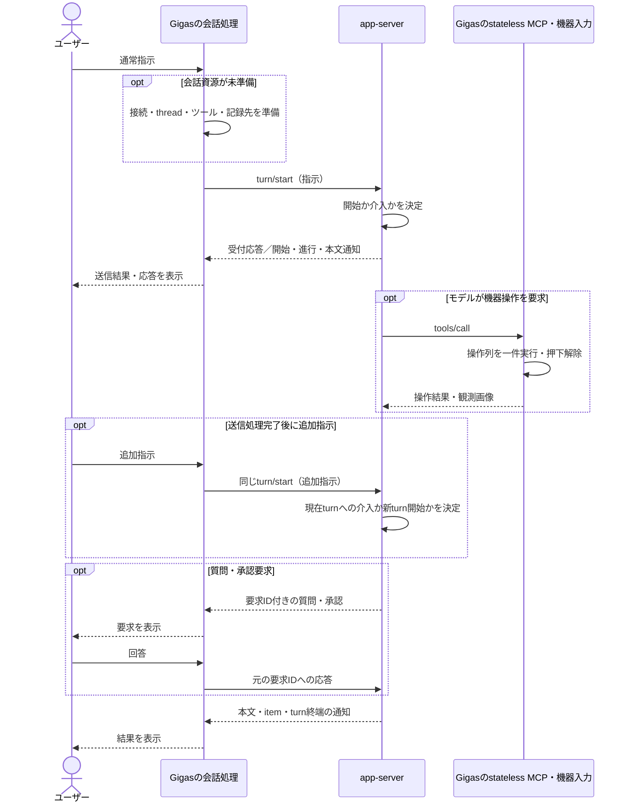
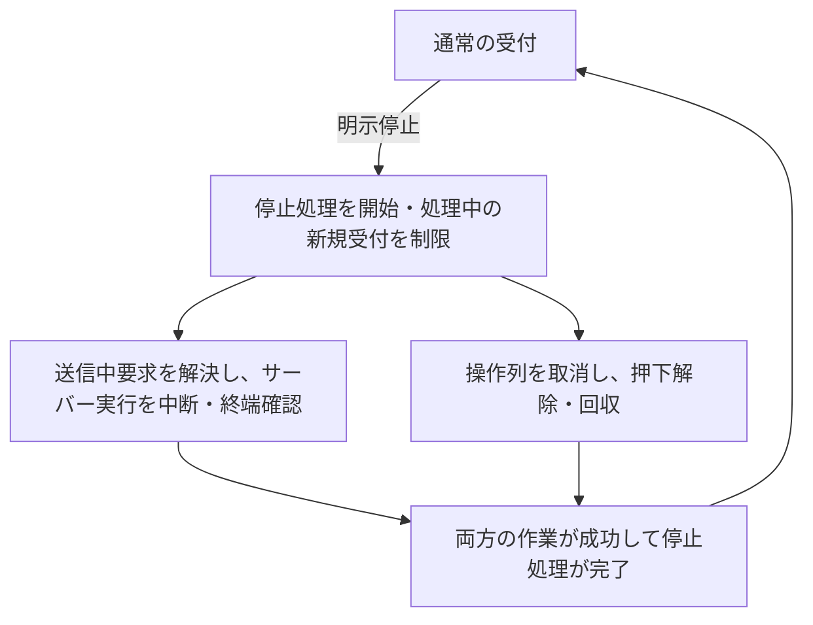
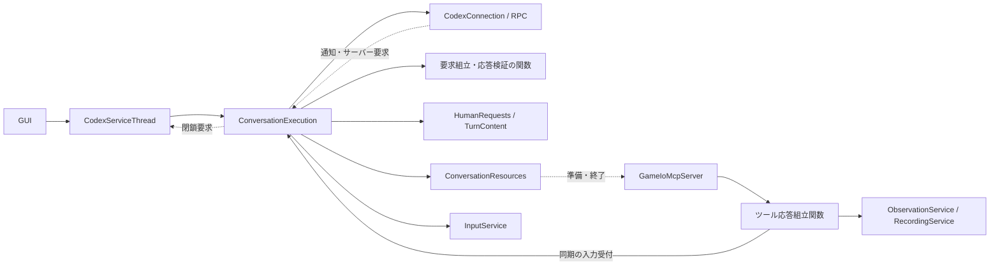

# 通常指示の送信・ゲーム操作・停止

## 1. 目的と範囲

状態: **完了**。内部設計の再レビュー、製品実装・既存仕様と試験の改訂、全体gate、実接続と短い実機入力・停止を確認した。確認範囲と未検証事項は第8・9節に記録する。

通常指示と追加指示をapp-serverへ送り、応答を表示し、stateless MCPを通じてゲームを操作する。実行の開始・介入判断はapp-serverに任せ、Gigasは要求の配送、会話表示、機器操作、ユーザーの明示停止を担う。

本書は通常指示の振る舞いと、通常指示・Goalに共通する送信、通知、機器操作、停止、資源所有の正本とする。[unit_062](../unit_062/GOAL_EXECUTION_MODEL.md)はGoal操作・公開状態と、共通停止に加わるGoal継続停止だけを定める。両者を通常実行モード／Goal実行モードとして分けない。製品コード・既存テスト・正本仕様を第6節の順に改訂する。アプリ終了・機器切替の機能拡張は対象外。

変更の範囲は、通常指示のturnごとの入力許可管理をなくし、有限の操作列と明示停止を中心にすること。第2〜5節は外部の振る舞いと所有境界、第6節は内部構成と旧実装からの変更、第7節は振る舞いの検証を記す。関連する初期設計と公開文書も同じ契約へ改訂する。

## 2. 通常指示の振る舞い

### 2.1 送信・追加指示

会話実行は、必要な接続・thread・MCP・記録先を準備し、指示をturn/startで一度送る。応答中の追加指示も同じ経路を使い、既存turnへの介入か新turnの開始かはサーバーが決める。追加指示の宛先を特定turnに固定しない。

通常指示とGoalの作成・編集・再開・削除は、共通の送信処理一件を使う。準備開始から送信結果の確定まで、その間は別の送信操作を受け付けない。独自の送信待ち行列は作らない。送信処理が完了すれば応答生成中でも追加指示を送れる。失敗・受付不明を利用者へ返し、自動再送しない。

MCPと記録先は通常送信・追加指示・turn終了のたびには作り直さない。機器の接続可否は機器操作時に確認し、会話の送信可否と同一視しない。

### 2.2 応答・質問・自然終了

本文・item・turn状態は通知を表示と記録へ反映する。turn/startの応答は受付結果と対象IDの取得に使い、その応答だけから実行中と判定しない。応答より先に届いた終端通知を、遅い受付応答で実行中へ戻さない。

通常送信の処理は受付応答に加え、対象turnの開始または既に受け取った終端通知を回収して終える。既に通知で把握した現在turnへの追加指示なら、新しい開始通知は要求しない。応答だけ先着した間に停止が来ても送信taskが残るため、開始通知から中断対象を捕捉できる。通知待ちはこの送信の寿命に限定し、切断時は結果不明として終了する。別の恒久的な開始待ちIDや完了turn一覧は持たない。

質問・承認は会話実行が元要求IDと内容を保持し、回答をそのIDへ返す。通常指示には変換しない。回答済み、サーバーによる解決・取消し、対象turnの終了、接続終了で回答対象から外す。別turnの要求まで一括で失効させない。表示側は回答対象を別管理せず、会話実行から得た情報を表示する。

自然終了では対象turnの本文・itemを確定する。次の指示や機器操作のための再開処理は設けない。追加指示、質問待ち、自然終了を理由に、実行中の操作列を取り消したり入力許可を切り替えたりしない。turnの失敗や利用状況の通知も事実として表示し、それだけで共通停止を起動しない。通信断による資源終了は別に扱う。

「右へ進んで」の途中で「左へ」と送っても、既存操作列は直ちには止まらない。即時停止は停止操作で行い、Gigasは文章内容を停止命令と解釈しない。

### 2.3 通常指示のフロー

ツール呼び出し・追加指示・質問は実行に応じて繰り返され、図の順に限定されない。RPC応答と通知の厳密な到着順も規定しない。停止はこの流れへ割り込む第4節の処理である。

### 2.4 共通の受付と配送

| 操作・出来事 | 受付・処理の所有 |
|---|---|
| 通常指示・Goal操作 | 会話実行の送信処理一件。通常指示・Goal作成では必要な会話資源を先に準備する。既存Goalの操作は準備済みの接続・Goal情報を使う |
| 次turnのモデル設定変更 | 会話実行が同じ送信枠で受付・threadへの適用を調整。候補の検証と確定した選択値は接続側が所有 |
| 質問・承認への回答 | 会話実行の元要求への応答処理。指示の送信枠には並べない。同じ要求への二重回答を送らない |
| 明示停止 | 会話実行の停止task。送信枠に並ばず割り込む |
| サーバー通知・RPC結果 | 通信から会話実行へ配送。送信・停止を待ち合わせている間も処理する |
| 機器操作 | 会話実行の受付から機器入力へ委譲。指示の送信中だけを理由に拒否しない |

停止・切断処理中は新しい指示、Goal操作、回答、機器操作を受け付けない。明示切断は停止待機中も受け付ける。送信操作の失敗はその操作結果として返し、停止処理の失敗と混同しない。例えば目的編集が拒否されただけなら、正常な接続や現在の実行を停止しない。

受付可否は接続と処理task、操作対象の情報から導出する。GUIのボタン活性と操作受付側は同じ判断を使い、独立したcan_sendやcan_resumeの正本を保存しない。サーバーの状態は操作後にも変わり得るため、活性表示をAPI成功の保証にしない。

## 3. 機器操作

stateless MCPの機器操作ツールは有限かつ非空の操作列を受け付ける。機器入力は一件ずつ実行し、完了・中断・失敗のいずれでも必要な押下解除を行う。操作列の外へ押下を持ち越さない。既に実行中ならBUSYで拒否し、後から実行するために保留しない。

MCP入口は引数を解釈し、会話実行を通して操作列を機器入力へ渡す。会話実行は停止中の新規要求を拒否する。機器入力は機器の使用可否と実行中taskを確認して操作を開始する。受付確認から操作taskの登録までは同一event loopで実行を譲らず、停止と受付の間に未所有の操作を作らない。

機器入力は操作taskを解除・回収の完了まで所有する。解除失敗は結果として返し、機器を使用不能として扱う。次の入力には機器の明示的な復旧が必要となる。正常解除を独立したフラグとして保持しない。

観測は最新画像を返し、操作結果には観測画像を添える。操作列と解除の完了後に最新Frameの取得を試みるが、次の操作開始より前にFrameを選ぶ順序は保証しない。Frameの取得時刻・識別情報を保持し、ゲームへの入力反映を保証する画像とは扱わない。画像処理・記録は押下解除と操作列の回収を妨げない。観測・記録の失敗を、既に実行した入力の取消しとして扱わない。MCPは会話に属する観測・記録先への参照を使い、要求処理中に別会話の保存先へ切り替えない。

run、Grant、入力世代、thread/turnとの権限照合は通常指示の受付に使わない。MCPの認証と引数検証は維持する。記録用のIDを権限IDに転用しない。

## 4. 明示停止

### 4.1 停止手順

会話実行が一つの停止taskを所有する。最初のawaitより先に登録し、実行中は新しい指示・機器操作・質問への回答を受け付けない。送信済みの指示・Goal操作と、既に開始した回答配送は、その処理の結果を回収し、進行したサーバー実行を停止対象とする。未送信の回答を停止後に配送しない。停止の連打は同じtaskを待ち、解除処理へ重ねてキャンセルを送らない。同じturnへの中断も一度の処理で応答と終端通知を待ち、応答後に終端通知がまだないことを理由に再送しない。

停止taskは、次の二つの作業を並行して待ち合わせる。

- **サーバー実行の停止:** 未送信の指示は準備処理を取りやめ、後から送られないよう回収する。送信済みならその受付結果と通知から対象を特定する。既に判明している実行中turnの中断は配送結果待ちで遅らせず、turn/interruptで中断して終端を確認する。Goalがある場合はunit_062第4節の継続停止を同じ作業に含める。対象が既に終端なら再び待たない。送信中処理、実行中turn、Goalの継続停止の残作業がなければ、この作業は終了する。
- **機器操作の停止:** 操作taskをキャンセルして残りのステップを捨て、押下解除・回収を待つ。サーバー側の応答を待ってから機器を止める順序にはしない。

双方が成功すれば停止処理を完了し、同じMCP入口で通常の受付へ戻る。次の指示による解除、再受付専用の条件判定・状態・APIは設けない。停止中に拒否した要求や操作列の残りを再開しない。通常受付への復帰自体はturnや機器操作を開始しない。

図の箱は手順であり、保存する状態の列挙ではない。サーバーの終端は機器の解除完了を保証しないため、待ち合わせる二つの作業は必要だが、それぞれの完了フラグを別管理しない。通知受信とGUI処理は停止の待ち合わせで塞がない。

### 4.2 失敗と停止の範囲

停止処理の終了と停止成功を区別する。サーバー側停止は成功し、操作taskも解除失敗を返して終了した場合、停止taskは失敗結果を返して終了する。停止中だけの受付制限を残さず、機器入力が保持する使用不能情報で次の機器操作を拒否する。通常指示は送信できる。解除成功を装ったり、機器故障だけを会話送信の禁止理由にしたりしない。

サーバー中断のエラーや通信断で停止不能が確定した場合は、会話実行がサービスの共通閉鎖処理を要求し、その接続・MCPの終了とローカル入力の回収結果を待って停止taskを終える。閉鎖処理の所有と待ち合わせは第6.3節に定める。結果を待っている間は停止処理を継続するが、明示切断で待機を打ち切れるようにする。いずれも未確認の停止を成功扱いにしない。接続を閉じた場合は明示再接続、機器だけが使用不能なら機器の復旧で利用を戻し、「停止失敗」「再受付待ち」を資源の状態と並ぶ恒久phaseにはしない。

本書の停止対象は通常指示のturnとGigasの操作列である。モデルが起動した背景プロセスや外部書込み全般の終了保証は含めず、通常停止のための端末列挙・全プロセス回収は採用しない。アプリ終了時の資源破棄は別の契約として扱う。

## 5. 責務と状態の所有

| 所有者 | 責務と保持する情報 | 寿命 |
|---|---|---|
| 通信 | app-server接続、RPC要求と応答の対応付け、通知配送 | 接続中。RPC要求は結果確定まで |
| 会話実行 | thread参照、通知由来のturn情報、共通の送信task・停止task。質問管理部品が未回答要求と元要求IDに対応する回答配送taskを所有。Goal情報の差分はunit_062に定める。送信準備・中断と機器受付を調整 | 会話中。未回答要求は有効期間中、回答taskは配送結果確定まで、その他のtaskは処理終了まで |
| 機器入力 | デバイス、操作列task、接続・故障情報。操作と解除を実行 | デバイス接続中。操作taskは解除・回収まで、故障は復旧まで |
| 会話資源 | MCPサーバー、観測元・記録先への参照。準備と終了を担当 | 会話の準備から終了まで。正常な明示停止では破棄しない |
| 表示・記録 | 本文・item・操作結果の表示／保存。制御判断の正本にはならない | 会話履歴・記録の寿命 |

会話実行は通信のRPC要求表を複製しない。ただし送信処理はRPCより前の準備も含むため、そのtaskは会話実行が所有する。停止時は同じ処理を回収する。通知由来のturn情報は中断先と表示のために持ち、ローカルな開始／介入判定へ使わない。

MCPから機器入力への経路は「MCP → 会話実行の受付 → 機器入力」とする。会話実行の受付は会話資源が利用可能で停止・切断処理中でないことを確認して委譲するだけで、入力列や機器taskを所有しない。機器入力が会話実行を参照する逆依存や、停止フラグの配布・同期を作らない。会話資源の組立時にこの呼出し先をMCPへ渡す。

会話実行は準備を会話資源へ、接続全体の閉鎖をサービスへ依頼する。通信は接続、会話資源はMCP・記録先、機器入力はデバイスをそれぞれ回収する。接続終了時は残る操作列も回収し、閉じた会話から新たに機器操作を受け付けない。これはGoalの非active通知とは別の資源終了である。

観測元や実機そのものの接続寿命を会話の寿命と同一視しない。会話資源は参照と会話専用のMCP・記録先を所有し、共有デバイスの破棄まで所有しない。

| 別状態として保持しない情報 | 使用する正本 |
|---|---|
| 送信中・準備中 | 会話実行の送信処理task。配送結果は通信のRPC結果 |
| starting・steering・runningの独自phase | サーバー通知と受付結果。開始／介入はサーバーの判断 |
| 停止中・受付閉鎖・双方の停止済みフラグ | 停止taskと処理内の待ち合わせ |
| stopped・再受付可能・次の指示待ち | 保存しない。正常停止の完了で通常受付へ戻る |
| busy・解除中・解除済み | 機器入力の操作task。解除完了まで所有する |
| 質問待ちによる入力保留 | 設けない。未回答要求は回答配送だけに使う |

上表は責務の境界であり、一行につき新しいclassを作る指定ではない。振る舞いと状態を所属先へ移し、通信・会話・機器の関心事を分けた後にファイルを分割する。全状態を一つの新しい実行classへ移すだけの構造にしない。

## 6. 内部再編と既存仕様・テストの変更方針

以下は合意した外部契約に沿った内部設計である。作業ツリーの実装を参照して所有境界を再確認し、未反映の修正方針を第6.3節へ記す。設計の記載、実装差分の存在、受入完了を区別する。旧クラスの全メソッドを新クラスへ移してから分割するのではなく、廃止する判断を除き、残る処理を所有者へ移す。

### 6.1 撤去する契約

| 現行の契約 | 変更と失う保証 |
|---|---|
| send/steerとexpected_turn_id | turn/startへ統合。送信時点のturnだけに適用する保証をなくす |
| InputGrant、begin_run/bind_turn/finish_run、入力世代 | 操作列taskと共通停止へ置換。停止前に発行された全要求を任意の遅延後も識別・拒否する保証は持たない |
| ConversationRunの入力許可、質問待ちのsuspend/resume | クラスごと削除。追加指示・質問・自然終端に連動した機器停止をなくす |
| 各送信でのMCP更新・unsubscribe/resume | 会話準備時に作成し、切断まで同じ入口を維持。通常送信・明示停止・機器設定変更で再生成しない |
| 自然完了・明示停止・切断を包括する_End | 自然終端は通知反映、明示停止は第4節、切断は資源終了へ分離。通常停止での端末列挙・一括終了も撤去 |
| runを必須とする入力・対話記録 | 実際の提出・操作・会話の識別へ変更。機器操作を特定のユーザー指示へ推定で所属させない |
| 入力枠解放直後・次の入力前のFrame選択 | 操作完了後の最新画像取得へ縮小。観測の厳密な隣接順を守るための入力側状態をなくす |

### 6.2 クラス・ファイルの組替え

| 現在の実装 | 変更先・残す責務 |
|---|---|
| [CodexConnection](../../../src/gigas/runtime/codex/connection.py) | 接続・認証・モデル候補の検証と選択値・Windows準備、受信pump、RPC配送に絞る。AccountSession/ModelCatalog/WindowsSandboxを再利用。thread/turn/Goal、質問・本文、送信・停止の判断を保持しない |
| [ConversationExecution](../../../src/gigas/services/_conversation_execution.py) | 会話操作を担当する。thread、通知由来のturn/Goal、共通の送信task・停止taskを所有し、準備・回答・中断・機器受付を調整。通常／Goalの実行モードやGoalControllerは作らない |
| [_notifications](../../../src/gigas/runtime/codex/_notifications.py)・[HumanRequests](../../../src/gigas/runtime/codex/_human_requests.py) | 通知変換・TurnContent・質問管理を再利用し、会話実行が組み合わせる。wire形式の解釈、本文集約、回答の元IDと配送taskの管理を会話手順へ展開し直さない |
| [_conversation_protocol](../../../src/gigas/runtime/codex/_conversation_protocol.py) | thread・turn・Goal要求のパラメータ組立と応答検証を関数にする。thread ID・選択値・準備結果を引数で受け、RPC送信・受付判断・可変状態を所有しない。turn・Goal通知の構造検証も状態を持たない関数へ寄せる |
| [CodexServiceThread](../../../src/gigas/services/codex.py) | Qtとasyncio間の配送、組立、結果通知、接続全体の閉鎖taskを所有。`_run`・`_prepare_recording`による実行開始、`_receive`内の入力許可判断、Goal再開用の入力drain・映像判定を除く |
| [ConversationResources](../../../src/gigas/services/_conversation_resources.py) | MCP・記録先・観測参照の準備と終了を再利用。`prepare`の毎回MCP再生成と`bind(grant)`を除き、ツール応答組立関数へ固定した観測・記録参照を渡す |
| [InputService](../../../src/gigas/services/input.py) | デバイスと一件の操作列task、接続・故障を所有。run/turn/Grant、suspend/resume、`_observing`、観測・保存参照を除く |
| [GameIoMcpServer](../../../src/gigas/mcp/game_io.py) | HTTP認証・引数検証・応答整形を担当。Grantの保持・bindを除き、組立時に渡された観測・機器操作の呼出し先を使う |

CodexConnectionの`prepare_turn`・`on_thread_started`への逆向きcallbackは廃止し、会話実行が会話資源を準備した後に必要なthread RPCを呼ぶ。通信の受信先はopen前の組立で固定し、会話通知とサーバー要求を会話実行へ渡す。会話実行は通信のrequest/respond境界を呼び、transportの要求表を直接持たない。runtime層からservices層をimportする循環や、汎用イベントバスは作らない。

現行`_configure_thread`の指示文・sandbox・MCP設定の組立と応答検証を、そのまま会話クラスへ移さない。会話実行は`Resources.prepare → 実行環境の準備確認 → thread要求 → thread採用 → Resources.record_thread`の順を所有する。要求形式は上記の関数、実行環境の準備確認はConnection、archive・memoryの準備はResourcesへ置く。`prepare`はThreadConfigurationだけを返し、`record_thread`は記録と観測の所属設定だけを行う形へ縮小する。観測・記録オブジェクトを会話実行へ返す現行のtupleは廃止する。

受信pumpは通知を適用して待機中の処理へ知らせるところまでとし、送信・停止・機器の完了をawaitしない。待機中のFutureなどは当該処理の寿命で回収する。`_Start.submitted`相当の「送信したか」や中断済みturnへの待ち合わせは必要な処理内情報であり、禁止しない。独立した開始phase、停止結果フラグ、永続的な中断済み集合へ広げない。

HumanRequestsは、回答を引き受けて未回答の表示対象から外した後も、その元要求IDと配送taskを結果確定まで所有する。停止はそこにあるtaskを待ち、要求解決通知だけで配送中taskを捨てない。回答専用の待ち行列や、全操作を混ぜた制御用task集合は作らない。

現行`select_model`のうち、カタログ検証・確定値はModelCatalogへ残し、送信中の受付調整と`thread/settings/update`は会話実行へ移す。候補は送信taskの局所値とし、必要なthread設定更新の成功後にModelCatalogへ確定する。失敗時は以前の確定値を保持し、会話側に選択値を複製しない。保持Goalの次turnへ設定を反映する挙動を維持し、通常指示も次のturn/startで確定値を使う。共通送信taskで直列化し、設定専用lockや独立した会話状態は持たない。

`_adopt_turn`の「Gigasが開始中／Goalがactiveだから採用する」判定を外し、接続先threadの開始・終端通知を反映する。`_accept_start_response`は受付結果・IDの取得へ縮小する。旧turnの終端で新turnの本文や質問を消さないよう、TurnContentとHumanRequestsの終端処理を対象IDに限定する。完了した全turnの制御情報は保持しない。

### 6.3 呼出し関係・状態寿命と入力処理

#### 再レビューの結論

ConversationExecutionのクラス本体は593行・32メソッドで、会話手順はなお集中している。ただし、実入力・本文集約・質問配送・資源回収は別の所有者へ委譲されており、旧巨大クラスの全状態を移しただけではない。長寿命の正本はthread ID・現在turn・最新Goalに限る。行数・属性数の閾値を受入条件にせず、下記の呼出し関係と状態寿命で判断する。

| レビューで確認した境界 | 実装と検証 |
|---|---|
| JSON形式と会話手順 | turn・Goalの構造検証はprotocol関数、本文・itemの内容解釈はTurnContentへ分離。Executionはmethodの振分け、thread/turn/request IDの選別、事実の適用、待機への通知を行う |
| 準備中の停止に続く切断 | 取消しはtaskの`cancelling()`を使って一度にする。Resourcesは開始済みwriter作成の回収まで所有を維持する。二重取消しによるlock残存を再現し、回収できることを確認した |
| 承認内容の変更 | HumanRequestsが要求を失効させ、Executionが同じ受信処理内で回答待ち表示も更新する。表示の更新漏れを再現・修正した |
| Goal変更の通知待ち | `_GoalReply`は一要求だけの受領情報。通知のない`cleared=false`で終了しない経路を再現・修正した。値照合の根拠と寿命はunit_062第7.1節 |
| 通常送信の応答先着 | `_TurnReply`を一送信内で使い、受付応答だけで送信の所有を解放しない。通知前の停止が対象turnを取り逃す経路を再現・修正した。終端先着・既知turnへの追加・切断も確認した |

送信、停止、通知反映は同じthreadの操作順序を扱うため、現段階でSendManager・StopManager・GoalControllerへ分けない。独立した状態や寿命を持たない分割先へ最新Goal、現在turn、送信taskを渡すcallback群を増やすと、所有が読みにくくなる。形式解釈と内容管理は既存部品へ分離した。今後の停止手順のファイル分割も禁止しないが、分割先が会話状態を複製せず、呼出しと待ち合わせの方向が下記から増えないことを条件とする。

CodexServiceThreadも約630行・49メソッドを持ち、小さいクラスになったとはいえない。thread/turn/Goalの正本は会話実行へ移せているが、Qt配送、入力機器の選択適用、記録イベントへの変換、接続全体の閉鎖が残る。記録payloadの変換は状態を持たない関数へ切り出せる。入力機器選択を後で切り出す場合は、選択済み設定・次の設定・適用taskを一緒に移し、InputServiceの操作taskやConversationExecutionの停止taskを複製しない。今回の会話分離を理由に機器切替の振る舞いまで変えない。

#### 呼出し関係と会話実行の上限

ConversationExecutionに残すのは操作の受付、必要な呼出しの順序、待ち合わせ、サーバーの最新事実の更新である。要求・通知の形式変換、本文や質問の蓄積、画像・JSONLの生成、機器の解除手順、接続全体の閉鎖は担当部品へ委譲する。これらの処理をprivateメソッドとして取り込んでからファイルだけを分ける構成にはしない。

実線は処理の呼出し、点線は通知配送・閉鎖要求・資源の準備と終了を示す。図の往復は同期的な呼出しの循環を意味しない。受信callbackは非同期処理の完了を待たず、閉鎖要求は下記のサービス所有taskを得るだけとする。ツール応答組立は`services/_game_io_tools.py`の関数とし、資源を追加所有するclassは作らない。ConversationResourcesはこの関数へ会話に固定した観測・記録参照と入力受付のcallableを渡してMCPを組み立てる。会話実行オブジェクト全体を渡さず、会話資源から送信・停止を呼び戻す経路は設けない。

| ConversationExecutionの入口 | 呼出しと待ち合わせ | 内部へ取り込まない処理 |
|---|---|---|
| 通常送信・Goal操作・モデル設定 | 共通送信taskを登録→必要ならResources.prepareとthread準備→関数による要求組立→Connection.request→結果検証と必要な通知の回収。通常送信は対象turnの開始または既観測終端までを含む。Goalの開始・継続は要求し直さない | archive作成・MCP生成、sandbox設定辞書、RPC要求表、Goal判断エンジン |
| receive | methodと対象IDを選別→構造検証・内容解釈の部品を呼ぶ→thread/turn/Goalの事実を更新→待機と表示・記録へ通知 | payload構造検証・本文辞書・GUI描画。ここでstopや入力をawaitしない |
| answer | HumanRequestsの検証・一度だけの消費→元IDへのConnection.respond。配送taskは質問管理が結果確定まで保持 | 質問形式別の検証・回答payload生成 |
| start_input | 停止・接続終了中の拒否→InputServiceの同期開始→操作IDとtaskを返す | 操作ループ、taskの取消し・解除、観測、記録 |
| stop | 一つのtaskで送信・回答の回収、Goal継続停止とturn中断、InputServiceの取消し・解除を待つ | 別の停止phase、端末回収、機器解除の再実装 |

通常送信と各Goal操作の違いは要求の内容であり、専用controllerや実行モードへ分けない。明示停止の並行待ち合わせは実在する独立処理として残すが、その処理内の中断対象・送信済み判定・通知待ちを、次の操作へ持ち越す会話状態にしない。

#### 保持情報の寿命

| 情報・所有者 | 生成と破棄 |
|---|---|
| 会話実行の依存参照（Connection、Resources、InputService、結果通知・閉鎖要求の呼出し先） | ServiceThreadが接続ごとに組み立てる。閉鎖時にサービスから参照を外す。依存先全体の所有権を移さない |
| thread ID・最新Goal（会話実行） | 新規thread準備から切断まで。初期値はGoalなし、以後は通知で更新し、通常停止では保持する。削除通知でGoalのみ空にする。Resourcesへ渡すthread IDは記録の所属であり、もう一つの実行状態にしない |
| 現在turnとTurnContent（会話実行内の部品） | 開始通知で生成、対象の終端で本文を確定して現在参照を解放。停止などが待つ終端情報は当該処理の回収まで保持し、完了turn一覧に蓄積しない。遅い別turnの終端で現在の部品を破棄しない |
| 未回答要求・回答配送task（HumanRequests） | 要求受信から解決・対象turn終端まで。配送開始済みtaskは要求失効後も結果確定まで残し、その後解放 |
| 送信task・停止task（会話実行） | 最初のawait前に登録、処理終了のfinallyで参照を外す。配送済みか・中断先・通知待ちFutureは当該task内だけで持つ |
| `_Submission.submitted`・`_Stop.interrupts` | 前者は一回の送信で取消しと結果回収を分けるため、後者は一回の停止で同じturnへ中断を再送せず終端を待つために保持。停止中に始まったturnもその停止へ追加する。次の送信・停止へ持ち越さない |
| `_TurnReply`・`_GoalReply` | 一回のturn/startまたはGoal変更が終了するまで。その要求中に届いた通知だけを照合し、finallyで受領情報とEventを解放する。会話全体の履歴・独立した開始待ちphaseにはしない。詳細は第2.2節とunit_062第7.1節 |
| MCP・ObservationService・RecordingService（Resources） | 会話準備から切断時の回収まで。通常停止では維持。各ツール要求は受付時の参照とthread IDを応答回収まで固定し、次の会話へ付け替えない |
| ProjectWriter・選択先・観測設定（Resources） | 自動作成chatのwriterは会話閉鎖で解放。明示選択したprojectのwriterと選択先は切断後も保持し、選択変更・サービス終了で解放。観測設定はサービス寿命。Resources本体を会話ごとに作り直す必要はない |
| デバイス・操作task（InputService） | InputService本体と接続デバイスはサービス寿命。会話閉鎖では操作を回収するが、正常なデバイス接続を破棄しない。機器切替・サービス終了ではデバイスも閉じる |
| 接続全体の閉鎖task（ServiceThread） | 明示切断・通信断・停止失敗の最初の要求で登録し、資源回収まで所有。Connection内のclose taskは通信資源だけを扱う |

#### 閉鎖処理の所有と待ち合わせ

接続全体の閉鎖はCodexServiceThreadの既存`_closing`を所有元とする。会話実行へclose用phaseや資源回収メソッド一式を追加しない。組立時に渡す閉鎖要求は、その接続の閉鎖taskを最初のawait前に登録して返す。受付判定は同じ所有元を参照し、閉鎖開始から通常送信・Goal操作・回答・機器入力を拒否する。古い会話からの閉鎖要求を、新接続へ適用しない。

閉鎖taskは、未送信の準備を取り消し、InputServiceへ操作取消しを依頼した上で、Connection.closeとMCP入口の終了を進める。Connection.closeは認証・Windows準備・pump・transportだけを回収し、会話のstopを呼ばない。閉鎖開始をサービスから会話実行へ同期的に伝え、残るturn・Goalの通知待ちを閉鎖による失敗で解決する。interruptの応答を受けていても終端通知待ちを残さず、サーバー終端を確認した成功には変換しない。通信終了で待機中RPCも決着させ、開始済みの準備I/O・送信task・回答配送task・入力writeと解除・受理済みMCP handlerを回収してから、Resources.disconnectで観測・記録を閉じる。準備I/Oが作ったwriterを回収前に取り残さない。

停止に続いて切断を要求しても、既に取消しを受けた準備・入力taskへcancelを重ねない。取消し後のfinallyや開始済みI/Oの回収も同じtaskの寿命に含める。呼出し側が待機を取りやめたことを、資源所有者の回収完了とは扱わない。

**閉鎖taskは共通停止taskと、閉鎖を要求したQt操作taskを待たない。** 停止失敗時は「停止task → 閉鎖task」、通知からは「同期の閉鎖要求 → pumpへ復帰」の方向に限定する。明示切断で中断結果や終端通知の待機を終え、停止taskは閉鎖結果を受け取って失敗として終了する。サービス終了時のQt操作task全体の回収は、閉鎖taskの外で行う。これにより停止と閉鎖、handlerと入力の相互待ちを作らない。

再接続は新しいConnection・ConversationExecutionを組み立てる。旧送信・回答・会話資源の回収前に新会話へ置き換えず、旧未回答要求を引き継がない。正常な明示停止はこの閉鎖経路に入らず、同じ会話・MCP・記録先で通常受付へ戻る。

巨大化の確認は行数だけでは判定しない。会話実行の長寿命の正本はthread・最新turn・最新Goal、処理中の参照は送信・停止、内容の所有者はHumanRequests・TurnContentである。実装レビューでは、これら以外の可変辞書・処理task・Goal専用判断が追加されていないか、既存helperを展開し直していないか、入力受付が同期の委譲で終わるかを確認する。ServiceThreadにもthread/turn/Goalの正本を残さず、`_tasks`はQt操作の結果配送・終了回収にだけ使う。操作可否や中断対象をその集合から判定しない。ファイルが長くなった場合はまず混入した責務を戻し、操作ごとのクラスや汎用managerを増やして隠さない。

#### 入力・観測・記録の接続

MCPの操作呼出しは、資源組立時に用意したツール応答組立関数から会話実行の受付を経てInputServiceへ到達する。入力の開始入口は、受付確認とtask登録を同期的に行い、受理した操作IDとそのtask参照を返す形にする。拒否はその場で返す。呼出側はその操作の開始記録を提出してtaskを待ち、機器結果に観測画像を添えて返す。記録処理へ進む前にevent loopを譲らず、保存完了は待たない。操作taskの所有者はInputServiceのままであり、別の実行台帳は作らない。

入力taskは開始済みwriteの回収と必要なneutral送信を済ませて終了する。呼出側はshieldして待ち、要求取消し時も当該操作への取消しを一度だけ依頼し、同じtaskから解除結果を回収して操作結果を記録する。`input_sent`・`neutral`・完了要素数は結果の事実として残す。旧`_finishing`による再cancel防止は、この一度だけの取消しへ置換した。観測応答の取消しでは、既に始まった次の操作を取り消さない。使用不能情報は、close失敗でdevice参照が残る場合にも必要なため残す。

観測は入力taskの完了後、会話資源側から既存ObservationServiceへ依頼する。入力結果と観測エラーを分け、観測失敗でも実行済み入力の結果を保持する。共通停止は画像完成や保存を待たず、開始済み符号化・保存の回収は既存の観測・記録所有者が資源終了時に行う。入力クラスへ画像完了phaseや観測task一覧を残さない。

[input_events.py](../../../src/gigas/storage/input_events.py)のRunStarted/RunFinishedと新規記録の必須run_idを削除し、[RecordingService](../../../src/gigas/services/recording.py)の`event.run_id`依存、[ProjectWriter](../../../src/gigas/storage/project.py)の対話run関連付けも外す。操作開始・結果はoperation_id、会話はthread_id、提出と配送結果はrequest_idで対応付ける。MCP要求とユーザー指示の対応や実行元turnが分からない場合は捏造しない。受付時に見えていたturnを実行元の証拠ともしない。

過去archiveを改変せず読める要件は残す。親unit_054のM2方針と合わせ、過去payloadの意味再検証を外して共通envelopeを検査する。旧run型・生成処理・新旧の二重書込みを読込互換のために残さない。保存・入力検証のM2全体をここへ取り込まず、run撤去に必要な変更だけを重複なく担当する。

### 6.4 GUIとの境界・結果の意味

GUIは会話実行の最新snapshotを表示し、同じ受付条件を純粋な判定として共有する。表示用snapshotは配送のためのコピーであり、制御の正本にはしない。[models.py](../../../src/gigas/runtime/codex/models.py)のSessionStatus/ConnectionPhaseは、接続状態と会話の通知・処理状況を混ぜた状態遷移から分ける。送信中・停止中などの表示はtaskから投影し、互換用のstoppedやGoal専用phaseを維持しない。

[ConnectionPanel](../../../src/gigas/ui/connection_panel.py)のphaseによるsend/steer分岐、`expected_turn_id`、停止後の恒久的な`_stopping`、Goal activeかつturnなしの送信禁止を削除する。[AppShell](../../../src/gigas/app/shell.py)とServiceOperationのsteer配送も除く。下書き、元要求への回答結果、配送不明を表示する情報は残す。接続切替後の古いGUIイベントを除くgenerationやエラー二重表示のfailure_idは入力権限ではなく、今回の入力世代廃止と一括削除しない。

Qtのコマンド受付は即時に戻り、非同期の操作結果は実際の処理完了時に通知する。共通stopのawait・結果は停止taskの終了を表し、単なるローカル受付を成功結果として返さない。Goal削除の結果はclear RPCの成否であり、停止完了ではない。通常指示と回答の未配送・受付不明の区別、自動再送しない契約は維持する。

### 6.5 既存仕様・テストの改訂先

| 改訂先 | 改訂内容 |
|---|---|
| [実行管理](../../initial/02-runtime.md)・[制御フロー](../../initial/09-control-flows.md) | send/steer分岐、複合phase、自然終端と明示停止の共通化、run/Grantの遷移図を本書の送信・停止・所有へ置換 |
| [入力・観測](../../initial/03-game-io.md)・[保存・記憶](../../initial/04-agent-memory.md) | Grantによる観測・保存の所属、runイベント、Frame選択順、操作と実turnの推定的関連付けを改訂 |
| [UI](../../initial/10-ui-interaction.md)・[Codex操作](../../../docs/codex-gui.md)・[Codex接続](../../../docs/codex.md) | 通常送信と停止の操作可否、結果の意味、次の送信で再許可する説明を更新。Goal差分はunit_062 |
| [入力API](../../../docs/input-api.md)・[MCP](../../../docs/observation-mcp.md)・[記録付き観測](../../../docs/recorded-observation.md)と対象docstring | Grant/run API撤去、入力結果と画像・保存の分離、同一入口の寿命を反映 |

complete配下は過去の実装記録として保持する。U07は初期版対象外とし、Goal pause通知から機器を止める専用終了フローと、U08/U10のU07待ちを撤去する。通常指示としての作業依頼と共通停止は維持する。

| 既存テスト | 残す検証／置換する期待 |
|---|---|
| `tests/unit/test_codex_connection.py` | 認証・モデル・Windows準備は接続側に残す。会話試験は会話実行の境界へ移し、targeted steer・毎送信MCP更新・_Endと端末回収の期待を置換 |
| `tests/integration/test_codex_service.py`・`test_codex_gui.py` | 下書き・配送結果・元要求への回答を残す。turn終了のrevoke、質問suspend、停止後の送信禁止を同一入口の受付・共通停止へ置換 |
| `test_input_service.py`・`test_input_observation_path.py`・`test_game_io_mcp.py` | 全列検査、BUSY、write回収、neutral、認証・HTTP寿命を残す。Grant照合・次runでの再受付・観測まで同じ入力taskという期待は除く |
| `test_observation_storage.py` | 操作と画像・結果の対応、原記録・秘密値除外を残す。run必須schemaを改訂し、旧archiveの読込を確認 |

通信の順不同応答・EOF・プロセス回収は`test_codex_transport.py`に残す。実行層の試験では、要求への応答と通知を個別に配送できる小さな代替peerを使う。旧FakePeerの「成功応答なら実行中」を前提にせず、app-serverの状態機械をテスト内へ再実装しない。内部属性数・新classの配置・旧suiteを無変更で通すことを受入条件にしない。

### 6.6 実装順と着手条件

ユーザーの実装指示に基づき、次の順で進める。各段階で該当する振る舞い試験と正本仕様を更新し、旧契約を守るためだけの互換wrapperを残さない。

1. **入力と結果組立を分ける。** 入力taskを解除までとし、観測・記録を会話資源へ移す。記録のrun依存とFrame選択順の契約も同じ段階で改訂する。
2. **通信から会話操作を取り出す。** 既存通知・質問部品を再利用し、共通送信task、turn/start一本化、初回の会話資源準備をつなぐ。Qt配送からsteerを除く。
3. **共通停止とMCP受付を切り替える。** 第4節へ置換し、ConversationRun・InputGrant・_Endとその全呼出しを除く。稼働中のGoalもunit_062第4節の停止に含める。通常指示だけ止めてGoalが再開する中間状態を受入済みにしない。
4. **Goal操作・表示を揃える。** unit_062第7節の編集・再開・削除・制限応答と既存ボタンを接続し、旧Goal分岐・lock・revisionを除く。
5. **製品経路を通して確認する。** Qt→会話実行→app-server境界→実HTTP MCP→模擬機器で送信・追加指示・停止・同一入口での次操作を検証し、採用版との接続と短い実機入力・解除を確認する。

純粋な移動・命名変更と契約変更は区別して差分を作る。途中の構造整理だけを両unitの完了にせず、旧契約の呼出し・保存形式・GUI判定・試験が残っていないことまで確認する。

## 7. TDD Test List

送信、通知、機器出力、結果を検査する。全項目を実装・試験へ対応付け、責務分離後の全体gateを確認した。レビューで追加した既存動作の観測試験は、製品不具合のredとは区別する。

| status | item | type | layer | notes |
|---|---|---|---|---|
| refactor-done | 通常指示・追加指示を同じturn/startへ一度送り、受付後は生成中でも次の指示を送れる | new | integration | 準備中・配送中の重複送信と自動再送をしない |
| refactor-done | 通知を表示し、終端後に届く受付応答で実行中へ戻さない | regression | unit/integration | 応答と通知の順序を変える |
| refactor-done | 受付応答の後・開始通知の前に停止しても、対象turnの中断と終端確認まで停止を完了しない | regression | integration | 送信task内の通知回収。現在turnへの追加・既観測終端・通知待ち中の切断も確認 |
| refactor-done | 有効な質問へ元要求IDで回答し、回答済み・対象turn終了後の回答を送らない | regression | integration | 別turnの要求を失効させない |
| refactor-done | 有限の操作列を実行し、成功・中断・失敗で必要な解除を行う | regression | unit/integration | 模擬機器の出力で確認 |
| refactor-done | 実行中の別要求をBUSYで拒否し、後から実行しない | regression | integration | 解除中も含む |
| refactor-done | 追加指示・質問待ち・自然終端だけでは入力をキャンセルしない | new | integration | turnごとの許可切替をなくす |
| refactor-done | turn失敗・利用状況の通知を表示し、通信が正常なら通知だけで共通停止を起動しない | new | integration | 通信断による資源終了とは区別 |
| refactor-done | 停止で残りのステップを捨て、サーバーを待たず解除・回収を進める | regression | integration | 停止中の新規入力・回答を拒否し、連打で解除を妨げない |
| refactor-done | 準備中の停止で後から指示を送らず、送信済みならその実行を止める | edge | integration | 停止対象がなければそのまま完了 |
| refactor-done | 双方の停止完了後、同じ入口で新規指示・操作を受け付ける | regression | integration | 片側だけの完了では停止完了にしない |
| refactor-done | 解除失敗を返して停止処理が終了した後、機器入力は拒否し通常指示は受け付ける | regression | integration | サーバー側停止が成功した場合。画像・保存失敗と区別 |
| refactor-done | 通信断・停止未確認を成功扱いにせず、待機中も明示切断できる | regression | integration | 資源終了時に操作列を回収する |
| refactor-done | 指示の受付待ち中も回答と通知を処理でき、停止後に未送信の回答を配送しない | edge | integration | 送信枠で受信・回答を塞がない |
| refactor-done | 入力・解除が完了すれば画像処理中も次の操作を受け付け、画像・保存失敗でも入力結果を保持する | regression | integration | 観測応答取消しが次の操作を止めず、停止が画像完成を待たない |
| refactor-done | runなしで操作開始・結果と取得画像を保存し、過去archiveも改変せず読める | new | integration | 不明な指示・turnへの関連付けを作らない |
| refactor-done | GUIの停止結果はサーバー終端と入力回収の後に届き、切断を含む失敗も結果で識別できる | new | integration | ローカル受付だけで停止成功にしない |
| refactor-done | 停止中にサーバー中断が失敗しても、閉鎖・入力解除が完了し、停止と切断の双方へ結果が返る | edge | integration | 同時の明示切断も同じ資源回収へ合流。interrupt応答済み・終端通知未着も含め、相互待ちを検出 |
| refactor-done | 次turn設定の更新が拒否されたとき、以前のモデル選択で次の指示を送れる | regression | integration | 成功時だけ確定値を変更。送信失敗で接続を閉じない |
| refactor-done | archive作成中の停止に続けて切断しても、作成済みwriterを回収し両操作が終了する | edge | integration | 作成I/Oの完了を制御し、二重cancelで回収を失わないことを確認 |
| refactor-done | 承認対象の差分変更で要求が失効し、回答待ち表示も同じ更新で消える | regression | integration | 新しいGUI側状態で補わない |
| refactor-done | 会話切替前の操作結果・画像が元のarchiveへ保存され、次の会話へ混入しない | regression | integration | 遅い画像応答と切断を含む。選択projectは切断後も維持 |

## 8. 制約・未検証事項

採用版app-serverのturn/startによる開始／介入と、サーバー中断とは別にGigasの入力解除が必要であることを前提とする。根拠となる版は0.167.0、commit `086ccc833bc9cf01024ad2dd6af7dbd421b6bf9a`の[通常指示受付](https://github.com/openai/codex/blob/086ccc833bc9cf01024ad2dd6af7dbd421b6bf9a/codex-rs/app-server/src/request_processors/turn_processor.rs#L692)。

同一MCP入口の通常経路は模擬機器と実app-server・CH552の短い入力・停止で確認した。HTTPとstdioの任意の通信遅延にまたがる旧要求の排除保証は持たない。世代管理や要求排出キューを予防的に追加せず、受付前に待機を追加する場合や旧要求混入が再現された場合は、実在する経路に基づいて設計を再確認する。

Goalと通常指示の混在時の扱いは、[unit_062](../unit_062/GOAL_EXECUTION_MODEL.md)で扱う。本書の通常指示だけからGoalの自律継続や停止を規定しない。

## 9. 対象ファイル・検証・完了条件

親仕様は[unit_054](../../complete/unit_054/KISS_SIMPLIFICATION.md)。第6節の製品コード、既存テスト、初期設計、公開文書を改訂した。ConversationRun・InputGrant・旧run記録生成、targeted steer、毎送信のMCP再構築を撤去し、これらを残す互換wrapperは追加していない。過去archiveは共通envelopeと元payloadを読み、新たなrunを生成しない。

### 自動検証

2026-11-14の最終結果。テスト件数の増減自体は整理の成果とせず、第7節の振る舞いとの対応を確認した。

| command | 結果・検査範囲 |
|---|---|
| `uv run pytest tests/unit tests/integration -q --tb=short --basetemp=tmp/pytest-unit061-acceptance` | **802 passed / 64.35秒**。全unit・integration。Qtから公開stdio、サービスから実HTTP MCP・模擬機器までを含む |
| `uv run ruff check .` / `uv run ruff format --check .` | 成功。238 Pythonファイルの形式確認 |
| `uv run ty check --no-progress` | 成功。src・testsの型境界を確認 |
| `uv lock --check` / `uv build` | 成功。依存整合とwheel・sdistの生成 |
| `uv run python -X utf8 scripts/check_package.py` | 成功。配布物の別環境インストール、同梱資源、module/scriptのGUI起動・終了 |
| `uv run python -X utf8 tmp/u054/validate_docs.py HEAD` | 成功。変更文書25件、ローカル参照356件、unit番号62件の一意性、コード囲み・仮テキスト・空白を検査 |
| `git diff --check` | 成功 |

送信・通知・回答は`test_conversation_execution.py`・`test_conversation_notifications.py`・`test_human_requests.py`、共通停止とGoal差分は`test_conversation_control.py`、Qt・GUIの結果配送は`test_codex_service.py`・`test_codex_gui.py`で検査した。入力・画像・記録の既存試験は新しい所有境界へ改訂した。遅い画像を回収してから次会話へ移る試験では、新archiveへの非混入と、明示選択projectの保持・追記をそれぞれ確認した。

内部再レビューでは、未送信準備への二重取消し、承認失効後の表示更新漏れ、通知のないGoal clear待ち、未送信回答を配送不明と扱う分類、受付応答後・開始通知前の停止を再現して修正した。補完した通知時の入力継続・回答配送・停止内pause拒否・Goal通知待ちの切断は、既存動作を確認する試験であり、製品のredを確認したとは扱わない。

### 実接続・実機

採用runtime `0.167.0`、`gpt-6.1-sol`・effort `low`、既存ChatGPT認証で確認した。

| command | 結果・範囲 |
|---|---|
| `uv run python -X utf8 scripts/check_codex.py ordinary --cwd tmp/unit061-live` | 通常応答とturn終端、資源終了を確認 |
| `uv run python -X utf8 scripts/check_codex.py question --cwd tmp/unit061-live` | 元要求への回答から応答・自然終端まで成功 |
| `uv run python -X utf8 scripts/check_codex.py interrupt --cwd tmp/unit061-live` | 質問待ち中の共通停止、終端、古い回答の拒否、接続回収に成功 |
| `uv run python -X utf8 tmp/unit061_goal_probe.py` | Goalの作成・保持停止・paused中の通常指示・目的保持再開・非停止削除・削除後停止の6項目に成功。unit_062に詳細 |
| `uv run python -X utf8 tmp/unit061_hardware.py` | COM8・CH552・9600 baudとUSB Video Device。実モデル→stateless MCP→実機の短い入力・途中停止・同一入口での次observeに成功 |

実機ではRIGHT 500 msの要求を約265 msで中断してneutralを送信し、その約47 ms後に共通停止が完了した。前後の映像で右への1マス移動、その後の観測で位置の維持を確認した。これは一回の観測値であり、最悪停止時間や機器ACKの保証ではない。検証プログラムには一回のRIGHTだけを許す制限を置いたが、製品の入力許可契約には含めない。

ローカル証跡は`tmp/unit061-live/checks/`、`tmp/unit061-live/goal/result.json`、実機の`tmp/unit061-live/hardware/9eee1b74f86f454b99452dde55c7f165/`にある。実機archiveには入力開始・interruptedの結果・neutral送出・次の観測を記録し、記録エラーはなかった。開始画像が黒かった初回は映像による移動確認の根拠にせず、取得を待った再実施で確認した。

### 残る確認範囲と完了

今回の実機確認は製品サービス部品を組み合わせたPythonプログラムによる。GUI→実機の通し操作、新規ログイン・Windows実行環境の新規準備、他機器・他OS、長時間運転は未実施。コマンド・ファイル承認は模擬試験で検査し、今回の実接続では再実施していない。APIキーとU07専用終了は初期版対象外。保存参照からの復帰はU08、長時間・機器構成の拡張確認はU10、残る保存・入力検証の整理はunit_054 M2で扱う。

設計と実装の対応、公開APIの型・docstring、変更文書の根拠・未検証表示をレビューした。文書のローカル参照、コード囲み、仮テキスト、空白を機械検査し、内容を読んで照合した。外部URLの再疎通とMermaidの描画は今回未実施。

- [x] 通常・追加送信と停止、Goalとの差分、責務と状態寿命を確定した
- [x] 旧run・Grant・steer・派生phaseを実装、記録、GUI、試験から撤去した
- [x] 正本仕様・公開文書・既存テストを新しい契約へ合わせた
- [x] 全体gateと実接続・短い実機入力・停止を確認した
- [x] 未検証事項を後続の所有範囲と区別し、U07を初期版対象外にした
