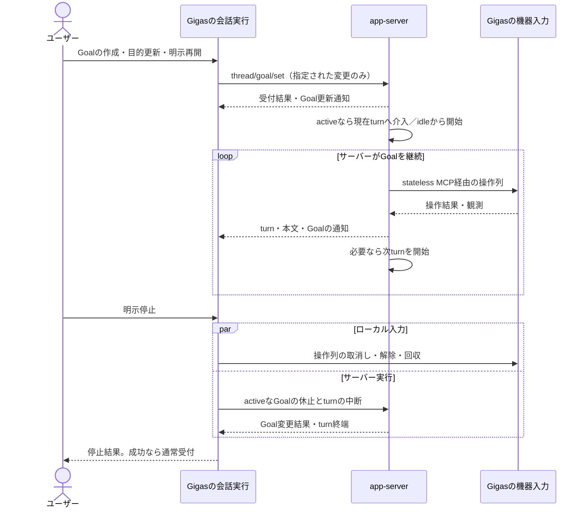

# Goalの目的変更・実行・明示停止

## 1. 目的と範囲

状態: **完了**。unit_061の共通経路にGoal操作を統合し、公開状態・操作可否・停止との差分を試験と実接続で確認した。

長期的な目標をapp-serverのGoalとして保持し、必要なturnの開始・継続と途中の目的変更をサーバーに任せる。Gigasはユーザー操作の配送、Goal情報の表示、機器操作、明示停止を担う。

[通常指示の設計](../unit_061/CONVERSATION_EXECUTION_MODEL.md)を土台とし、本書はGoalによって増える契約だけを扱う。Goal状態を機器入力の許可状態へ変換しない。stateless MCPと有限の操作列、停止完了後の通常受付は共通とする。

対象は同一接続・thread内の作成、目的編集、開始・再開、削除、通常指示との混在、明示停止、右下の目標セクションの再開・削除操作と、その製品実装・試験の改訂。再起動後の復元、プレイ終了・セーブの専用手順、その他のGUI再配置は対象外。既存のrun/Grant・世代・明示再開手順を維持することは要件にしない。

## 2. 要件と判断の分担

| 要件・判断 | 所有者 | Gigasの扱い |
|---|---|---|
| 目標の作成・目的の変更・明示再開 | ユーザー | 指定された変更をGoal APIへ一度送る |
| 目的変更を現在turnへ伝えるか、idleから始めるか | app-server | turn/startやturn/steerを重ねて送らない |
| 指示を適用するゲーム内の場面・作業の区切り | モデル | ユーザーの条件をそのまま届け、turn単位の配送制約へ変換しない |
| turn終了後に目標を継続するか | app-server | 続行指示、監視タイマー、自動再投入を作らない |
| 達成・進行不能・予算／利用制限 | app-serverとモデル | 公開状態を表示。本文や沈黙から独自判定しない |
| ユーザーの明示停止 | Gigasの会話実行 | Goalの継続停止とturn中断、機器解除を調整する |
| 操作列一件の実行・解除 | Gigasの機器入力 | Goal状態に関係なく通常指示と同じ契約を使う |

Goalはthreadに保持される目的・状態・利用量であり、turnの実行状態ではない。activeでもturn間や回答待ちがあり、非activeでも現在turnの報告や開始済みの操作列が残り得る。

## 3. ユーザー操作とGoal状態

### 3.1 操作の意味

| 操作 | 配送 | 変更しないもの |
|---|---|---|
| Goalを作って開始 | thread/goal/set(objective, status=active, origin=user) | 通常指示を重複送信しない |
| 目的を編集 | thread/goal/set(objective, origin=user)。statusは省略 | 現在状態、既存の予算・累積利用量。入力を中断しない |
| 保持Goalを再開 | thread/goal/set(status=active, origin=user)。objectiveは省略 | 目的・予算・累積利用量。MCPを作り直さない |
| 通常指示 | turn/start | GigasはGoalの目的や状態を併せて変更しない |
| 明示停止 | 第4節の停止処理 | Goalを削除しない |
| Goalを削除 | thread/goal/clear(origin=user) | 会話履歴。現在turnや操作列を中断しない |

右下の「目標」セクションに「再開」「削除」を置く。再開は目的編集と分け、objectiveとtokenBudgetを省略してstatus=active、origin=userを送る。入力欄の下書きや「再開して」という文を目的へ送らず、通常メッセージも重ねて送らない。編集だけで非activeのGoalを再開しない。停止は共通操作を使い、目標セクションに別の停止・休止操作や任意の状態を設定するボタン群を追加しない。

削除は「長期目標を取り下げる」操作とする。実行中turnと開始済み操作列は削除だけでは中断しない。削除後も今の動作を止めたい場合は、Goalの有無に関係なく共通の停止操作を使う。削除にturn/interruptや機器停止を付け足さず、実行終了まで削除を保留する処理も設けない。別目的を新規の利用量で開始したい場合は、旧Goalの削除後に作成する。目的編集を暗黙の削除・新規作成へ変換しない。

### 3.2 操作と状態の関係

通常指示と共通停止はGoal状態で無効にしない。目的編集は既存Goalの状態を維持し、Goal作成はGoalがない場合に目的を指定して行う。再開・削除の活性条件は3.5を正本とし、ここに別の状態別判定表を持たない。

activeへの変更は明示的な実行依頼である。制限により拒否されたり、再び制限状態になったりする可能性がある。Gigasは予算の増額・利用量の初期化・課金先変更・再試行を代行しない。completeのGoalは再開対象にしない。別の実行を新規Goalとして始める場合は削除後に作成する。completeの目的編集だけではactiveにならない。

非activeのGoalがあるときも通常指示を送れる。「今の画面を確認して」などをGoal再開なしで依頼できる。通常メッセージの「再開して」も、そのままturn/startへ渡す。Gigasは本文から再開を判定せず、goal/setや目的編集へ変換しない。採用版のモデル向けupdate_goalもactiveへの変更を受け付けないため、Goal再開には専用の再開操作を使う。通常指示のturnで観測・機器操作を行うことと、Goalの自律継続を再開することは別である。質問への回答は通常指示へ変換せず、元要求へ返す。

### 3.3 Goal通知の扱い

| 受信する公開状態 | Gigasが行うこと | 行わないこと |
|---|---|---|
| active | 状態・目的・利用量を反映 | turnを自分で開始、機器の再許可 |
| paused / blocked / budgetLimited / usageLimited | 状態・理由として提供された情報を反映 | ユーザー停止とみなしてturnや操作列を中断 |
| complete | 達成状態と結果を表示 | 報告中turnの中断、機器の一括停止、セーブ成功の推定 |
| Goal削除 | 保持Goal表示を空にする | 会話履歴の削除、turnや操作列の中断 |

状態通知は事実の反映であり、操作命令ではない。停止処理中に通知が届いても、その通知だけで停止taskを完了させたり受付を戻したりしない。

### 3.4 turnの実行状況と指示の適用範囲

Goal状態×turn状態の組合せで操作可否を定める独自の状態機械は作らない。turn情報は通知表示・質問の対応付け・明示停止の対象特定に使う。通常指示の開始／介入と、activeなGoalの目的更新後の介入／継続開始はapp-serverへ任せる。

| ユーザーの意図 | 扱い | Gigasが設けない契約 |
|---|---|---|
| この場面への追加指示としてだけ届けたい | 「まだ戦闘中なら逃げて」など、適用条件を指示としてモデルへ渡す | 特定turnにだけ配送し、終了していたら破棄する契約 |
| 現在の作業を終えてから目的を変更したい | 「買い物を済ませ、その後クチバへ向かう」など、作業順序を指示・目的に含め、モデルに判断させる | turn終端や操作列完了まで目的更新を保留する契約 |
| 行き先変更の際に今の動作を直ちに止めたい | 共通の停止操作を使い、停止後に目的編集・必要な再開を行う | 目的編集だけで操作列を即時中断する契約 |
| 長期目標を取り下げたい | Goalを削除する。今の動作の停止は共通の停止操作で別に行う | Goal削除とturn・機器停止の自動連動 |

ゲーム内の戦闘・買い物などの区切りはturn境界とは一致しない。Gigasは指示文を自動的に条件文へ書き換えたり、ゲーム内の作業完了を判定したりしない。条件の解釈・遵守はモデルに委ね、アプリの配送保証にはしない。通常指示は配送時に旧turnが終わっていれば新turnとして受け付けられ得る。

### 3.5 再開・削除ボタンの操作可否

接続と会話の準備が済み、送信処理・停止処理が動いていない場合の活性条件を以下に示す。

| 目標の状態 | 再開 | 削除 |
|---|---|---|
| 目標なし | 無効 | 無効 |
| active | 無効 | 有効 |
| paused / blocked | 有効 | 有効 |
| budgetLimited / usageLimited | 有効 | 有効 |
| complete | 無効 | 有効 |

unit_061第2.4節の共通受付制約に従い、未接続・会話準備中も両方を無効にする。今回の接続は新規threadを使い、初期値はGoalなしとする。以後は通知されたGoalから上表を導出し、Goal取得中という追加状態や、ボタン専用の受付状態・待ち行列を持たない。保存済みthreadの復元はU08の範囲である。

turn実行中であること、質問・承認待ちであること、機器未接続であることだけでは再開・削除を無効にしない。paused中に通常指示のturnが動いていても再開を要求でき、開始／介入の扱いはサーバーに任せる。機器操作時の使用可否は通常指示と同じ機器入力の責務とする。

再開の有効表示はAPI要求を送れる意味であり、制限の解除や実行開始の保証ではない。要求中だけ共通の送信処理で重複送信を防ぎ、処理後はサーバーの公開状態から活性を導出する。一度の拒否を理由に再開を恒久的に無効にしない。拒否・失敗・受付不明は結果を表示し、自動再送しない。接続が失われた場合は共通の接続制約に従う。

| 再開要求の結果 | Goal表示と再開ボタン |
|---|---|
| RPCエラーで拒否、接続は正常、公開状態は制限状態のまま | エラーを表示し、状態をローカルで変更しない。送信処理終了後は再開を再び有効にする |
| 成功応答だがGoalはbudgetLimitedのまま | 要求受付と実行再開を区別する。制限状態を表示し、再開を再び有効にする |
| activeを受理・通知 | activeを表示し、再開を無効にする |
| active受理後にusageLimitedへ戻る | 後続通知で制限状態へ更新し、再開を再び有効にする |

Goal状態はサーバー通知で更新し、ボタン押下やRPC成功だけでactiveへ先行更新しない。応答のGoal値は操作結果として扱い、後続の状態通知を古い応答で巻き戻さない。

共通停止はこの表の活性条件に従わせない。送信処理中でも割り込め、Goalなしや非activeでも現在turn・操作列を停止できる。停止中の再操作は既存の停止taskへ合流する。

## 4. ユーザーの明示停止

停止task、受付制限、入力解除、turn中断、失敗時の資源終了はunit_061第4節を正本とする。Goal用の停止task・phaseは作らない。Goal固有の追加作業は、サーバー側停止に含める**自律継続の停止**だけである。

送信済みのGoal作成・再開・編集・削除があれば、その結果と対応する通知を処理した情報で休止要否を判断する。送信前の「Goalなし」「paused」の表示だけで省略しない。Goalがactiveならthread/goal/set(status=paused, origin=user)を送り、既に非activeならcompleteや制限理由を上書きしない。Goalが削除済みなら休止要求は不要だが、残るturnは共通停止の対象である。

Goalの休止処理を待たず、既に分かっているturnの中断とローカル入力解除を進める。休止が成立するまでに自律turnが始まった場合も、同じ停止処理内の中断対象とする。送信中Goal操作の決着と継続停止、対象turnの終端が確認できるまで、サーバー側停止を成功としない。API受付応答だけを実行反映の完了と扱わない。採用版の代表場面でこの手順を確認した範囲は第9節に示す。同じturnへ中断要求を重ねず、一度の中断処理で応答と終端通知を待つ。新しいturn開始通知にはそのturnの中断処理を行う。停止task内の要求・待ち合わせで扱い、永続的な中断済み一覧は持たない。

Goal休止が失敗した場合は、共通停止のサーバー側失敗として扱う。通常の目的編集や再開要求が拒否された場合まで接続終了に結び付けない。

正常停止ではGoalを削除せず、activeだった保持Goalをpausedにする。停止中にcompleteや制限状態などの非active状態になっていた場合は、その状態を保つ。到達条件はGoalによる自律継続が止まり、現在turnと操作列が終了して押下解除・回収が済むことであり、Goal不在や一律のpaused化ではない。

正常停止の完了で通常受付へ戻ることと、保持Goalの再開は別である。前者は共通停止taskの終了、後者はユーザーによるactive要求であり、再開ボタンで機器の受付を開く処理は行わない。

## 5. フロー

図は典型的な流れであり、状態通知・turn終端・応答の到着順を保証しない。目的変更の受付成功も、モデルが既に新目的に沿って機器を動かしていることを意味しない。

## 6. 責務と状態の所有

通常指示の所有分担を維持する。Goalのために追加する保持情報は、**サーバーから得たGoalの最新情報（存在、目的、状態、予算・利用量）**に限定する。会話実行が新規threadのGoalなしから始め、Goal通知で更新する。表示・記録はそこから受け取り、Goalの別コピーで制御判断しない。

送信処理とRPC要求の所有はunit_061第2.4節・第5節に従う。Goal専用の送信task、待ち行列、lockは追加しない。Goal作成にも共通の会話資源準備を使い、通常指示で準備済みなら再利用する。

Goal変更応答は操作の成否と、その操作を待つ停止手順で使う。応答のGoal値を表示用の別状態として保存せず、Goal表示の継続更新は通知を正本とする。遅い応答で後続通知を上書きしない。順序調整のための独自revision、Goalの初期取得・定期取得・状態修復を追加しない。

| 追加しない情報・処理 | 代わりに使うもの |
|---|---|
| Goal実行run、入力Grant、実行世代 | 共通の会話資源と操作列task |
| Goal実行中／休止中から導いた機器許可 | 共通の停止task・機器の使用可否 |
| 次turn待ち、自律継続待ち、停滞判定 | サーバーの継続処理・通知 |
| 停止後の再開許可、停止意思の恒久フラグ | 停止taskの寿命とサーバーのGoal状態 |
| 累積利用量・予算到達のローカル計算 | サーバーの公開値・状態 |

## 7. 内部再編と既存仕様・テストの変更方針

共通のクラス構成・入力と観測の分離・記録・実装順はunit_061第6節に従う。会話実行には公開Goal情報と、共通送信枠から操作に対応する要求を選ぶ処理を加える。RPCの組立・応答検証は状態を持たない関数に置き、Goal用の実行クラスや入力経路は追加しない。停止失敗時の閉鎖もunit_061第6.3節のサービス所有taskへ依頼し、Goal側に資源終了処理を増やさない。以下に旧実装からの変更を示し、受入結果は第10節に記録する。

### 7.1 既存の判断を除く箇所

| 現在の実装 | 変更 |
|---|---|
| `CodexConnection._set_goal`のfresh/complete判定 | 作成と既存目的編集を第3.1節のパラメータへ分ける。completeの暗黙clear/create、目的編集時の自動active化を除く |
| `resume_goal`とサービス側の`_resume_goal` | 目的・予算を付けずactiveを一度要求。turn終端待ち、映像確認、入力drain、新run、MCP再生成、unsubscribe/resumeを除く |
| `clear_goal`、サービスの`_start_operation` | clear RPCだけにする。`_request_end(goal_action="clear")`や`_run.stop()`を除く |
| `_accept_goal`・`ConversationRun.receive` | 公開Goalの反映へ縮小。非active化による入力停止、質問の一括失効、complete報告の中断を除く |
| `_runtime_fact`、`_notification(error)`、`_complete_turn` | 利用制限通知・最終error・failed/interrupted終端から独自のGoal休止や共通停止を起動しない。通知を反映し、通信断は共通の資源終了として扱う |
| `_goal_lock/_goal_revision`、`_Start.goal`、Goal準備・入力許可の派生情報 | 共通送信task、当該RPC結果、順に処理する通知へ置換。独自のGoal状態機械を残さない |

通常送信・Goal要求の受付から利用枠表示によるローカル拒否を外す。認証や接続の準備、要求形式の検証は残すが、active要求が実際に受け付けられるか、制限状態を抜けるかはサーバーに判断させる。AccountSessionの利用状況は表示として残す。

第4節のGoal休止は共通停止task内の作業にする。送信済み変更の決着を待つ間も、既知turnの中断と入力解除を並行して進める。応答で成功したことを別のGoal状態へ保存せず、通知反映と当該処理の待ち合わせを用いる。単独の目的編集・再開・削除の拒否は、その操作の失敗として返す。停止内の休止失敗とは区別する。

[GoalState](../../../src/gigas/runtime/codex/models.py)は現在の目的・状態・利用量に、サーバーが返すnullableなtokenBudgetを含める。threadに属する最新値を一か所で所有し、表示へ投影する。予算編集UI、残予算の独自計算、再開失敗フラグは追加しない。

#### Goal変更の通知待ち

送信済みGoal操作に続く停止が、古いpaused表示を見て休止を省略しないよう、Goal setは成功応答と対応する更新通知を同じ送信task内で回収する。応答後に別の「反映待ち操作」を会話へ保存する方式は採らない。通知待ちは一件のGoal操作の寿命に限定し、接続終了時は成功にせず解放する。

採用版の`thread_goal_processor.rs`は一つのGoal値を応答と更新通知の両方へ渡すため、目的・状態・利用量を含む値の対応付けには根拠がある。応答と現在値が同じなら追加待機は不要とする。先に対応通知、その後に新しい状態通知が来ている場合は、一要求中に受け取った対応通知で待機を終え、最新Goalを古い応答へ戻さない。作業ツリーの`_GoalReply`はこの短命な通知受領情報であり、Goalの履歴管理ではない。

clearの`cleared=true`は削除通知を回収する。`cleared=false`は削除対象なしの結果として完了し、この要求に伴う削除通知を待たない。採用版はfalseの場合には通知を出さないため、setと同じ無条件の通知待ちは課さない。通知のないfalse応答から操作が終了し、次の操作を受け付ける試験で確認した。

通知の回収は、サーバーに保存されたGoalを受信したことを示す。目的変更どおりの機器操作の開始や、サーバー内の実行反映処理の完了を保証しない。明示停止のGoal休止とturn終端の待ち合わせは別に必要である。保存ソースではGoal変更は実行反映まで同一threadのlock内で処理される。応答・通知の順序を変える模擬試験と、新しい製品経路での実app-server接続を別々に検証した結果を第10節へ記す。

### 7.2 既存GUIの変更

[PlanPanel](../../../src/gigas/ui/plan_panel.py)の既存`resume_button`（再開）と`clear_button`を使い、後者のラベルを「破棄」から「削除」へ変更した。Goalなしの場合も両ボタンを表示して無効にし、活性は第3.5節へ揃える。新しいGoal操作欄は増設しない。

[ConnectionPanel](../../../src/gigas/ui/connection_panel.py)の`_resume_goal`でローカル停止状態を解除する処理、`_clear_goal`で停止・Plan中断・質問失効を先行表示する処理を除く。`_render`のsettled/active_turn、`_usage_blocked`、goal_finishingを再開・削除の条件として使わない。共通の接続・送信・停止情報と公開Goalだけから活性を導出する。

操作結果は送信処理の完了と失敗表示に使い、Goalの目的・状態を先行更新しない。再開拒否やbudgetLimitedの成功応答でも、送信処理が終われば同じ公開状態に基づき再開を再び有効にする。状態通知は有効な質問の失効理由にしない。

### 7.3 正本仕様とテスト

[実行管理](../../initial/02-runtime.md)のGoal操作と終了規則、[制御フロー](../../initial/09-control-flows.md)のS04/S05と複合状態図、[UI](../../initial/10-ui-interaction.md)と[操作説明](../../../docs/codex-gui.md)を本書へ合わせる。入力・記録の共通改訂はunit_061が所有する。complete仕様は過去の実装記録として保持する。

`test_codex_connection.py`のGoal lock、利用制限による自動停止・再開拒否、Goal clearによるinterrupt、completeによる全質問失効の期待を第8節へ置換する。`test_codex_service.py`の一括Goal試験は、目的編集・再開・削除と通常指示によるゲーム操作へ分ける。`test_codex_gui.py`は既存ボタンを操作して要求内容、状態表示、再開の再操作を確認する。

代替peerは成功応答と公開状態を同一視せず、budgetLimitedのまま成功、active後のusageLimited、応答前の通知をそれぞれ明示する。共通停止・機器解除をGoal用に重複試験せず、Goal変更との競合だけを追加する。pausedのGoalがある状態でも通常指示でゲーム操作できる経路を結合受入に含める。

## 8. TDD Test List

共通の送信・機器解除・受付復帰・切断の試験はunit_061が所有し、ここではGoalを加えた場合の差分を検査する。

| status | item | type | layer | notes |
|---|---|---|---|---|
| refactor-done | Goal作成・active中の目的更新だけでサーバーが開始／介入し、Gigasは通常指示を重複送信しない | new | integration | 実行中とidleの両方 |
| refactor-done | 非activeの目的編集ではstatusを送らず、状態・累積利用量を維持する | new | integration | paused・completeを含む |
| refactor-done | 再開操作はobjective・tokenBudgetなしでstatus=active、origin=userを一度送り、同じMCPを使う | new | integration | 目的・予算・累積利用量を保持。入力欄の下書きを送らない |
| refactor-done | 再開拒否またはbudgetLimitedの成功応答後、状態を維持し送信処理終了後に再開を再び押せる | new | integration | RPC成功をactiveとみなさず、恒久的な失敗フラグを残さない |
| refactor-done | 再開後のactive→usageLimited通知に従って表示とボタン活性を更新する | new | integration | 後続通知を受付応答で巻き戻さない |
| refactor-done | Goal状態と共通処理の状態に応じて再開・削除が操作可能となり、無効時には要求を送らない | new | unit/integration | 3.5の表と共通制約。turn実行中だけでは無効にしない |
| refactor-done | 通常メッセージの「再開して」はturn/startへだけ配送し、Goal目的・状態の変更要求を付け足さない | new | integration | モデルの応答文ではなく配送内容を確認 |
| refactor-done | 自律turnの切替とGoal状態通知だけでは機器操作をキャンセルしない | new | integration | complete後の報告も中断しない |
| refactor-done | Goalの非active通知だけでは有効な質問を失効させず、元要求への回答を配送できる | new | integration | 対象turn終端・要求取消しによる失効とは区別 |
| refactor-done | 非activeのGoalがあっても通常指示を送れ、Gigasは再開要求を付け足さない | new | integration | モデルによるGoal変更とは区別 |
| refactor-done | Goal削除だけでは現在turn・操作列を中断せず、次の自律継続対象をなくす | new | integration | 履歴を保持 |
| refactor-done | Goal削除後も共通の停止操作で残るturn・操作列を止められる | new | integration | Goalがないことを停止の拒否理由にしない |
| refactor-done | 場面条件・作業順序を含む指示や目的を改変せず配送し、turn終端や操作列完了まで保留しない | new | integration | 配送を検査し、モデルのゲーム内判断を固定期待にしない |
| refactor-done | 明示停止はGoalの継続・turn・操作列を止め、成功後は通常受付へ戻る | regression | integration | Goal変更待ちでも解除・turn中断を進める。既にcomplete・制限状態ならその状態・理由を保持 |
| refactor-done | Goal設定／再開の配送中と自律turn切替時の停止で、停止後に実行を残さない | edge | integration | 応答と実行反映の間の競合を確認 |
| refactor-done | 停止内のGoal休止失敗は停止成功にせず、単独の編集・再開拒否では現在の実行や接続を停止しない | regression | integration | 共通失敗処理へ渡す操作の区別 |
| refactor-done | 更新応答より先に対応通知と後続の制限通知が届いても操作は終了し、表示を巻き戻さない | edge | integration | 待機情報は一要求だけ。通知未着時の切断も終了させる |
| refactor-done | Goal削除のcleared=falseと通知なしで操作結果が返り、次の操作を受け付ける | edge | integration | APIが出さない削除通知を待たない |

## 9. 根拠・未検証事項・進行条件

確認対象はapp-server 0.167.0、commit `086ccc833bc9cf01024ad2dd6af7dbd421b6bf9a`。保存ソースの[目的変更と継続](https://github.com/openai/codex/blob/086ccc833bc9cf01024ad2dd6af7dbd421b6bf9a/codex-rs/ext/goal/src/runtime.rs)、[Goal更新の直列化と実行反映](https://github.com/openai/codex/blob/086ccc833bc9cf01024ad2dd6af7dbd421b6bf9a/codex-rs/app-server/src/request_processors/thread_goal_processor.rs#L143)、[予算超過時の状態保存](https://github.com/openai/codex/blob/086ccc833bc9cf01024ad2dd6af7dbd421b6bf9a/codex-rs/state/src/runtime/goals.rs#L323)を確認した。[モデル向け更新](https://github.com/openai/codex/blob/086ccc833bc9cf01024ad2dd6af7dbd421b6bf9a/codex-rs/ext/goal/src/tool.rs#L250)はactiveへの再開を受け付けない。クライアントのGoal操作には公開APIを使う。

| 確認対象 | 採用版で確認した結果 |
|---|---|
| 再開の配送中・受付直後・turn開始後、目的変更の配送中、自律turn間・次turn開始後の停止 | 6場面各3回で目的を保持したpaused、全turn終端へ収束。API応答だけで停止完了にせず、通知で開始・終端を確認 |
| 予算超過後のactive要求 | 予算1・利用量20で2回とも成功応答だがbudgetLimitedのまま。値を保持し、新turnなし |
| 利用制限後のactive要求 | 模擬HTTP 429でusageLimited。再開はactiveで受理され、制限継続ならusageLimitedへ戻る。模擬制限の除去後は次の再開でturn開始 |

実測は実app-serverとローカル固定モデル応答による代表場面の確認である。実アカウントの制限、Gigasの製品制御・GUI・MCP・実機入力は対象外。終端後の監視は0.4秒で、任意の遅延を網羅した保証ではない。製品の組替え後の試験・実接続は第10節に別記する。

予算編集UIと再起動後の復元は今回の範囲外とし、必要になった時点の作業仕様で扱う。専用の計画的終了は[U07](../../planned/unit_012/PLANNED_STOP.md)とともに初期版対象外とする。終了を求める通常指示を禁止せず、Goal非active通知から機器停止を起動する契約も追加しない。

## 10. 対象ファイル・検証・完了条件

親仕様は[unit_054](../../complete/unit_054/KISS_SIMPLIFICATION.md)。第7節の会話実行・GUI・既存テスト・正本仕様を改訂した。機器入力・MCPにGoal固有の実行状態を追加していない。共通の自動検証・配布確認・実機受入・未検証範囲はunit_061第9節へ集約する。

`test_conversation_control.py`は作成・編集・再開・削除の要求内容、送信枠、順不同通知、再開拒否、budgetLimitedの無変化応答、停止競合を検査する。Goalの非active通知による入力・質問の非中断、停止自身のpause拒否時の閉鎖、通知待ち中の切断も確認した。`test_codex_gui.py`で第3.5節のボタン活性、失敗後の再操作、下書き保持を検査する。全体はunit_061と合わせて**802 passed**。

最新製品の実接続は`uv run python -X utf8 tmp/unit061_goal_probe.py`で確認した。app-server `0.167.0`、`gpt-6.1-sol`・effort `low`、既存ChatGPT認証で、次の一連の操作が14.078秒で成功した。

1. Goalを作成し、モデルの質問を受信。
2. 共通停止で目的を保持したpausedとなり、現在turnの終端を回収。
3. pausedのまま通常指示を送り、Goalを再開せず通常turnを完了。
4. objective・予算を付けないactive要求で再開し、元の目的を保持。
5. Goal削除で現在turnを中断しないことを確認。
6. Goal削除後の共通停止で残るturnを終了。

結果・要求・応答・通知は`tmp/unit061-live/goal/result.json`に保存した。通常送信は開始通知を回収して完了し、接続終了後の残存task・記録エラーはなかった。Goalによる長時間のゲーム攻略や実アカウントの予算・利用制限は未検証。制限状態からのactive要求は第9節の隔離境界確認と模擬製品試験の結果であり、実アカウントの制限を発生させた試験とは区別する。

第9節の境界確認は`uv run python -X utf8 tmp/goal_boundaries_probe.py`、exit 0。ローカル証跡は`tmp/goal-boundaries-20261114-021200/`。新しい製品経路の実接続を代用する根拠にはしていない。文書の参照・形式検査、根拠と未検証表示のレビューはunit_061第9節と共通とする。

- [x] 公開Goal状態とユーザー操作、再開・削除・共通停止を分離した
- [x] 共通の会話経路へ実装し、Goal専用のrun・入力許可・lock・revisionを除いた
- [x] 既存GUI・正本仕様・公開文書・テストを改訂した
- [x] 制限・停止競合の境界確認と、製品の自動試験・実接続を区別して記録した
- [x] 予算編集・再起動後復元・長時間運転・専用終了を今回の完了から分離した
