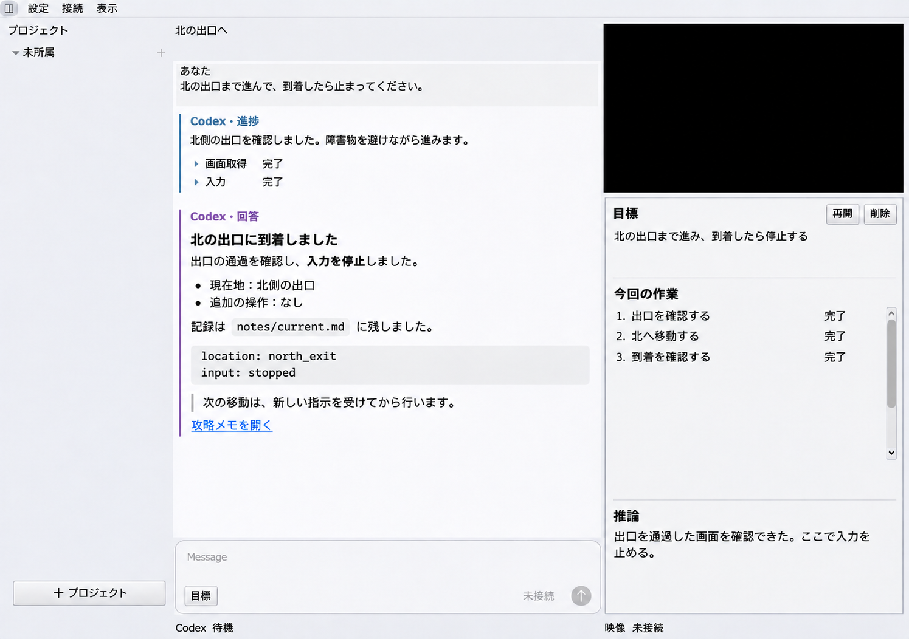

# 活動記録の表示改善

2026-11-15完了。M1のPySide6試作を経て、Qt標準Markdown解析、単一文書、解析ワーカー1本、50msを基準とした更新を採用した。[M1検証結果](M1_VALIDATION.md)に採用理由・実測値・確認範囲をまとめた。M2の表示データと通知・履歴の整備、M3のMarkdown装飾・折り畳み・右側推論欄への統合も完了した。製品コードでの試験・性能・画面と制約は[M3検証結果](M3_VALIDATION.md)を参照する。M4では実モデル・実映像・機器で主要な操作を確認し、要約の要求と字幕保持を修正した。最大114msの応答間隔の調査は後回しとし、長文・縮小・100%表示の実接続での再検証を必須にせず、この範囲で完了することを利用者と合意した。[M4検証記録](M4_VALIDATION.md)に確認範囲と制約を記載する。

製品全体の到達点は[開発計画](../../../docs/roadmap.md)、実装済みの表示は[デスクトップUI仕様](../../../docs/design/ui/desktop.md)を参照する。この資料の予定を、現在動作する仕様とは扱わない。

## 目的と範囲

ゲーム映像とともにエージェントの考察・活動・進行を観察でき、必要なときに会話や活動の詳細を読み返せる表示にする。操作列や生の結果を常時並べることより、公開推論要約と応答、活動の短い表示を優先する。

対象は、公開通知・保存履歴から表示情報への変換、会話のMarkdown装飾、応答種別の表示、活動の折り畳み、右側の公開推論要約表示。ゲーム判断・入力実行・Goal実行の意味は変えない。

サニタイズロジック、配信向けの情報保護、ゲームI/O記録の保存形式変更は今回の範囲外。折り畳みは表示量の調整であり、情報保護の保証ではない。app serverの全item種別への対応や、画像結果の会話内表示も今回の完成条件には含めない。

## 合意した表示方針

配置、情報の表示優先度、左線を残すこと、見出しを控えめにすることは利用者と合意した表示方針。見出しの具体的な倍率、末尾3行、解析ワーカーと50ms更新は、その方針を実現するためにM1で採用した設計値である。製品統合で問題が出た場合は、まず設計値と更新方式を調整し、表示方針を変える必要があるときに相談する。

### 映像と右側の情報

映像の下にある領域を、上から「目標」「今回の作業」「推論」とする。目標は目的と状態、今回の作業は現在turnのPlan、推論は最新の公開推論要約を示す。

Planが長い場合はPlan領域内でスクロールし、推論欄を押し出さない。推論欄は数行分の高さを確保し、本文の更新ごとに箱の高さを変えない。採用モックの高さ配分を基準とし、実際のウィンドウサイズ・表示倍率・サイドバー開閉時の映像視認性は実画面で確かめる。

### 公開推論要約

`item/reasoning/summaryTextDelta`の`delta`を受信順に反映し、字幕のように最新部分を表示する。モデルが公開した要約だけを対象とし、生の推論`content`を使わず、独自の要約・翻訳を挟まない。

同じitem・`summaryIndex`には追記し、次の要約本文が届いたら表示を切り替える。境界通知だけで空欄にせず、次の文字が届くまで直前の表示を保つ。長い要約は最新部分を追い、古い字幕を順番待ちで再生しない。固定秒数で消す方式や、受信済み文章を一文字ずつ遅延再生する演出は採用しない。

ツール活動の開始だけで推論欄をツール名へ置き換えない。全文は履歴から展開して読める形を基本とし、会話内でも同じ要約を常時展開する二重表示を避ける。要約が来ないことだけで停止・待機とは判断しない。turn終了・中断後は更新中に見せず、次のturnや別会話へ前の字幕を持ち越さない。

要約の区切りが数行に収まるとは限らない。M1では末尾3行を追い、全文は履歴で展開し、終了後は最後の本文と終了状態を残す方式とした。既存の「推論要約の表示」設定は右側と履歴の両方に適用する。詳細は[M1検証結果](M1_VALIDATION.md)を参照する。

### 会話本文と装飾

ユーザーの発言、Codexの進捗報告・回答、質問・承認を会話内に残す。Codexの本文にはMarkdownの見出し、太字・斜体、箇条書き、インラインコード・コードブロック、引用、リンクを表示できるようにする。

採用する見た目は、応答の左線と種別ラベルを使う案2の見出し縮小版。進捗は青系、回答は紫系を基準とし、本文は読みやすい通常の文字色にする。色だけに頼らずラベルでも種別を区別する。回答色はゲーム操作の成功を意味しない。

Markdownの見出しは大きなページタイトルにせず、本文より少し大きい程度に抑え、太さと余白で区切る。M1でH1・H2を本文の1.15倍、H3〜H6を本文と同じ大きさの太字とする配分を採用した。階層は保持する。画像モックは正確な文字寸法の保証ではない。

`agentMessage.phase`が得られる場合は公開値を使う。`commentary`は青の進捗、`partial_answer`と`final_answer`は紫の回答、欠落・未知値は通常色のCodexとする。本文の内容から種別を推測せず、`final_answer`だけでturnやGoalの完了を判断しない。

### ツール活動と詳細

普段は活動名・短い対象・状態を、通常の応答より控えめに表示する。詳細はユーザーが展開したときだけ表示し、引数・結果・出力全文を一律に載せる要件にはしない。

| 活動 | 閉じた状態の方向 | 詳細の候補 |
|---|---|---|
| シェル | 短いコマンド表示と状態 | コマンド全体、終了コード、必要な実行結果 |
| ゲーム入力 | 入力と状態。細かな操作列を常時出さない | ボタン・スティック・時間を含む入力列、入力結果 |
| 画面取得 | 画面取得と状態 | 観測内容の確認に必要な情報 |
| Web検索・閲覧 | 検索語や対象と状態 | 必要な参照先・結果 |
| ファイル変更など | 活動名・短い対象・状態 | 対象・差分など、活動を確認する情報 |

この表は表示の方向であり、種類別の細かな装飾の確定表ではない。M1で閉じた行と展開内容の基準を具体化し、ツールの生出力はプレーンテキストとした。採用する詳細項目と実画面は[M1検証結果](M1_VALIDATION.md)を参照する。

質問・承認の操作、失敗・介入が必要な状況は詳細を開かなくても把握できるようにする。入力の送出結果、観測の成否、ゲーム画面での成功を混同しない。既存の通知詳細・停止操作を妨げない。

## 採用モック

右側の配置と高さ配分は次の3状態で確認した。各画像は同一配置の状態比較であり、別々の採用案ではない。

- [通常のPlan・推論](mockups/layout-short.png)
- [長いPlan](mockups/layout-long-plan.png)
- [長いPlanと推論の最新部分](mockups/layout-long-reasoning.png)

会話の装飾は以下の見出し縮小版を採用する。右側の配置は上記のままとする。

いずれもImageGenの静止画で、スクロール、リンク、折り畳み、ストリーミング、停止操作を検証したものではない。進捗とツール活動の線のまとまりは表現の参考であり、異なるitemの同一視や架空の親子関係を要求しない。

## 現状と実装前の検証

M1の検証環境はPySide6 6.12.0とCodex 0.167.0。`TurnContent`は本文差分と公開推論要約を蓄積し、完了itemで確定情報に置き換える。M2でphase、index付き要約、活動の作業場所・終了コード・公開引数を`HistoryEntry`まで保持するようにした。シェル出力差分とMCP進捗も同一活動を更新する。M2完了時点では表示用文字列を従来のプレーンテキスト描画に使い、保持したデータをM3の装飾・展開に渡す構成とした。ライブと保存履歴で変換規則を共有するが、対応itemの範囲は完全には一致しない。

M3着手前の`Transcript`は単一の`QTextBrowser`へプレーンテキストを挿入し、UTF-16上の位置を使って選択・閲覧位置・埋め込み回答操作の配置を保つ。Markdownで受信文字列と表示文字列が異なるようになるため、この位置管理をそのまま流用できるとは限らない。

M1ではQt標準のMarkdown解析、見出し階層・文字サイズのAPI、文書への追加描画で実現できることを確認した。単一文書を維持し、解析をワーカーへ分離する方式を採用する。製品の既存操作との統合はM3で検証する。独立カードへの分割は採用しない。

### M1の検証項目

| 検証対象 | 試す内容 | 決めること |
|---|---|---|
| 通知と履歴の契約 | 採用CLIの生成スキーマと代表通知を照合。phaseの欠落・確定、要約のitem・index、完了時の置換、履歴で取得可能な情報を確認 | 表示用データと更新規則。未知の情報は推測しない |
| Markdownと書式 | Qtの解析後に見出しサイズを制御。日本語、長い行、ネストしたリスト、コード、引用、リンク、表、未完の記法を描画 | 対応するMarkdown範囲、サイズ・余白、ユーザー本文やツール出力との解釈の違い、リンク・画像の扱い |
| ストリーミング更新 | 未完の強調・コードフェンス・リンク、後から届く参照定義、完了本文による訂正を再生 | 再解析する範囲、差分をまとめる間隔、確定時の反映。段落が一度描かれただけで不変とは仮定しない |
| 文書操作と装飾 | 応答をまたぐ選択・コピー、逆方向選択、絵文字、履歴追加、折り畳み、質問操作、リサイズ、スクロール中の左線を確認 | 単一文書を維持する方法、原文と表示位置の対応、展開状態の保持 |
| 推論と右側配置 | 複数要約・長文・受信なし・終了・中断・切替・遅着通知、長いGoalとPlan、サイドバー開閉と表示倍率を確認 | 字幕の切替・表示範囲・全文参照・非表示設定、各領域の最小寸法 |

ライブの表示順、保存履歴との同一item対応、完了itemによる訂正を保つ。公開推論要約の履歴を増やすために、ゲームI/Oの`events.jsonl`へ新たな保存責務を持たせない。

### 更新性能の検証方法

受信と描画を分け、受信した原文は欠落なく保持する。完了した応答を含む会話全体を差分のたびに再解析せず、変更した応答を更新対象とする方式を試す。通知ごとの描画に固定せず、短い間隔で受信差分をまとめる。タイマー・未反映差分はturn終了、切断、会話切替でも扱いを明確にし、別会話への遅れた反映を防ぐ。

初期の計測条件は、表示済み履歴100件／1,000件、生成中本文1万字／10万字、20ms間隔の差分受信と短時間の集中受信を組み合わせる。日本語・絵文字・Markdownを含め、描画のまとめ間隔16／50／100msを比較候補とする。これらは負荷を比較するための試験条件で、製品の文字数制限や確定した更新間隔ではない。

解析・書式付与・レイアウトに要した時間、受信から画面反映までの遅延、GUI操作の応答遅延、CPU・メモリ、更新待ちデータ量を測る。長い履歴、長い一応答、継続受信を分けて評価し、映像プレビュー・入力欄編集・停止要求の受付に支障がないか確認する。

M1では比較計測に先立って操作応答と画面反映遅延の暫定目標を置き、通常利用と高負荷条件を分けて評価する。終了時には実測条件、採用方式、更新間隔、性能の合格基準と未達事項を明示してから本実装へ進む。平均値だけで判断せず遅い更新や待ちデータの増加も調べる。表示待ちを理由に質問・承認・停止の配送を遅らせない。単一応答の再解析でも十分でなければ、解析範囲の縮小や処理分担を検討し、必要性が確認できるまで独自Markdownエンジンや新しいスレッドを導入しない。

## 開発順序と完成条件

実装前に不確実だった見出し制御・左線・更新負荷はM1で検証し、その結果をM2・M3へ引き継ぐ順序とする。M1の結果だけで製品の操作や終了処理まで成立したとは判断しない。

| 段階 | 作業 | 完了を判断する状態 |
|---|---|---|
| M1：描画・更新方式の検証（完了） | 上記の小さなPySide6試作、通知・履歴の照合、性能計測。代表的な活動詳細と未確定の表示規則を具体化 | [検証結果](M1_VALIDATION.md)に実画面、更新方式・データ境界・性能基準を記載。製品への統合確認はM3・M4で行う |
| M2：表示データと通知・履歴の整備（完了） | phase、要約の識別、活動の状態・対象・必要な詳細を保持し、文字列へ潰すタイミングを見直す。ライブと履歴の対応を揃える | 通知再生・履歴変換・Qt結合試験で開始・差分・完了・中断・再読込を確認。欠落情報を補完せず、表示境界まで情報を保持。実接続での確認はM4 |
| M3：会話・推論表示の実装（完了） | Markdownとサイズ制御、種別ラベル・色・左線、活動の展開、右側推論欄と受信更新を統合 | M1の条件で表示と性能を満たす。選択・コピー・閲覧位置・末尾追従、質問・承認、切替・停止を製品コードで確認。[検証結果](M3_VALIDATION.md)に実画面・数値・制約を記載 |
| M4：実接続での受け入れと文書更新（完了） | 実GUI・実モデル・映像で推論、活動、応答、操作中の更新・停止・履歴を確認し、仕様・ガイドを更新 | 活動と進行を追い、詳細を必要時に読める。性能の未達と再検証しない範囲を明示し、利用者と完了範囲を合意。[実接続記録と完了判断](M4_VALIDATION.md)を参照 |

各段階で差分を見直し、責務・状態・依存が必要以上に増えていないか確認する。振る舞いを固定するのに適する箇所ではTDDを使い、文言や見出しの固定文字列一致を品質検査にしない。

M1の引き継ぎには、再実行できる試作と計測手順、採用モックと比較できる実画面、計測結果、採用する描画・更新方式、未確定だった表示規則の結論を残す。イベント再生による確認、実モデルとの接続、実際の映像・機器での確認を区別し、代用した試験を実接続の検証済みとは扱わない。性能や操作の問題が残る方式はM2・M3の前提として確定しない。

M1〜M3では表示用イベントの再生とQt結合試験で、完了時の訂正、非表示・展開、選択、履歴追加、切替、中断、未処理更新の後始末を確認する。通知変換の単体試験だけで描画や操作の成立を判断しない。実機入力の成否と表示の成否は区別する。

M4ではサイドバーの開閉、長いPlan・推論、ウィンドウ縮小・表示倍率を含む実画面を採用モックと比較する。数時間の自律攻略そのものは後続のロードマップ項目で検証し、この作業の短時間受け入れだけで長時間利用を検証済みとはしない。

### 製品統合の確認項目

M3の製品コード・通知再生での確認は完了した。下表のうち実モデル・実映像・機器の接続を必要とする確認はM4で行う。

| 対象 | 確認方法と完成条件 |
|---|---|
| Markdownと既存操作の共存 | 製品の表示部品で、未完の記法から確定本文への更新、応答をまたぐ選択・コピー、詳細開閉、履歴追加、質問・承認を確認する。上を読んでいる最中に末尾へ戻されず、操作部品が本文に重ならないこと |
| 更新性能と大量履歴 | M1と同等条件で、1万字はGUI更新・描画p95が33ms以内／送信から描画p95が150ms以内、10万字は60ms以内／400ms以内。GUIタイマー最大間隔100ms以内、製品側に保持した原文の完全一致、終了時の未反映差分0を確認する。M1の測定から除外した履歴の初回読み込みも別に測り、解析後の大量反映が入力・停止受付を長時間塞がないか調べる |
| 切替・停止・終了 | 解析中の会話切替、確定本文による訂正、切断、ウィンドウ終了を再生する。古い解析結果が新しい会話を上書きせず、描画待ちで停止配送を遅らせず、ワーカー終了時にGUIを同期的に待たせないこと。単体の表示部品を閉じる場合も確認する |
| 実画面と実接続 | 通常・長いPlan・長い推論、暗い／明るい配色、100%／150%表示、縮小、サイドバー開閉で文字と左線・映像領域を確認する。M4では実モデルの通知と実映像で観察し、要約がない場合や未知のphaseも含め、生成した状態を推測で補わないこと |

M3の完了記録には製品コードでの試験・計測と実画面を残し、M1試作の結果とは分ける。文書は各段階で実装済みの内容へ更新する。実モデル・実映像・機器を代用した項目は明記し、残る実接続の確認をM4へ引き継ぐ。

## 変更箇所の見込みと参照先

- 通知・履歴：`src/gigas/runtime/codex/_notifications.py`、`models.py`、`history.py`と、それらの配送経路。
- 表示：`src/gigas/ui/transcript.py`、`connection_panel.py`、`_conversation_display.py`、`plan_panel.py`、`main_window.py`。設定との連携は既存の表示設定の扱いに合わせる。
- 実装時に更新する文書：[デスクトップUI](../../../docs/design/ui/desktop.md)、[Codex通信](../../../docs/design/interfaces/codex.md)、[操作ガイド](../../../docs/guides/codex.md)、[設定ガイド](../../../docs/guides/settings.md)。公開APIや責務が変わる場合は該当API文書と[アーキテクチャ](../../../docs/architecture.md)も更新する。
- 外部仕様：[App Server](https://learn.chatgpt.com/docs/app-server)、[QtのMarkdown解析](https://doc.qt.io/qt-6/qtextdocument.html#setMarkdown)、[追加描画](https://doc.qt.io/qt-6/qtextedit.html#paintEvent)。通知の正確な型は採用CLIの`app-server generate-json-schema --experimental`の結果と照合する。

日々の進行と逐次の計測結果は作業チャットで扱う。本資料には採用判断と残る設計事項を反映し、全体の到達点だけをロードマップへ反映する。
