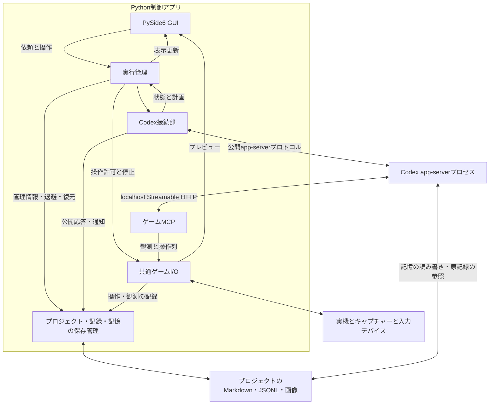

# 02-runtime.md — 全体構成・実行管理

[文書一覧](README.md)

初期設計は2026-11-10、工程参照の改訂は2026-11-11です。計画的終了は、元の攻略Goalを休止して同じスレッドの通常ターンでプレイ終了処理を行います。攻略の継続・再試行はCodexへ委任し、アプリ側では実行状態の整合性検査・停滞推定・自動修復を行いません。部品間の処理順序は[09-control-flows.md](09-control-flows.md)に示します。

Windows上のPythonプロセスにネイティブGUI、実行管理、ゲームI/Oの調整、MCP、保存処理を同居させ、別プロセスのCodex app-serverを公開v2プロトコルの単一stdio接続で制御する方針です。U03では終了期限を保証できない映像ドライバー呼出しを専用子プロセスへ分離します。本書は構成部品の責務・所有と実行制御の原則を定めます。スレッド配置と内部型の名称は、実装で得た事実に応じて変更できる初期実装設計です。各工程の実装・検証済み範囲は親仕様に記録し、以下の全体構成が実装済みという意味ではありません。

# 実行単位と責務

Codex本体は別プロセスです。Python接続部とapp-serverのstdio接続は、ゲームMCPのHTTP接続とは別です。app-serverの実体と採用版の確認先は[08](08-sdk-compatibility.md)にまとめます。

| 部品 | 所有するもの | 所有しないもの |
| --- | --- | --- |
| GUI | 表示、入力欄、ユーザー操作の受付 | シリアル接続、攻略判断、app-serverイベントの直接解釈 |
| 実行管理 | 選択プロジェクト、依頼、ユーザー操作の手順、操作許可、整理処理との排他 | 独立した攻略判断、停滞診断・自動修復 |
| Codex接続部 | stdio接続、スレッド、Goal、要求・通知の受け渡し | デバイスやUIウィジェット |
| ゲームMCP | 2ツールの入出力形式、ゲームI/Oへの変換 | Codex接続部、ゲーム固有の解析 |
| ゲームI/O | 一つの映像取得元と一つの入力接続、操作列、事後観測、停止 | Goalやプロジェクトの攻略上の意味 |
| 保存管理 | プロジェクト作成・読込、管理情報、追記ログ、観測画像、記憶の退避・復元 | 記憶内容の推論、攻略計画、Codexの実行制御 |

起動箇所が実体を一度だけ作り、必要な部品へ渡します。MCPやGUIが別々にキャプチャーや入力接続を開くことはありません。ゲームMCPを構成するだけなら、UIやCodex接続部の読み込みは不要にします。単独起動入口の実装は将来の範囲です。

# 並行処理の初期実装設計

Qtのメインスレッドを画面表示に使い、別のサービス用スレッドにasyncioのイベントループを一つ置きます。このループで実行管理、Codex接続、MCPサーバ、保存要求の調整を行う案です。同期APIしかない処理は、そのAPIの所有者を決めてワーカーへ隔離します。Codex接続のreader・stderr排出・要求待機を同じasyncioループで所有し、GUIで長い同期待ちをしません。

映像取得は専用ワーカーで継続し、連番・時刻付きの最新フレームを共有します。GUIは最新フレームだけを表示対象にし、表示が遅れた分を無限にキューへ蓄積しません。観測ツールは[03](03-game-io.md)の鮮度条件を満たすフレームを待ちます。

U03の映像取得では、列挙とDirectShowのopen/read/releaseをspawnした子プロセスに所有させ、親の専用監視スレッドが最新1枚の共有領域と状態を読み取ります。停止要求・通常終了の期限・強制終了・回収確認を親で管理し、GUIは待機しません。子がロックを保持したまま終了しても親は期限付きでしかロックを取得せず、異常終了した共有資源を次の接続へ再利用しません。正常解放と強制終了、終了未確認を区別します。根拠と採用版は[映像取得設計](../complete/unit_020/VIDEO_CAPTURE_DESIGN.md)に記載します。

入力実行部だけがシリアル接続へ書き込みます。停止は通常操作の待ち列に積まず、実行中の待機にも伝わるキャンセル通知で扱います。GUIから直接シリアルへ別の解除命令を送る構成にはしません。操作実行部自身が中断後のニュートラル送信まで担当します。

GUIへの更新はQtのqueued signal等で返し、ワーカーからウィジェットへ触れません。GUIスレッドでランタイムの応答や長いjoinを同期的に待ちません。以上を同居の前提とし、実装時にライブラリの制約が判明した場合は、この境界内で配置を修正します。

U01の設定I/Oは、appが所有するQtワーカーからUI非依存の同期storage処理を呼ぶ実装です。[U02](../complete/unit_007/CODEX_CONNECTION.md)でCodexServiceThread内にasyncioループを追加し、stdio受信・要求応答・GUI通知・終了を結合しました。設定I/Oは既存Qtワーカーを維持し、同じ設定ファイルの書き込み主体を増やしていません。終了時もI/Oとワーカーの終了を通知で確認し、長い同期待ちや強制的なスレッド破棄を行いません。U01の根拠と検証範囲は[構成・依存選定](../complete/unit_002/ARCHITECTURE_AND_DEPENDENCIES.md)を参照します。

映像ワーカーはU03、MCPサーバと観測保存はU04、入力実行と即時停止はU05で調査・設計・結合します。各部品の所有責任は上表を維持しますが、全実体や共有の空クラスをU02で先に作りません。プロジェクトの保存は使用するデータごとに追加し、記憶の退避・復元はU09の整理フローと一緒に設計します。

# 認証・接続と実行設定の分離

2026-11-11の追加要求として、ログイン・接続の操作とモデル・推論レベル（エフォート）の選択を分けます。接続後も会話を維持したまま設定を変更し、次のターンへ適用できることを要求します。U02の現実装は接続時の値を固定しており、以下は未実装の設計です。[U06](../planned/unit_011/GOAL_EXECUTION.md)の冒頭で公開プロトコルの適用経路を確認し、GUI結合までに実装します。

| 管理する状態 | 契約 |
| --- | --- |
| 接続・認証 | app-serverとの接続、認証状態、ログイン処理をモデル選択から独立して扱います。保存済みモデル・エフォートが無効でも、ログインと候補の取得・選び直しを妨げません。接続済みと送信可能は別に判定します |
| 保存する既定値 | TOMLのモデル・エフォートは新しい会話の初期値です。会話中の選択を自動保存せず、既定値の保存・再読込だけで現在の会話や実行中ターンを書き換えません |
| 次ターンの選択 | 認証状態に応じて取得できたモデルと、そのモデルが対応するエフォートから選びます。無効な組合せは送信前に示し、別モデル・別エフォートへ黙って置き換えません。変更のための再ログイン・再接続・会話の作り直しは不要にします |
| 実行中ターン | 通常ターンはアプリが送信操作を受け付けた時点でモデル・エフォートを確定し、実行中に選択を変えてもそのターンは変更しません。適用中の値と次ターンの選択が異なる場合は区別して表示します |

通常ターンとGoalが自律的に開始する次ターンでは、設定を渡す経路と適用境界が同じか未確認です。U06のM0で採用版の公開経路、変更受付の時点、適用済み値の確認方法を決めます。切替が成立しない場合は理由と未適用を示し、接続や会話を無断で破棄せず、仕様と方式を再検討します。設定反映のためにアプリ独自の続行ループを増設しません。

GUIは接続・ログイン、次ターンの設定、実行状態を別の操作・表示として扱います。ラベル・状態・値を使い、利用手順や適用時点の説明文はdocsへ置きます。U02で実接続を確認したのは既存ChatGPT認証であり、新規ブラウザログイン・APIキーの実接続確認は残っています。使用アカウントの識別表示とCodex home共有の扱いはU06で設計し、ログアウト・アカウント切替の提供範囲はその時点で判断します。現実装はランタイム既定のhomeを使い、`CODEX_HOME`が環境にあれば継承します。

# Goalを軸にした実行状態とアプリの制御責任

プロジェクトは記憶をまとめる単位、依頼はユーザーが達成を求めた仕事、実行は開始から停止までの活動です。スレッドは複数ターンを含む会話の単位です。一つの依頼を複数の実行・スレッドで継続できます。

実行の継続・達成・休止の判断では、現在の攻略スレッドに属するGoalを主軸とします。アプリとCodexに独立した攻略状態機械を二つ作り、それぞれで進捗や完了を判断する構成にはしません。アプリは、Codex接続部が受け取るGoal状態、実行中ターン、未回答の要求と、ユーザーの停止意図・機器状態・実行中の入力を合わせて、表示と許可する操作を決めます。

責務を分けることは、状態を無関係にすることではありません。Goalの状態をアプリが保持する場合も、最後に観測したランタイム状態として扱い、独立した攻略判断の正本にはしません。入力遮断、押下解除、旧処理の終了確認はアプリ自身が担います。例えば、ユーザーの即時停止後に古いactive通知が届いても入力を再許可せず、逆にGoalがpausedになっただけで機器の解除完了とみなしません。

| アプリの表示状態 | 操作の扱い | 主な遷移 |
| --- | --- | --- |
| 待機 | AI入力を許可しません。プレビューは表示可能です | 明示的開始で開始・再開確認中へ |
| 開始・再開確認中 | 記憶・スレッド・接続を用意し、現在画面を確認します | 実行中、または理由付き停止へ |
| 実行中 | 有効な実行からの入力を許可します | 回答待ち、プレイ終了処理への移行、停止、依頼完了へ |
| 回答待ち・承認待ち | 新しいゲーム入力を保留し、内容を表示します | 有効な回答・承認で元の処理フェーズを続行。手動停止で停止へ |
| プレイ終了処理中 | 元Goalを休止し、同じスレッドの終了処理ターンに必要な入力を許可します | 完了・失敗・中断で停止処理へ。即時停止は優先します |
| 停止処理中 | 新規入力を拒否し、旧入力の解除と旧実行の収束を確認します | 収束を確認して停止へ。未確認事項は表示します |
| 停止 | 入力を拒否します。理由と未完の依頼を保持します | 明示的再開で開始・再開確認中へ |
| 依頼完了 | 入力を閉じ、結果を表示します | 記憶整理または次の依頼へ |

Goal休止から終了処理ターン開始までの移行と、ユーザーによる明示的再開は09の図で補います。表示は最後に受け取ったランタイム状態とアプリ自身の操作状況に基づき、最終更新時刻を添えます。アプリ独自の状態照合処理や、それを前提とする復帰操作は設けません。

上の表は利用者向けの表示分類であり、Goalとは独立に攻略を進める状態機械の定義ではありません。接続状態、内部再試行中、記憶整理中は補助表示として持ちます。Goal、ターン、要求、機器状態のすべての組み合わせを巨大な列挙型へ展開しません。Goalがactiveでも、ターン間や質問待ちの場合があります。単一ターンの完了や自然文の「完了」という単語で依頼完了を判定しません。

# 開始と通常攻略

機器接続とプロジェクト選択だけでは操作を開始しません。開始要求を受けると、実行管理が依頼と識別子を保存し、Codex接続部へ目的、プロジェクトの場所、共通指示、MCP接続情報を渡します。Codexは案内と現状メモを読み、新しい画面を観測してから進めます。

継続はGoalsへ任せます。接続部は一回のrunの終了までではなく、対象スレッドのGoal・ターン・計画・要求の通知を受け取ります。アプリが毎ターン「続けて」と送る方式や、独自の攻略計画管理は設けません。**Codex接続は公開app-server v2プロトコルを使います。** 2026-11-11のユーザー承認で、SDK 0.167.0の要求保留制約を避ける直接接続へ変更しました。 通信の管理主体は一つのCodex接続実装にまとめ、SDKと独自処理による同じ通信の二重受信や、SDKの非公開メソッドの差し替えで不足を補いません。必要な機能が公開経路で成立しない場合は制約として記録し、版や接続方式の変更を別途判断します。方式変更は承認済みで、詳細は[U02 M1](../complete/unit_017/CODEX_DIRECT_CONNECTION.md)に記録します。

## 処理の反復と、その担当

| 処理 | 次の処理へ進む契機 | 担当 |
| --- | --- | --- |
| 一つのターン内の攻略 | 画像・ツール結果を受け取り、次の観測、入力、検索、記憶更新を判断する | Codexのモデルとランタイム |
| ターンをまたぐ継続 | ターン終了後などにGoal、スレッドの稼働状態、保留入力、予算等の継続条件を確認する | CodexのGoals機構 |
| アプリのイベント処理 | ユーザー操作、Goal・ターン・要求の通知、機器・保存処理の結果を受け取る | 制御アプリ。指示の配送、表示・記録、入力許可と停止を行う |

アプリのイベント処理は独立した攻略ループではありません。ゲーム操作ツールはCodexから呼ばれた操作列と観測を実行し、その結果を返します。ライブプレビューの継続取得は、この判断・継続のループとは別に動きます。

## 依頼開始から停止・完了まで

ユーザーが開始する → 依頼・スレッド・記憶・MCP接続を準備する → 現在画面を確認できる状態で攻略Goalを開始／明示的に再開する → Codexがターン内の攻略とGoalによる継続を進める → アプリが通知と介入を処理する、という流れを基本とします。通知の購読と実行識別子の対応付けは、初回のGoal／ターンの開始より先に用意します。

| 受け取った状態・要求 | フローの分岐 |
| --- | --- |
| 攻略ターンが終了し、Goalの継続条件が成立する | 次のターンはGoalsに任せます。アプリから攻略の再投入はしません |
| 明示的な質問・承認要求がある | 入力を保留して回答を待ちます。手動停止されていなければ、有効な要求への回答で続行します |
| 元の攻略Goalがcompleteになる | その依頼への追加指示の配送を閉じ、未配送分を破棄します。新しい入力を閉じ、実行中処理の終了を確認して依頼完了を確定します。その後、別スレッドの記憶整理へ進みます |
| Goalのpause、block、利用枠・予算の制限、最終失敗が通知される | 達成とは区別します。自分が発行した計画的終了用pauseは移行の確認として処理し、それ以外は理由付き停止へ進みます。明示的な回答要求の待機は回答待ち仕様に従います |
| ユーザーが即時停止を要求する | Goalの通知より先に入力を遮断し、押下解除とランタイムの停止を進めます |
| ユーザーが計画的終了を要求する | 元の依頼の達成とは別に、下記のプレイ終了処理へ移ります |

**攻略の継続・再試行・休止・完了はCodexの判断と公開状態に従います。** アプリは通知を表示・記録し、質問やユーザー操作を受け渡します。実行中の状態整合性検査、通知がないことからの停滞推定、読み取りAPIを使った自動修復、実行の自動再投入は行いません。activeかつ実行中ターンなしという状態でも原因を診断せず、Codexへ継続判断を任せます。

Codexの内部再試行は重ねずに待ち、明示的な最終失敗・通信切断は理由を表示して入力を止めます。通知欠落による古い表示や、Codexが解消できない停滞をアプリが自動復旧しない制約を受け入れ、必要ならユーザーが停止・明示的再開、またはアプリ再起動後の再開を行います。開始・再開・プレイ終了処理に必要な状態取得と応答確認は、その操作の一部として残します。即時停止、旧入力の拒否、デバイス・保存障害の処理はアプリ自身の責務です。

計画表示は最後に受信した計画項目と状態を表示します。再開前の計画には記録時刻を付け、更新がないときは新しい計画を捏造しません。応答・進捗・公開される推論要約も表示可能ですが、内部推論全文の取得を要件にしません。

# 追加指示と入力要求

追加指示は受信順に記録し、対象の依頼へ紐付け、実行中なら公開プロトコルのturn/steerで届けます。送信だけでは操作列を中断しません。ターン切替と競合してまだ配送できない指示は、同じ依頼が継続している間に限り、次の有効ターンへの配送を待ちます。受付済みと配送済みを区別し、二重配送を避けます。

**対象Goalの完了通知を受けたら、その依頼への追加指示の配送を閉じ、未配送の指示を破棄します。** 完了を受信した後に同じ依頼宛てで届いた追加指示も破棄し、新しいGoal・通常ターンの開始、次の依頼への転送、再送は行いません。破棄は配送対象から外す意味であり、本文と「依頼完了のため未適用」という結果はトランスクリプトに残して画面にも示します。新しい目的は、追加指示の自動転用ではなく、ユーザーの明示的な新規依頼として開始します。

アプリが完了通知を受ける前に既にランタイムへ送信した指示は、未配送の破棄と区別します。Codexが受け取った内容を遡って取り消せるとは扱わず、受付の成否が確認できない場合は未確認と記録し、再送しません。完了通知と指示送信の競合を解消するための状態照合・補正ループは設けません。

エージェントの質問は、app-serverの明示的な入力要求とそのIDを使って表示します。回答待ちのまま回答が届けば続行します。ユーザーが手動停止した後は、元の要求への遅い回答だけでは続行しません。回答と「再開してください」をまとめた指示は再開として扱えますが、単なるテキスト送信を自動再開へ変換しません。初期UIでは回答送信と再開を区別して操作できます。

権限承認は質問と別の要求です。許可済みの範囲は自律実行し、拡張要求だけをGUIへ届けます。Codex接続部が要求IDと有効性を管理し、有効な回答を公開プロトコルで返します。人間の回答待ちで通知受信や停止受付を塞がず、停止・取消しで失効した要求へ遅い回答を送りません。採用ランタイムでこれらを成立させ、要求を暗黙に承認しないことを[08](08-sdk-compatibility.md)の確認項目とします。

# 停止の順序

即時停止では、まず実行管理が操作許可を閉じ、実行中の列へ中断を通知します。入力実行部は残りを破棄し、キャンセル状態でも押下解除を行います。並行してCodexのターン中断とGoalsの自動継続停止を要求します。Codexの応答を待ってから実機へ停止を送る順序にはしません。

停止要求の受付と、次の実行を許可できる状態を区別します。旧操作の解除・終了処理と、旧ランタイムのファイル更新などが収束するまで、新しい入力、プロジェクト切替、記憶整理を開始しません。その間は停止処理中と表示します。これにより、旧処理の解除が再開後の押下へ干渉することを防ぎます。

停止済みの実行から遅れて届いた要求を拒否するため、操作許可は実行の世代に紐づけます。これはモデルが引数で自己申告する番号にはしません。MCP接続コンテキストを発行した世代に固定し、停止後はその接続からの入力を許可しません。再開時には新しい接続コンテキストを使います。接続差し替え方法の詳細は[08](08-sdk-compatibility.md)の確認項目です。

観測・操作・保存要求は、受付時のプロジェクト、実行、保存先を結果まで引き継ぎます。遅れて届いた結果を、受信時に選択されている別プロジェクトへ記録したり、現在の計画表示へ混ぜたりしません。

## 計画的終了の起点と意味

初期版の計画的終了は、ユーザーが「プレイ終了処理を行って停止」を選ぶことを起点とします。アプリを閉じる際に同じ操作を選ぶ場合も含みます。**プレイ終了処理**とは、ゲーム内で区切りを付ける、必要に応じてセーブする、現状メモを更新するなどの作業です。これを実行する通常ターンを**終了処理ターン**と呼び、アプリのプロセス終了・機器解放とは区別します。Goalの自然な達成、利用制限や障害による停止も別です。停止後も未達の攻略依頼は保持し、計画的終了だけでは記憶整理を自動起動しません。

## 計画的終了の採用方式

**元の攻略Goalを休止し、同じ攻略スレッドに明示的な通常ターンを開始してプレイ終了処理を行います。** 攻略Goalの目的は保持します。終了用のGoalへ置き換える方式は不採用です。元Goalの休止、旧ターンと入力処理の収束、終了処理ターンの開始、処理結果の確認、入力停止を別の段階として扱います。詳細は[09のS03](09-control-flows.md)に示します。

| 段階 | 処理と判断 |
| --- | --- |
| 終了要求の受付 | 元の依頼に対応する終了要求を記録します。受付だけを攻略完了・終了処理完了とみなしません |
| 自動攻略の休止と収束 | 元Goalを休止し、実行中ターンがあれば区切る指示を届けます。Goalのpauseだけではターン停止・押下解除が済んだと扱いません |
| 実行の切り替え | 旧ターン・入力・書き込みの収束を確認し、旧操作権限を失効させます。終了処理用の権限と通常ターンを用意します |
| プレイ終了処理 | 元Goalをpausedのまま保持し、同じスレッドの通常ターンで必要な観測・操作・現状メモ更新を行います。記憶整理用スレッドは使いません |
| 結果と停止 | 対象ターンの完了・未完理由を対応付けて保存し、入力許可を閉じ、解除と終了を確認します。失敗しても元の攻略へ自動復帰しません |
| 後日の再開 | ユーザーの明示的な再開で現在画面と記憶を照合し、未完の元Goalを再開します。終了処理の成功を元依頼の達成とは記録しません |

即時停止はどの段階でもプレイ終了処理を待たずに優先します。終了処理中の回答・承認待ちや利用制限にも既存の扱いを適用します。Goal休止の明示的失敗などで移行できない場合は、終了処理ターンを開始せず、入力を閉じて停止処理へ進みます。旧処理の収束を確認できない間は停止完了とせず、対象と理由を表示します。単なる無通知から自動的に異常判定する処理は追加しません。

終了処理の結果は、対象の通常ターンの終了状態と、実施内容・未完理由を対応付けて受け取ります。構造化結果には公開app-serverの`outputSchema`を候補とし、公開app-serverプロトコルでの指定方法と結果項目を採用版で確認します。結果が取得できなければ未確認として停止し、自然文に「完了」と書かれたことだけで成功にしません。モデルの完了報告と、実機のセーブ成功の保証は別です。元Goalの目的と利用量を保持し、切替時に元Goalが実際に達成していた場合も、その記録と終了処理結果を分けます。

同じスレッドでGoalを休止したまま通常ターンを実行し、元Goalが意図せず再活性化されないことはU07で検証します。直接接続では不採用SDKの論理Goal登録は使いません。単一readerは継続し、切替時は旧要求の対応付けと有効性を更新します。pause要求直後に開始せず、旧ターン・入力・書き込みの終了を確認する条件は維持します。公開された接続経路、通知順序、待機の打ち切り条件、終了処理結果の形式は、Codex接続部の実装時に具体化します。

# 制限と障害

| 起点 | 動作 |
| --- | --- |
| ランタイムの内部再試行 | 再試行中と表示し、ランタイムの結果を待ちます。操作列は再送しません |
| 利用枠・残高不足で続行不能 | 入力と自動継続を止め、取得できた利用枠・回復時刻を表示します。明示的再開を待ちます |
| 想定した移行以外のGoalのpause・blocked、最終的なランタイム失敗 | 通知された理由を保持して停止します。終了処理への移行用pauseはその確認として扱います。active通知だけで入力を再許可しません |
| app-serverの終了・通信切断・受信エラー | 入力を閉じ、旧処理の停止を進め、接続エラーを表示します。自動再接続・自動再起動による攻略復帰は行いません |
| キャプチャー・入力接続・記録保存の故障 | 有効な観測と記録を残せない状態で入力を継続せず、エラーを示します |
| 新しい通知がない | 最後の公開状態と更新時刻を表示します。時間経過だけで状態診断・再取得・再投入は行いません |
| ユーザーによるアプリ再起動 | 未完実行を自動実行せず、停止状態で読み込みます |

HTTP 429だけで回復可能な制限と残高不足を分類しません。課金先・モデルの自動変更もしません。PCプロセス自体の異常終了後にMCUの押下が残らないことは、ソフトウェアのfinallyだけでは保証できません。機器側の挙動を確認し、未確認のハードウェア保証をUIに表示しないこととします。

# 再開とアプリ終了

再開時は古い操作を無効にしたまま、保存された依頼・記憶と新しい画面をCodexへ渡します。スレッドを使える場合は再開し、利用できない場合は新しいスレッドで再構成します。ゲームがリセットされて記憶より前の地点へ戻っていても、過去操作を再生して埋め合わせません。現在状態だけを訂正し、有用な知識を引き継ぎます。失敗・中断した記憶整理が残っている場合は、整理側の書き込み終了と整理前の記憶への復元を完了してから、次の攻略を開始・再開します。復元が失敗・未完なら開始を許可せず、その理由を表示します。詳細は[04](04-agent-memory.md)に従います。

初期設計は対象ゲームが起動済みの画面から始め、ゲーム内の再開操作を扱います。SwitchのHOME画面から任意ソフトを起動する機能は必須にしません。起動範囲の拡張はゲーム別の手順として判断します。

アプリを閉じる場合は、即時停止または計画的終了を選び、その完了後にMCP、Codex接続、デバイス、保存処理を順に解放します。GUIは終了中も応答を保ちます。終了待ちが解消しない場合は、停止を確認できない対象を表示し、無限待ちで画面を固めません。実行中のデバイス変更とプロジェクト切替は、まず停止してから行います。

# 変更を閉じ込める境界

Claude Codeへ替える場合はCodex接続部を置き換え、継続・質問・停止・計画の能力差を明示します。MCP、共通ファイル、ゲームI/Oを置き換える前提はありません。ただしGoalsやスレッド自体の完全互換は保証しません。

同一プロセスのため、致命的障害と依存環境は共有します。別プロセスへ変更する場合も、ゲームI/Oの契約を維持してプレビューと停止通知の転送を追加します。現時点でその転送実装まで作りません。

