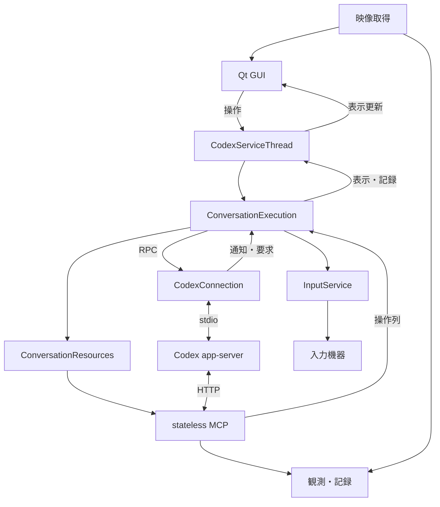

# 02-runtime.md — 全体構成・実行管理

[文書一覧](README.md)

通常指示と追加指示の開始・介入、Goalによる自律継続はapp-serverへ任せます。GIGASはユーザー操作の配送、公開状態の表示・記録、ゲームI/O、明示停止を担います。共通契約は[unit_061](../complete/unit_061/CONVERSATION_EXECUTION_MODEL.md)、Goal固有の契約は[unit_062](../complete/unit_062/GOAL_EXECUTION_MODEL.md)を正本とし、操作画面は[10](10-ui-interaction.md)、処理順は[09](09-control-flows.md)に示します。

以下はunit_061・062で組み替えた構成です。模擬app-server・機器、Qt、実HTTPの試験と、実app-server・実モデル・CH552の短い入力・停止を確認しています。GUIを経由した実機操作、他の機器構成と長時間運転は今回の確認に含めません。検証の範囲と結果は両unitと[互換性・受入記録](08-sdk-compatibility.md)を参照します。

## 実行単位と責務

| 所有者 | 保持する情報・処理と寿命 |
| --- | --- |
| GUI | 下書き、表示内容、Qt配送結果待ち。接続と会話の通知から活性を導出する |
| `CodexServiceThread` | Qt操作の配送、接続世代、部品の組立、接続全体の終了task。サービスの寿命で所有する |
| `CodexConnection` | stdio、認証、モデル候補と確定選択、Windows実行環境、受信処理。一接続の寿命 |
| `ConversationExecution` | thread ID、最新Goal、現在turn、送信task、停止task。接続に一つ。turn内容と要求は個別の所有者へ委譲する |
| `HumanRequests` / `TurnContent` | 未回答要求は解決・対象turn終端まで、配送開始済みtaskは要求が消えても配送結果確定まで所有する。本文は対象turn終端で確定する |
| `ConversationResources` | MCP、観測・記録サービス、writer。MCPは会話の寿命、明示選択したwriterは切断後も選択を維持する間保持する |
| `InputService` | 一つの機器接続、使用可否、一件の操作task。taskは解除まで、正常な機器接続はCodex切断後も保持する |
| MCP | HTTP入口、認証、形式検査、応答変換。会話や機器の状態を複製しない |

会話の状態は`ConversationStatus(thread_id, turn_id, goal, sending, stopping, waiting_for_answer)`へ投影します。`sending`と`stopping`はtaskの存在、回答待ちは元要求から導き、独立した実行phase・再受付許可・停止済みフラグを保存しません。Goal状態とturn状態の組合せを列挙型へ展開しません。機器入力にrun、Grant、入力世代を持たせません。Qtの古いイベントを識別する接続世代は維持します。

要求パラメーターの組立・応答検証は状態を持たない関数に置きます。会話実行へ機器通信、画像加工、保存、認証、モデル一覧、全文の表示処理を集めません。資源取得・停止中だけ必要な待ち合わせは、そのtask内の値として保持します。

## 並行処理と資源の寿命

Qtのメインスレッドは表示と操作受付、サービス用QThreadの一つのasyncioループはCodex、MCP、入力・観測・保存の調整を担当します。通知の反映処理は送信や停止の完了を待ちません。GUIへはqueued signalで更新を返し、長い同期待ちやワーカーからのウィジェット操作を行いません。

映像ドライバーの列挙・open/read/releaseは専用子プロセスが所有し、監視スレッドが最新一枚と状態を読みます。期限付き終了と回収は取得側が管理し、異常終了した共有資源を次の接続へ再利用しません。入力の同期シリアル呼出しは単一workerへ直列化します。操作列の取消しは待ち行列へ積まず、実行中taskへ届けます。開始済みwriteを回収してから実行部がneutralを送出し、別経路から解除bytesを割り込ませません。

入力taskは解除まで一件だけです。`InputService.start()`は同期的にtaskを登録し、処理中はBUSYを返します。`stop()`は現在のtaskへ取消しを要求してそのtaskを返します。停止所有者は捕捉したtaskの解除結果を回収し、後から始まった別の操作を取り消しません。画像加工・保存は入力枠から外し、停止完了のために画像完成を待ちません。

観測は最新キャッシュを一度採用し、要求後の新フレームを待ちません。操作後の観測でも同じ契約を使い、画像の選択前に次の入力が始まる場合があります。符号化中の別観測はBUSYですが、保存中であることを理由に次の観測を拒否しません。開始済み符号化・保存は要求取消し後も各所有者が回収します。

共通のRecordingServiceがwriterへの追記を直列化します。入力・観測・会話の記録は非同期に提出し、保存完了を送信・入力・停止の条件にしません。終了時は入力・要求・符号化を回収し、保存をdrainしてからwriterを閉じます。入力結果はoperation_idで対応付け、既知のthread IDと観測IDを残します。ユーザー指示やturnへの帰属を推定しません。

## 認証・モデル・実行環境

`SessionStatus`は接続・認証を扱い、phaseは`connecting / login_required / authenticating / ready / error / closed`です。認証はruntimeのhomeを共有し、資格情報をアプリへ複製しません。起動だけで接続・ログインせず、切断もログアウトへ変換しません。APIキー認証は初期版対象外です。

保存するモデル・推論レベルは次の接続の既定値です。無効でも認証は維持し、公開候補から選び直せます。選択変更は送信taskと共通の枠で扱い、threadがあれば`thread/settings/update`の受理後に確定値を通知します。現在turnは書き換えず、次の通常指示と設定受理後の自律turnへ反映します。無効値を別候補へ自動置換しません。

Windows実行環境は接続後に認証と独立して取得します。設定画面の準備操作は開始受付ではなく、完了通知とreadinessの再取得まで待ちます。成功後も非readyなら明示再接続を求め、受付不明なら再送せず待ちます。待機中の切断は可能ですが、Windows側の処理取消しは保証しません。

通常指示とGoal操作は、接続・認証、有効なモデルと推論レベル、実行環境readyを要求します。送信または停止処理中は新しい送信を受け付けません。turn実行中、質問待ち、機器未接続、映像未取得、利用枠表示だけでは拒否しません。モデル選択は無効値からの復旧にも使うため、現在選択やsandboxの準備を前提にしません。回答は元要求の有効性、接続、停止状態で判断し、通常送信の枠には並べません。

## 初回準備と通常指示

初回の通常指示またはGoal作成で、選択プロジェクトまたは未選択チャットの記録先、memory、観測・記録、MCPを準備し、永続threadを作ります。接続・ログインだけでは記録先を要求しません。準備失敗でも認証は維持します。同じ会話ではthread・MCP入口を再利用し、毎送信のunsubscribe/resumeや再生成を行いません。

書込先とthreadのcwdは記録先の`memory/`へ限定します。追加書込先・一時領域・ネットワークを許可せず、応答のcwd・モデル・承認設定・sandboxを検証します。配布物のプレイ指示と原記録・画像の参照方法を渡し、開発リポジトリの指示やユーザーの別MCP設定を混入させません。MCPの認証値をプロンプト・表示・原記録に含めません。thread IDの保存提出はターン開始前に行いますが、保存完了は待ちません。

通常指示と追加指示はどちらも`turn/start`へ一度配送します。既存turnへの介入か新turnの開始かはapp-serverが決めます。特定turnだけへの指示、turn終端までの保留配送、本文の意図分類、自動再送を設けません。送信中に編集した下書きや失敗・受付不明の下書きは保持します。

現在turnは開始・終端通知から更新し、受付応答だけで実行中へ戻しません。送信taskは受付応答と対象turnの開始または既観測終端を回収して終了し、応答だけ先着した間の停止でも中断対象を取り逃しません。既知の現在turnへの追加では新たな開始通知を要求しません。本文・Plan・公開推論要約・activityはturn終端で締め、履歴を残します。遅い同turn更新を再照会で補わず、毎turnのPlan・要約出力を要求しません。追加指示・質問待ち・自然終端・turn失敗だけで機器入力を止めません。

## Goalと質問・承認

Goalなしの作成はobjectiveとactive、既存Goalの編集はobjectiveだけ、再開はactiveだけを`thread/goal/set(origin=user)`へ送ります。目的更新後の介入・継続開始はサーバーに任せ、通常指示を重ねません。completeの編集も状態・利用量を維持し、別Goalとして始める場合は削除してから作成します。

Goal削除は目的の取り下げです。現在turn・操作列・質問を中断せず、記憶や原記録も削除しません。Goalのcomplete・paused・blocked・制限状態の通知は表示・記録へ反映し、明示停止へ変換しません。非activeのGoalがあっても通常指示でゲームを操作できます。「再開して」という本文はGoalをactiveへ変える特別な操作にしません。

Goal変更は対応通知を処理するまで同じ送信taskで扱います。無変化の応答とclearの`cleared=false`では追加通知を待ちません。表示の正本は通知で、遅い応答を使って後続状態を巻き戻しません。通知受領をサーバー内の実行反映完了とはみなさず、停止ではturn終端も確認します。再開拒否または制限状態維持の応答ではその状態を保ち、処理終了後に再開ボタンを再び有効にします。予算を変更したり利用量を初期化したりして補いません。

質問・承認は元要求IDへ一度返し、通常指示と混同しません。複数質問は要求と質問IDごとに下書きを保持し、一つのanswers応答で返します。秘密入力指定を含む質問は全体を未対応として返します。承認は提示された一回限りの判断だけを使い、通常本文や既定値で許可しません。詳細な対応範囲は[接続API](../../docs/codex.md)に示します。

要求解決・turn終端・停止・切断で未送信の回答を失効させ、配送開始済みの回答は別に結果を回収します。`RequestResolved`は受付終了であって配送成功ではありません。通信への書込完了を許可対象の実行成功とせず、不明な結果を自動再送しません。

## 明示停止と切断

共通停止は送信枠に並ばず割り込み、一つのtaskで所有します。その間の新しい指示・Goal操作・回答・機器入力は拒否し、繰り返し停止は同じtaskへ合流します。入力列の取消し・開始済みwriteの回収・neutral送出はサーバー待ちと独立して進めます。未提出の送信は取り消し、提出済み送信・回答は決着を確認します。

既知turnには直ちに中断を送り、Goal変更待ちで遅らせません。送信済みGoal操作の結果と通知を処理した後、最新Goalがactiveならpausedを要求し、非activeの達成・制限理由は維持します。停止中に新しい自律turnが始まっても同じ停止taskで中断します。対象ごとの中断応答と終端通知、Goalの継続停止、捕捉した操作列の解除・回収を確認して成功を返します。

正常停止が完了すれば通常受付へ戻ります。再受付専用の状態・手順は追加しません。Goalの明示再開は自律継続を要求する操作であり、機器受付の再許可ではありません。停止はゲーム内セーブや任意のバックグラウンド処理の全終了を保証せず、端末一覧の取得・一括終了は行いません。

入力解除だけの失敗は機器を使用不能にして停止失敗を返し、サーバー側停止を確認した会話は維持します。サーバー側の停止失敗はサービス所有の終了taskへ合流し、接続・MCPを閉じてローカル処理を回収した後に失敗を返します。終端や通知待ちが続く間も明示切断できます。

サービスの終了taskは接続・MCP・送信・回答・入力・観測・保存を回収します。発端となった停止taskやQt操作taskは待たず、相互待機を作りません。切断時は通知待ちを失敗として解き、Goal休止の永続化・最終応答・任意の子孫プロセス終了は保証しません。正常な入力接続と映像取得はCodex切断だけでは閉じません。アプリ終了ではそれぞれの所有者が解放します。

入力設定の変更は必要な共通停止と並行して、旧列の解除・回収後に機器を切り替えます。提出済み設定適用は停止で取り消しません。MCPは共通形式を公開し、入力サービスが現在の機器能力で列全体を検査するため、機器切替で会話や入口を作り直しません。観測解像度だけの変更は次の観測から反映し、入力を止めません。

## 障害と初期版の範囲

| 事象 | GIGASの処理 |
| --- | --- |
| Goal状態・利用枠・turn失敗の通知 | 公開値を表示・記録する。共通停止や自動再開へ変換しない |
| 通信切断・app-server終了 | 共通の資源終了を開始し、入力を取り消して理由を表示する。自動再接続しない |
| 入力故障 | 解除・回収を試み、確認できた結果を返す。明示的な機器接続の適用で復旧する |
| 観測・保存失敗 | 入力結果と分けて返す・記録する。成立した入力を失敗へ書き換えず、後続入力を止めない |
| 通知が来ない | 受信済み情報を保持する。時間経過から停滞推定・再取得・自動修復をしない |

PCプロセス自体の異常終了後の押下解除はソフトウェアのfinallyだけでは保証できません。機器のACK・最悪停止時間を未確認のまま保証しません。

同一接続内のGoal再開は目的文を変えないactive要求です。保存参照の読込、アプリ・接続再起動後の会話復元は[U08](../planned/unit_013/RESUME.md)の対象で、過去操作の自動再生や攻略の自動開始は行いません。起動済みゲームの画面から扱い、HOME画面から任意ソフトを起動する機能を必須にしません。

専用の計画的終了[U07](../planned/unit_012/PLANNED_STOP.md)は初期版対象外です。「保存して終えて」も通常指示として配送し、区切りと作業順はモデルに任せます。専用の終了turn・権限・Goal休止からの自動停止やセーブ成功判定を追加しません。

別ランタイムへの変更では通信部と会話機能の対応を見直します。MCP・ゲームI/O・保存形式の継続利用を狙いますが、Goalや会話復元の完全互換、汎用ランタイム登録基盤は初期版の要件にしません。
