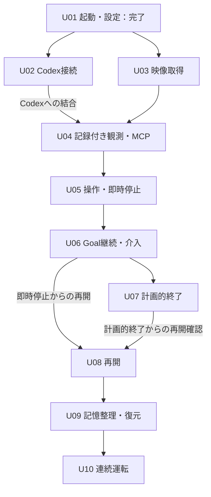

# 05-implementation.md — 実装計画・工程の依存関係

[文書一覧](README.md)

2026-11-11改訂。初期版の製品範囲は[01](01-overview.md)に従い、U01を基準点としてU02〜U10を進めます。U01は起動・グローバル設定・最小GUI・指示資材の配布まで完了しています。後続工程の親仕様を用意したことは、調査・設計・実装・接続検証の完了を意味しません。

この文書は工程の入口、依存関係、推奨順を所有します。各工程の調査項目、子工程の分割、受入条件はリンク先の親仕様、具体的なAPI・TDD・検証結果は着手時に作る子仕様へ置きます。文書の役割と移動規則は[06](06-repository.md)に従います。

## 1. 現在地と引き継げるもの

| 領域 | U01で実装・確認した範囲 | 後続へ持ち越す範囲 |
|---|---|---|
| 起動・GUI | 主画面、設定ダイアログ、状態・エラー表示、未保存確認、終了 | 映像・会話・計画・要求表示、ゲームの開始・停止・再開 |
| 設定 | 映像取得元・シリアルポート・モデル・エフォート・認証方式の保存と読込、コメント保持、失敗処理 | 機器識別・接続、モデルの有効性、認証・資格情報の保管 |
| 並行処理 | 設定I/O用QtワーカーとGUIへの通知・終了調整 | サービス用asyncioループ、Codex受信、映像・入力・MCPの寿命 |
| 指示と配布 | `play.md`の同梱、隔離環境での読込・起動 | 製品側の指示取得・配送、案内・整理指示、実ツールとの整合 |
| 保存 | アプリ共通のTOML設定 | プロジェクト、JSONL、観測画像、依頼・実行、記憶の退避・復元 |

実装と検証範囲の根拠は[U01の基準点](../complete/unit_001/APP_STARTUP.md)にまとめます。映像取得方式、シリアル通信仕様、Codex/MCP接続の成立性はU01では確認していません。将来画面の配置図は、部品の実装や操作設計の完成を意味しません。

U01で依存定義へ反映済みなのは、Python `>=3.12,<3.16`、`PySide6-Essentials==6.12.0`、`tomlkit==0.15.2`、GUI試験用`pytest-qt==4.5.0`等です。開発推奨はPython 3.13系、既存のローカル製品試験はWindows x64の3.12・3.13です。許容するPython版全体の実行確認を意味しません。詳細は[構成・依存選定](../complete/unit_002/ARCHITECTURE_AND_DEPENDENCIES.md)を参照します。

## 2. 開発方針

最初の接続上の到達点は、Codexが実画面を見て短い操作を行い、利用者が停止できることです。通常ターンで観測・操作を確認した後、Goalsによる継続、計画的終了、再開、記憶整理へ広げます。各段階は後続でも使う本実装とその試験として残します。

保存機能は記録元の振る舞いと一緒に設計・実装します。プレビューに保存機能を要求せず、モデルへ返す観測には同じ画像とIDの保存、実機入力には開始記録と停止処理を組み込みます。記憶の退避・復元は、利用者となる整理処理と同じU09で完成させます。保存コードの所有先は一貫して`storage`とし、工程ごとに保存方式を作り直しません。

全クラス・全イベント詳細・将来の設定項目を先に作りません。模擬機器と固定通知は試験資産として使い、製品経路に未実装の成功応答や偽の実機画像を置きません。使い捨てPoCからの増築を標準工程にせず、必要な接続調査の結果を本実装の契約と継続利用する試験へ引き継ぎます。

## 3. マイルストーンと着手条件

U番号は製品の到達点、`unit_XXX`は作業仕様の識別子です。一工程を一つの巨大な変更にせず、親仕様にある子工程をレビュー可能な単位で進めます。U02はM0へ着手し`spec/wip`、U03〜U10は未着手の`spec/planned`です。U02 M0では配布SDK 0.167.0の要求保留と受信が両立せず、直接接続への明示承認を受けM1を開始します。詳細は[調査子仕様](../complete/unit_016/CODEX_SDK_SELECTION.md)を参照します。

| 工程・親仕様 | 前提 | 冒頭で調査・設計すること | 工程の到達点 |
|---|---|---|---|
| [U02 Codex接続](../wip/unit_007/CODEX_CONNECTION.md) | U01の起動・設定・GUI | 採用版、公開要求経路、認証、受信所有者、サービス用ループ、起動・中断・終了 | 通常ターンを動かし、回答待ちでも受信と停止を塞がない |
| [U03 映像取得](../planned/unit_008/VIDEO_CAPTURE.md) | U01。U02完了は不要 | 取得APIと版、機器識別、FPS・解像度、フレーム共有、切断・終了 | 一つの取得元から実映像プレビューと連番・時刻付きフレームを供給する |
| [U04 記録付き観測](../planned/unit_009/RECORDED_OBSERVATION.md) | U03。Codex結合にはU02 | 観測確定、最小プロジェクト、ID・画像・追記記録の失敗、MCP公開方式 | 保存と同じ画像・IDを`observe`でCodexへ返す |
| [U05 入力と即時停止](../planned/unit_010/INPUT_AND_STOP.md) | U04、旧接続を失効できる方式 | 実機プロトコル、上限・送信期限、入力所有者、操作権、取消し・解除、開始記録 | 通常ターンから短い操作と事後観測を行い、GUIで即時停止する |
| [U06 Goalによる継続](../planned/unit_011/GOAL_EXECUTION.md) | U02・U05、Goalの公開経路 | Goalと依頼の対応、通知・配送競合、質問待ち・制限、記憶の入口 | 複数ターンの攻略、途中介入、完了時の入力閉鎖・未配送指示破棄 |
| [U07 計画的終了](../planned/unit_012/PLANNED_STOP.md) | U06 | Goal休止、旧処理の収束、同一スレッドの通常ターンへの移行と結果取得 | 元Goalを保持したプレイ終了処理と停止 |
| [U08 再開](../planned/unit_013/RESUME.md) | 即時停止後はU06、計画的終了後の確認はU07 | 必要な保存参照、同じGoal、新規スレッド、未完記録、現画面の受渡し | 停止・再起動後に明示操作で再開し、過去操作を再送しない |
| [U09 記憶整理](../planned/unit_014/MEMORY_MAINTENANCE.md) | U08までの開始・停止・読込 | 別スレッドの終了確認、退避・採用・復元、実行中の印、再起動 | 整理と排他、失敗時復元、未完整理を含む次回開始の制御 |
| [U10 連続運転](../planned/unit_015/CONTINUOUS_OPERATION.md) | U02〜U09の必要な受入条件 | 機器構成、利用場面、遅延・資源・記録量の測定と判定 | Windows実機で短い依頼から数時間の運転へ広げる |

### 依存関係と推奨順

推奨はU02の調査から開始し、表の順に進めます。U03はU02と独立して着手でき、U04の観測・保存部品もCodex接続前に検証できます。U08全体の受入にはU07との結合確認が必要ですが、即時停止後の再開を先に実装できます。並行可能であることは全工程への同時着手の指示ではありません。次に行う子作業を一つ選びます。

U04まではゲーム入力を提供しません。U05は有限の通常ターン、U06はGoalsによる継続までの到達点です。U06完了時点では依頼完了後の記憶整理をまだ提供せず、停止・次の依頼待ちまでを扱います。整理はU09で結合します。途中段階の完成を初期版全体の完成として扱いません。

## 4. 保存・画面・指示を追加する時期

| 最初の利用 | 保存・指示の追加 | 画面の具体化 |
|---|---|---|
| U02 通常ターン接続 | 同梱指示の製品側読込・配送を確認。接続試験の記録を残す | 接続・応答・中断・質問と承認の最小操作。汎用チャット製品を作らない |
| U03 プレビュー | プレビュー全フレームは保存しない | 映像選択、表示、切断・終了 |
| U04 観測 | 最小の`project.json`、保存場所の案内、画像と観測イベント | プロジェクト保存先の作成・選択と観測結果 |
| U05 入力 | 必要な依頼・実行・操作の識別、開始・完了・中断・失敗の記録 | 入力機器選択、短い依頼の開始、即時停止と解除未確認 |
| U06 継続 | Goal・スレッド参照、追加指示・応答・計画、`memory/current.md`等の入口 | 計画、継続状態、追加指示、回答待ち、利用制限 |
| U07・U08 終了と再開 | 終了処理結果、再開に必要な参照と未完状態の読込 | 計画的終了、既存・新規スレッドでの明示的再開 |
| U09 整理 | 整理指示、退避・復元、実行中の印と退避先 | 手動整理、整理・復元の状態と開始禁止理由 |

形式・イベント一覧の正本は[04](04-agent-memory.md)です。全イベントの詳細を先に固定せず、その記録元を実装する子仕様で具体化して04へ反映します。保存失敗時の原本保護は最初の保存実装から必要で、再開工程まで放置しません。原記録を無言で切り捨てず、未完操作を自動再実行しない契約も維持します。

同梱資材を追加・変更する工程では[07のT20](07-verification.md)を再確認します。U01の`play.md`配布成功を、将来の案内・整理指示の同梱や配送の根拠にはしません。GUIは各機能の工程で具体化し、説明文を置かない[01の方針](01-overview.md)を適用します。

## 5. 外部仕様と技術選定の確認期限

| 対象 | 現在の位置づけ | 調査・実行確認の期限 |
|---|---|---|
| `openai-codex`と対応ランタイム | 0.167.0を調査。要求保留中に受信停止するため製品には不採用 | 直接接続への方式変更を承認済み。通常ターン・要求応答・終了の実接続受入は未実施 |
| Goals、休止後の通常ターン、書込終了 | 固定コミットの調査あり。採用版で未検証 | U02で成立性を先行調査。Goal継続はU06、終了処理切替はU07、整理後の復元はU09の依存する実装へ進む前に必要経路を確認 |
| `opencv-python`、`numpy` | 初期選定。NyXの共有取得を参考にする | U03冒頭で採用版・取得方式・機器を選ぶ。列挙ライブラリは必要性を確認して追加 |
| `pyserial`と実デバイス | シリアル方式の方針。プロトコル・速度未選定 | U05で送信・解除と期限を確認してから実機入力を公開 |
| 公式Python MCP SDK | Streamable HTTPの方針。版・組込み方式未選定 | U04でサーバと画像応答を実接続。世代の更新・失効はU05の実機入力前 |
| 認証方式・モデル | U01は文字列保存のみ | U02でChatGPT認証を先行。APIキー経路はU02内の別作業またはU06までに確認。未確認方式を対応済みにしない |

[08](08-sdk-compatibility.md)の根拠と未確認事項を参照します。必要な公開経路が成立しなければ、その経路に依存する設計・実装を保留し、影響範囲と採用版・接続方式の変更判断を記録します。独立した映像等の作業は継続できます。非公開API差替え、二重受信、外側からの攻略自動再投入で不足を隠しません。

## 6. 仕様の状態と検証

未着手の親仕様は`spec/planned`、実際に調査・実装を始めた仕様は`spec/wip`、受入条件を満たした仕様は`spec/complete`へ置きます。既存仕様を複製せず、ディレクトリごと移動して参照を更新します。親仕様の先行執筆だけで工程を着手中・完了にしません。

各工程は冒頭の調査・設計で、採用版・所有・通知・失敗・取消し・終了・確認方法を決めます。具体的な子仕様とTDDは次に選ぶ作業に必要な範囲で作ります。調査・設計の判断済み、製品実装済み、接続・実機検証済みを区別し、該当する実行確認なしに工程の受入を通しません。機器がない場合も模擬境界での試験を進められますが、実機確認は未実施として残します。

品質コマンドと変更範囲による選択は[AGENTS.md](../../AGENTS.md)、製品の受入観点は[07](07-verification.md)を参照します。文書整備に無関係な製品テスト・型検査・ビルドを実行して文書品質の根拠にしません。新規外部依存の追加・配布資材の変更時は、その工程でlock・build・配布確認を行います。

## 7. 旧計画からの対応

この表の「旧」は2026-11-10の工程表です。以下以外の工程番号は改訂後の番号を使います。

| 旧工程 | 改訂後の担当 |
|---|---|
| U01 起動と設定 | U01。実装・検証の境界を基準点として整理 |
| U02 保存・記憶管理一式 | U04の観測保存、U05の操作記録、U06の依頼と記憶参照、U08の再開読込、U09の退避・復元 |
| U03 映像取得と保存接続 | U03の取得・表示、U04の観測保存 |
| U04 入力列と停止 | U05 |
| U05 ゲームMCP | U04の`observe`、U05の`act_and_observe` |
| U06 Codex接続 | U02の最小接続、U04の画像、U06〜U09で利用する公開機能 |
| U07 実行管理と画面の結合 | 各機能の工程で結合。継続はU06、計画的終了はU07 |
| U08 再開と記憶整理 | U08の再開、U09の整理・復元 |
| U09 Windows連続運転 | U10。個々の機器・ランタイム確認は各工程で実施 |
