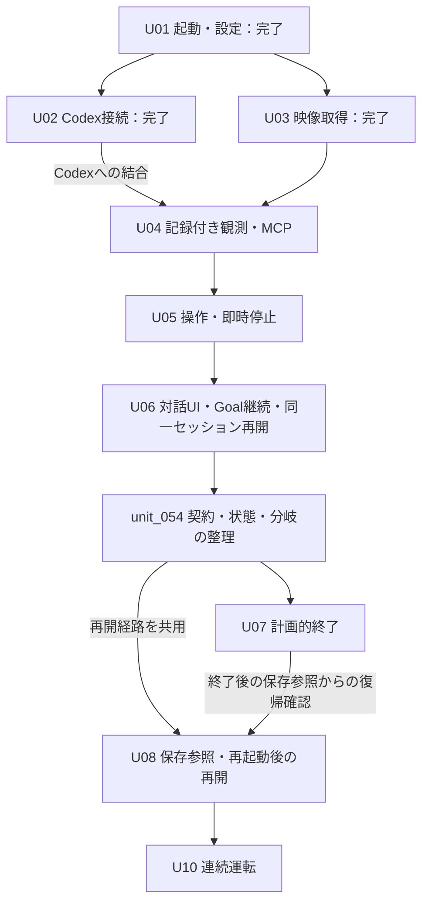

# 05-implementation.md — 実装計画・工程の依存関係

[文書一覧](README.md)

2026-11-13改訂。初期版の製品範囲は[01](01-overview.md)に従い、U01を基準点としてU02〜U08・U10を進めます。U01〜U06は実装と対象構成の受入を完了しました。U06の実接続受入と残る制約は[M3](../complete/unit_050/GOAL_ACCEPTANCE.md)へ記録しています。APIキー認証は対象外です。対象機器はUSB Video DeviceとCOM8・CH552・9600 baudに限定し、他機器・長時間運転の未検証範囲を親仕様へ残します。後続工程の親仕様を用意したことは、その工程の調査・設計・実装・接続検証の完了を意味しません。

この文書は工程の入口、依存関係、推奨順を所有します。各工程の調査項目、子工程の分割、受入条件はリンク先の親仕様、具体的なAPI・TDD・検証結果は着手時に作る子仕様へ置きます。文書の役割と移動規則は[06](06-repository.md)に従います。

2026-11-13に[契約・状態・分岐の整理](../wip/unit_054/KISS_SIMPLIFICATION.md)のM0方針を承認し、関連正本へ反映しました。M1の接続・停止・表示・サービス整理と責務分離を実装し、必要な受入を完了しました。M2の保存・入力の縮小も採用設計ですが、製品実装は未着手です。単なるファイル分割で完了とせず、残す契約・削除する状態・改訂する試験を対応付けます。U09は初期版から外し、U10の必須依存にしません。M1の改訂後の製品・実接続受入はunit_054へ記録し、過去のU06受入と区別します。

2026-11-11の実装棚卸しを受けた[実装整理](../complete/unit_027/IMPLEMENTATION_SIMPLIFICATION.md)と[M1](../complete/unit_028/SETTINGS_DEVICE_SIMPLIFICATION.md)・[M2](../complete/unit_029/DISPLAY_AND_REMAINDER_SIMPLIFICATION.md)は完了しました。続くUI/UX議論の合意を[10-ui-interaction.md](10-ui-interaction.md)へまとめ、共通入力・公開表示・Goal操作をU06、追加指示による計画的終了をU07へ反映しました。APIの未確認事項は[08](08-sdk-compatibility.md#ui-api-open)へ分離しています。この時点の親仕様の先行更新は工程への着手を意味しません。現在の進捗は第3節と各親仕様に従います。

## 1. 現在地と引き継げるもの

| 領域 | U01で実装・確認した範囲 | 後続へ持ち越す範囲 |
|---|---|---|
| 起動・GUI | 主画面、設定ダイアログ、状態・エラー表示、未保存確認、終了 | 映像・会話・計画・要求表示、ゲームの開始・停止・再開 |
| 設定 | 映像取得元・シリアルポート・モデル・エフォート・認証方式の保存と読込、コメント保持、失敗処理 | 機器識別・接続、モデルの有効性、認証・資格情報の保管 |
| 並行処理 | 設定I/O用QtワーカーとGUIへの通知・終了調整 | サービス用asyncioループ、Codex受信、映像・入力・MCPの寿命 |
| 指示と配布 | `play.md`の同梱、隔離環境での読込・起動 | 製品側の指示取得・配送、案内指示、実ツールとの整合 |
| 保存 | アプリ共通のTOML設定 | プロジェクト、JSONL、観測画像、依頼・実行、通常のmemory入口 |

実装と検証範囲の根拠は[U01の基準点](../complete/unit_001/APP_STARTUP.md)にまとめます。映像取得方式、シリアル通信仕様、Codex/MCP接続の成立性はU01では確認していません。将来画面の配置図は、部品の実装や操作設計の完成を意味しません。

U01で依存定義へ反映済みなのは、Python `>=3.12,<3.16`、`PySide6-Essentials==6.12.0`、`tomlkit==0.15.2`、GUI試験用`pytest-qt==4.5.0`等です。開発推奨はPython 3.13系、既存のローカル製品試験はWindows x64の3.12・3.13です。許容するPython版全体の実行確認を意味しません。詳細は[構成・依存選定](../complete/unit_002/ARCHITECTURE_AND_DEPENDENCIES.md)を参照します。

U03では[取得サービス](../complete/unit_021/VIDEO_CAPTURE_SERVICE.md)と[プレビュー結合](../complete/unit_022/VIDEO_PREVIEW.md)を実装しました。Live Gamer 4K 2.1で1920×1080・要求60 FPSの実映像取得、切断・再接続、表示中のアプリ終了を確認し、正常解放と子プロセスが残らないことを受入結果に記録しています。物理抜去と入力から表示までの光学的な遅延は未検証です。U04へは変更不能な最新画像、接続世代・連番・取得時刻・停止状態を引き継ぎ、保存やMCP接続が完成したとは扱いません。

## 2. 開発方針

最初の接続上の到達点は、Codexが実画面を見て短い操作を行い、利用者が停止できることです。通常ターンで観測・操作を確認した後、共通対話UI、Goalsによる継続と同一セッション再開、計画的終了、保存参照からの復帰へ広げます。各段階は後続でも使う本実装とその試験として残します。

保存機能は記録元の振る舞いと一緒に設計・実装します。プレビューに保存機能を要求せず、モデルへ返す観測には同じ画像とIDの保存、実機入力には開始記録と停止処理を組み込みます。専用の記憶整理・退避・復元は初期版に追加しません。保存コードの所有先は一貫して`storage`とし、工程ごとに保存方式を作り直しません。

全クラス・全イベント詳細・将来の設定項目を先に作りません。模擬機器と固定通知は試験資産として使い、製品経路に未実装の成功応答や偽の実機画像を置きません。使い捨てPoCからの増築を標準工程にせず、必要な接続調査の結果を本実装の契約と継続利用する試験へ引き継ぎます。

## 3. マイルストーンと着手条件

U番号は製品の到達点、`unit_XXX`は作業仕様の識別子です。一工程を一つの巨大な変更にせず、親仕様にある子工程をレビュー可能な単位で進めます。U01〜U06は`spec/complete`、U07〜U10は未着手の`spec/planned`です。固定runtime 0.167.0の公開app-serverへ直接接続します。接続方式の根拠は[調査子仕様](../complete/unit_016/CODEX_SDK_SELECTION.md)、現在の実接続確認範囲は[08](08-sdk-compatibility.md)を参照します。

| 工程・親仕様 | 前提 | 冒頭で調査・設計すること | 工程の到達点 |
|---|---|---|---|
| [U02 Codex接続](../complete/unit_007/CODEX_CONNECTION.md) | U01の起動・設定・GUI | 採用版、公開要求経路、認証、受信所有者、サービス用ループ、起動・中断・終了 | 通常ターンを動かし、回答待ちでも受信と停止を塞がない |
| [U03 映像取得](../complete/unit_008/VIDEO_CAPTURE.md) | U01。U02完了は不要 | 取得APIと版、機器識別、FPS・解像度、フレーム共有、切断・終了 | 一つの取得元から実映像プレビューと連番・時刻付きフレームを供給する |
| [U04 記録付き観測](../complete/unit_009/RECORDED_OBSERVATION.md) | U03。Codex結合にはU02 | 観測確定、最小プロジェクト、ID・画像・追記記録の失敗、MCP公開方式 | 保存と同じ画像・IDを`observe`でCodexへ返す |
| [U05 入力と即時停止](../complete/unit_010/INPUT_AND_STOP.md) | U04、旧接続を失効できる方式 | 実機プロトコル、有限列・通信条件、入力所有者、操作権、取消し・解除、開始記録 | 通常ターンから有限の操作列と事後観測を扱い、GUIで即時停止する |
| [U06 Goalによる継続](../complete/unit_011/GOAL_EXECUTION.md) | U02・U05、Goalの公開経路 | M0〜M3完了。新規認証・実行準備、実IME、通常/自律次turn設定、入力/書込/設定の同時停止、本人手動後の再開と旧権限回収を実接続確認 | 複数ターンの攻略、通常入力と要求応答、pause／同一セッション再開／stop、Goal完了時の入力閉鎖と自然最終応答 |
| [U07 計画的終了](../planned/unit_012/PLANNED_STOP.md) | U06 | 共通の追加指示・公開通知・休止で区切り作業と結果を確認する。UI-A6と必要な指示資材・記録の差分 | 元Goalを保持した終了作業、pause／stop割込み、U06の再開との結合。専用制御の追加は要求しない |
| [U08 保存参照・再起動後の再開](../planned/unit_013/RESUME.md) | U06の同一セッション再開。計画的終了後の復帰確認はU07 | 保存参照の読込、アプリ・接続の再起動、同じGoalまたは新規スレッドへの再構成 | 共通の再開経路へ復帰の前処理を接続し、破棄Goalや過去操作を復活させない |
| [U09 記憶整理](../planned/unit_014/MEMORY_MAINTENANCE.md) | 初期版対象外。実需と再採用の明示判断 | 必要になった時点で明示生成だけの方式から再設計 | 未着手の候補として保持。初期版の受入条件には含めない |
| [U10 連続運転](../planned/unit_015/CONTINUOUS_OPERATION.md) | U02〜U08と契約整理の必要な受入条件 | 機器構成、利用場面、遅延・資源・記録量の測定と判定 | Windows実機で短い依頼から数時間の運転へ広げる |

### 依存関係と推奨順

実装・受入の根拠と未検証範囲は各親子仕様へ集約します。同一セッションの保持Goal再開はU06、保存参照からの復帰はU08が所有します。U08全体の受入にはU07の終了結果との結合確認も必要です。依存条件を満たす子作業を一つ選び、未着手の工程へ同時に着手しません。

U04まではゲーム入力を提供しません。U05は有限の通常ターン、U06は共通対話UI、Goalsによる継続と同一セッション再開までの到達点です。依頼完了後は停止・次の依頼待ちまでを扱い、自動記憶整理を結合する計画は撤回しました。U09はplannedのまま初期版対象外です。途中段階の完成を初期版全体の完成として扱いません。

## 4. 保存・画面・指示を追加する時期

| 最初の利用 | 保存・指示の追加 | 画面の具体化 |
|---|---|---|
| U02 通常ターン接続 | 同梱指示の製品側読込・配送を確認。接続試験の記録を残す | 接続・応答・中断・質問と承認の最小操作。汎用チャット製品を作らない |
| U03 プレビュー | プレビュー全フレームは保存しない | 映像選択、表示、切断・終了 |
| U04 観測 | 最小の`project.json`、既存指示経路での保存場所案内、画像と観測イベント | プロジェクト保存先の作成・選択。観測専用表示は追加しない |
| U05 入力 | 必要な依頼・実行・操作の識別、開始・完了・中断・失敗の記録 | 入力機器選択、短い依頼の開始、即時停止と解除未確認 |
| U06 継続 | Goal・スレッド参照、追加指示・応答・公開計画、`memory/current.md`等の入口 | 10のGoal・Plan・History・Message、目標トグル、reasoning設定、activity、pause／再開／stop、認証と独立した次ターン設定 |
| U07・U08 終了と再開 | 追加指示による終了結果、保持したGoalの参照と未完状態の読込 | 共通Messageによる計画的終了、保持したGoalの保存参照からの復帰。破棄Goalの自動復活はしない |

形式・イベント一覧の正本は[04](04-agent-memory.md)です。全イベントの詳細を先に固定せず、その記録元を実装する子仕様で具体化して04へ反映します。保存失敗時の原本保護は最初の保存実装から必要で、再開工程まで放置しません。原記録を無言で切り捨てず、未完操作を自動再実行しない契約も維持します。

U06のUI変更はM0のAPI確認直後のM1に独立した子工程として置きます。Goal制御を旧UIへ実装してから画面を作り直す順序にせず、U04・U05の前提も増やしません。

この表は機能を提供する工程の分担です。unit_027へ全体UI変更を遡及して追加しません。10の合意と08のUI-A1〜A5はU06 M0で具体化し、M1〜M3で製品結合と受入を確認しました。公開summaryの提供範囲などの制約は[08](08-sdk-compatibility.md#ui-api-open)へ残します。U07 M0では追加指示で終了する経路とpause／stopの割込みを確定します。担当工程のGUI実装前に公開経路とPySide6の表示を確認し、未着手の子仕様は一括生成しません。

同梱資材を追加・変更する工程では[07のT20](07-verification.md)を再確認します。U01の`play.md`配布成功を、後から追加する資材の同梱や配送の根拠にはしません。GUIは各機能の工程で具体化し、説明文を置かない[01の方針](01-overview.md)を適用します。

## 5. 外部仕様と技術選定の確認期限

| 対象 | 現在の位置づけ | 調査・実行確認の期限 |
|---|---|---|
| `openai-codex`と対応ランタイム | SDK 0.167.0は要求保留中に受信停止するため不採用。製品はruntime 0.167.0への公開直接接続 | U02で方式変更を承認され、通常ターン・要求応答・終了を実接続確認済み。Goal・機器連携は各担当工程で確認 |
| Goals、追加指示による終了、書込終了 | U06でGoal操作・自律継続・同thread再開、公開端末回収によるmemory書込停止、自然最終応答を製品確認。公開一覧外の背景子孫の全終了は保証しない | 回収順序の改訂はunit_054 M1で検証済み。共通経路による計画的終了はU07、保存参照からの復帰はU08で確認 |
| `opencv-python-headless`、`numpy`、`cv2-enumerate-cameras` | U03で4.14.0.94・2.5.4・1.4.0を採用。NyXの共有取得を参考にし、DirectShowを子プロセスへ隔離 | [U03 M0](../complete/unit_020/VIDEO_CAPTURE_DESIGN.md)に資料・採用理由・プローブ記録、[U03親仕様](../complete/unit_008/VIDEO_CAPTURE.md)に製品の実機受入と未検証範囲を記録 |
| `pyserial`と実デバイス | pySerial 3.5、CH552/PokeCon/3DS S2/T3の設定・変換・有限列・停止を実装。U05 M2でCH552・9600 baudを実モデルとGUIへ結合確認 | 実機受入はCOM8とUSB Video Deviceの構成に限定。PokeCon/3DS、他OS、通信断と長時間運転は未検証としてU10へ引き継ぐ |
| 公式Python MCP SDK | 2.3.0を既存ループへ組込み。U04で画像配送・保存、U05でrun固定の入力と次送信での同thread公開更新を確認 | 同期MCPの期限を300秒に設定。採用runtimeで65秒操作と短縮期限時の停止を確認。300秒実待ちと長時間連続はU10の未検証範囲 |
| 認証方式・モデル | M3で資格情報を複製しない新規homeの本人ログインと実利用枠取得を確認。無効保存値でもログイン/選び直しを妨げない | APIキーはU06対象外。利用不能時の停止は固定試験で確認し、意図的な課金超過を起こさない。未確認方式を対応済みにしない |
| 認証・接続と実行設定の分離 | 通常の次turn/start、自律のthread/settings/updateへ選択を反映し現在turnは不変。実行準備は認証と独立した明示操作 | M3で両設定経路の実モデル反映、新規homeの準備後再接続readyを確認。別home/環境の準備済みや全モデル対応を保証しない |

[08](08-sdk-compatibility.md)の根拠と未確認事項を参照します。必要な公開経路が成立しなければ、その経路に依存する設計・実装を保留し、影響範囲と採用版・接続方式の変更判断を記録します。独立した映像等の作業は継続できます。非公開API差替え、二重受信、外側からの攻略自動再投入で不足を隠しません。

設定障害時の中断・切断は[U05](../complete/unit_010/INPUT_AND_STOP.md)までに確認済みです。後続で扱う修正候補は[開発ジャーナル](../dev-journal.md)と各親仕様を参照し、該当画面を拡張する前に確認します。

## 6. 仕様の状態と検証

未着手の親仕様は`spec/planned`、実際に調査・実装を始めた仕様は`spec/wip`、受入条件を満たした仕様は`spec/complete`へ置きます。既存仕様を複製せず、ディレクトリごと移動して参照を更新します。親仕様の先行執筆だけで工程を着手中・完了にしません。

各工程は冒頭の調査・設計で、採用版・所有・通知・失敗・取消し・終了・確認方法を決めます。具体的な子仕様とTDDは次に選ぶ作業に必要な範囲で作ります。調査・設計の判断済み、製品実装済み、接続・実機検証済みを区別し、該当する実行確認なしに工程の受入を通しません。機器がない場合も模擬境界での試験を進められますが、実機確認は未実施として残します。

品質コマンドと変更範囲による選択は[AGENTS.md](../../AGENTS.md)、製品の受入観点は[07](07-verification.md)を参照します。文書整備に無関係な製品テスト・型検査・ビルドを実行して文書品質の根拠にしません。新規外部依存の追加・配布資材の変更時は、その工程でlock・build・配布確認を行います。

## 7. 旧計画からの対応

この表の「旧」は2026-11-10の工程表で、対応先は2026-11-11の再編時点です。その後U09は初期版対象外へ変更しました。現在の工程範囲は第3節を使います。

| 旧工程 | 改訂後の担当 |
|---|---|
| U01 起動と設定 | U01。実装・検証の境界を基準点として整理 |
| U02 保存・記憶管理一式 | U04の観測保存、U05の操作記録、U06の依頼と記憶参照、U08の再開読込、U09の退避・復元 |
| U03 映像取得と保存接続 | U03の取得・表示、U04の観測保存 |
| U04 入力列と停止 | U05 |
| U05 ゲームMCP | U04の`observe`、U05の`act_and_observe` |
| U06 Codex接続 | U02の最小接続、U04の画像、U06〜U09で利用する公開機能 |
| U07 実行管理と画面の結合 | 各機能の工程で結合。継続はU06、計画的終了はU07 |
| U08 再開と記憶整理 | U08の再開、U09の整理・復元 |
| U09 Windows連続運転 | U10。個々の機器・ランタイム確認は各工程で実施 |

現在の実装・検証範囲は第3節と各親仕様を正本とします。旧計画の番号や過去の工程状態を、現在の未着手範囲へ読み替えません。

通常turnの選択UIと設定境界の最終修正は[unit_048](../complete/unit_048/NEXT_TURN_MODEL.md)を参照。
