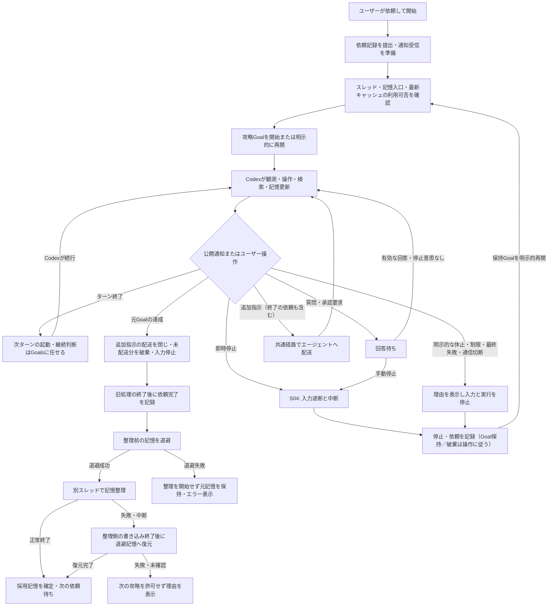
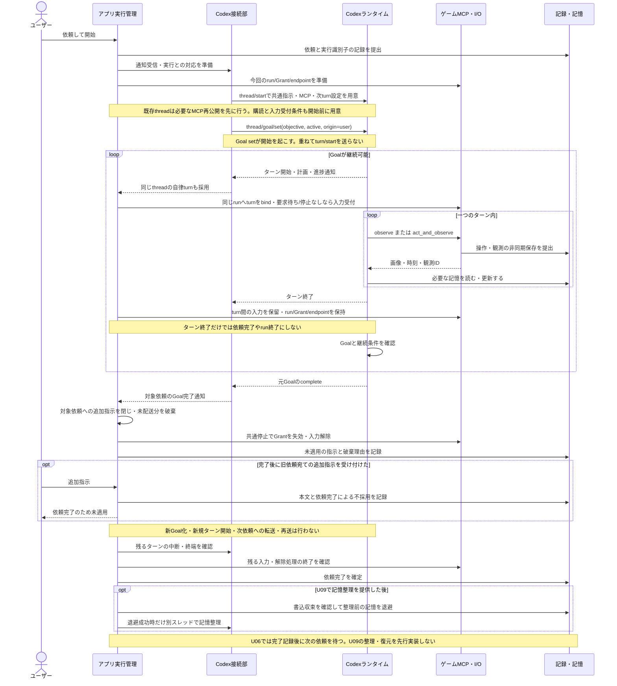
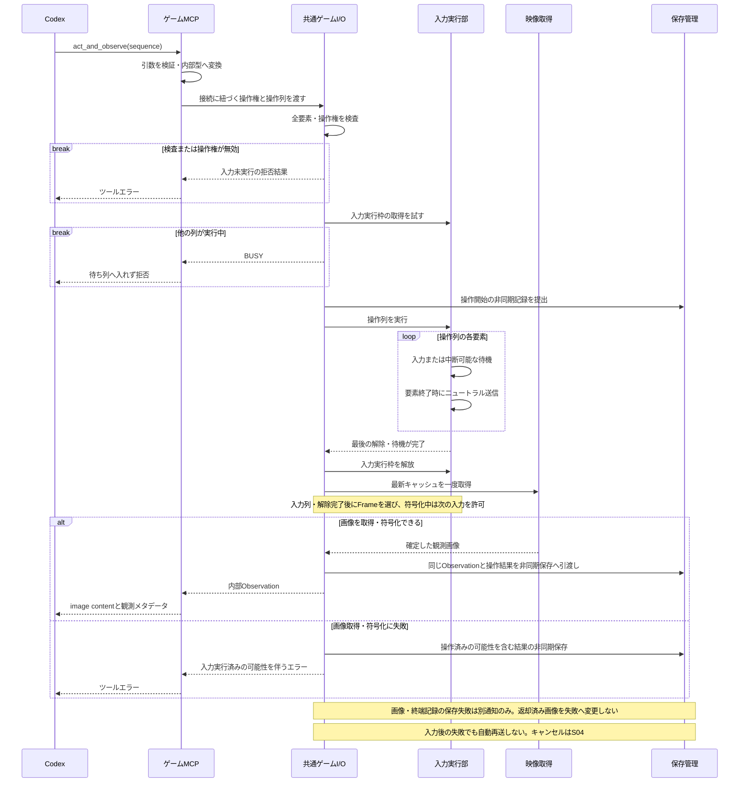
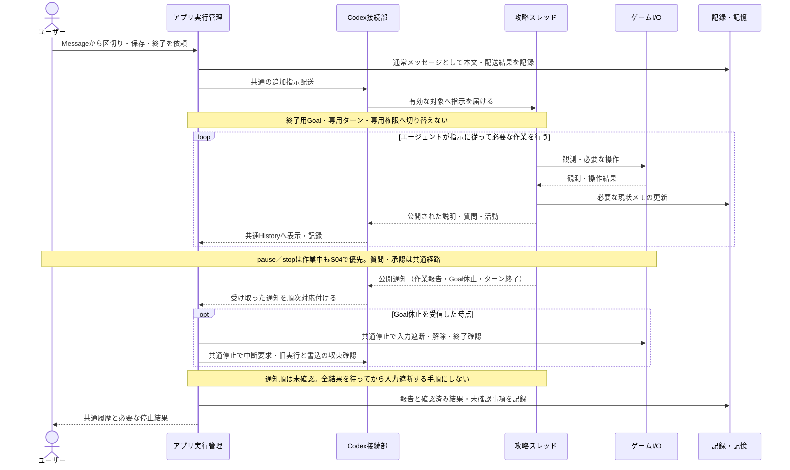
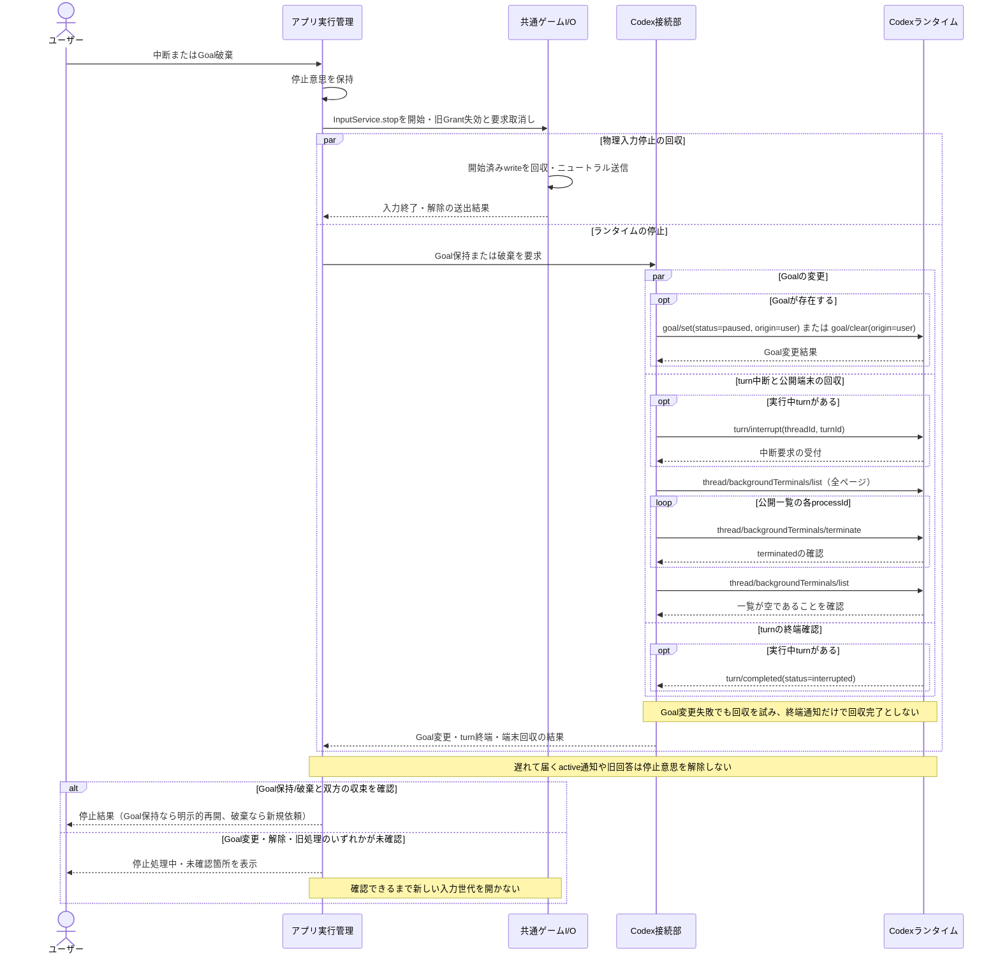
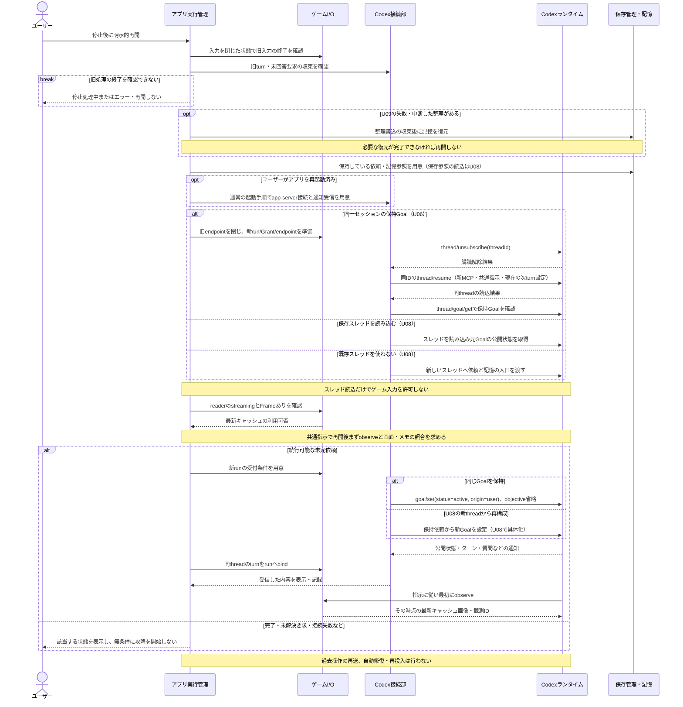
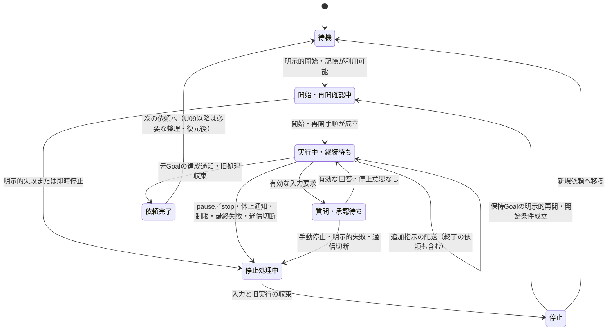
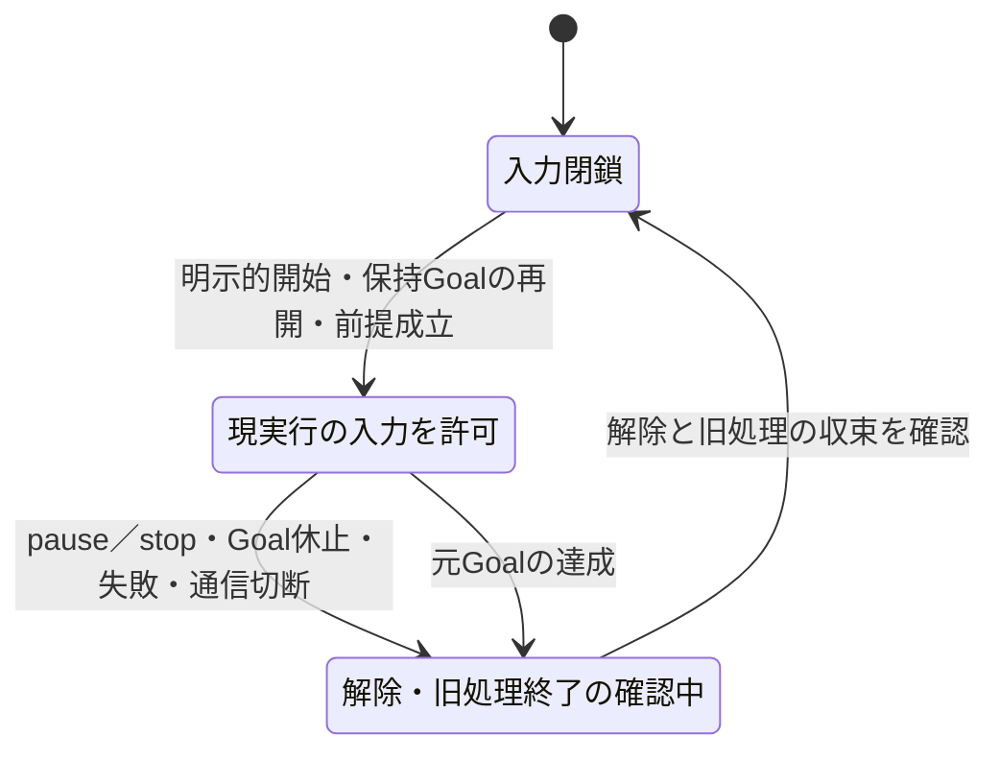

# 09-control-flows.md — Goal中心の処理フロー・停止・再開

[文書一覧](README.md) · [実行管理](02-runtime.md) · [SDK調査](08-sdk-compatibility.md)

処理フローの初版は2026-11-10、U06受入による改訂は2026-11-13です。本書はGoalを中心とした攻略、計画的終了、即時停止、明示的再開、記憶整理について、複数部品にまたがる処理順序を示します。図は編集可能なMermaidです。[U06 M0](../complete/unit_044/GOAL_INTERACTION_DESIGN.md)では採用0.167.0の実モデルでGoal操作と設定変更、実runtime・模擬モデル/機器で自律turnの操作権とMCP再公開を確認しました。製品のGoal結合はM2、対象構成の実モデル・実機受入は[M3](../complete/unit_050/GOAL_ACCEPTANCE.md)で確認しました。S03の計画終了はU07、再起動後復旧はU08、記憶整理はU09の未実施範囲です。

## 読み方と設計上の区分

攻略Goalを主軸に継続し、即時入力遮断はモデルの応答を待ちません。[10のUI合意](10-ui-interaction.md)に従い、入力枠の「中断」でGoalを保持して一時停止し、目標欄の「破棄」でGoalを継続対象から外します。どちらも推論中断と操作停止を直ちに要求します。以下の図のpause／stopは、この保持／破棄の違いを表します。Goalなしでは「中断」で通常turnを止めます。計画的終了はMessageからの追加指示に従う区切り作業の経路です。S03は共通の追加指示・公開通知・停止を使い、終了専用ターン・権限・アプリ状態を設けません。成立性はU07 M0で確認します。

呼称は**プレイ終了処理**とします。ゲーム内で区切りを付ける、必要ならセーブする、現状メモを更新する、といった作業です。これはエージェントが指示に従って行う作業の呼称であり、アプリの専用実行モードではありません。アプリのプロセス終了・デバイスの解放とは別で、元の攻略依頼の達成も意味しません。

攻略の継続・再試行・休止・完了はCodexの判断と公開状態に従います。アプリは通知を受けて表示・記録・要求の受け渡しを行い、実行中の状態整合性検査、無通知からの停滞推定、自動修復、自動再投入は行いません。明示的な失敗・通信切断では入力を停止し、ユーザーの明示的再開を待ちます。独立した復帰操作は設けません。

## 図の索引

| 図 | 抽象度・種類 | 読み取る内容 |
| --- | --- | --- |
| F01 | 全体・処理フロー | ユーザー依頼、Goal、介入、完了、記憶整理の関係 |
| S01 | 通常系・シーケンス | 開始、ターン内のツール利用、ターン間継続、自然完了 |
| S02 | 入出力・シーケンス | 操作列、解除、事後観測、保存、応答の順序 |
| S03 | 計画的終了・シーケンス | 共通の追加指示で区切り作業を依頼し、休止・結果・収束を確認する |
| S04 | 即時停止・シーケンス | 入力遮断の優先順位と旧処理の終了確認 |
| S05 | 再開・シーケンス | ユーザーの明示的再開、アプリ再起動後の読込、コールドスタート |
| M01 | 操作可否の分類 | 公開通知とユーザー操作に従う受付条件。常設ラベルの要求ではない |
| M02 | 入力制御の状態遷移 | 共通の操作許可、世代更新、停止処理 |

図中のメソッド名は公開プロトコル上の意味を示す例であり、製品APIの確定した呼び出しコードではありません。U02のユーザー承認に基づき公開app-serverプロトコルの単一stdio接続で通信を管理します。非公開APIや二重受信で不足を補いません。開始・明示的再開・計画的終了の状態取得と応答確認は操作手順の一部であり、実行中の診断・補正ループではありません。

図は初期版全体の契約を表し、前半工程の完了条件へ全分岐を一括で課すものではありません。U02は通常ターンの接続、U03は映像、U04は記録付き観測、U05は有限の操作列と停止を作り、U06でGoal継続・同一セッション再開、U07で終了作業の結合、U08で保存参照・再起動後の復帰、U09で整理・復元を結合します。F01・S01・M01の記憶整理への遷移はU09まで未提供であり、それ以前の依頼完了後は入力を閉じて次の依頼を待ちます。

## F01 — 依頼の全体フロー

アプリのイベント処理は常時動きますが、攻略を毎ターン再投入するループではありません。次のターンが始まらず、失敗の通知もない場合は、最後に受け取った状態と時刻の記録を維持し、10に従って表示します。原因の診断、定期的な状態照合、時間経過だけによる停止や再起動は行いません。

## S01 — 開始・通常攻略・自然完了

ループを抜ける理由はcompleteだけではありません。pause、blocked、利用制限、エラー、ユーザー要求は別の分岐へ移ります。二つのループ枠は反復の担当を表し、アプリがその回数を決める意味ではありません。自律turnごとにrun/Grantを新設せず、継続区間を保持します。turn間の追加指示は下書きのまま利用者が次turnで送信し、配送キューや自動再送を作りません。既にランタイムへ送信した指示を遡って取り消せるとはせず、受付不明なら未確認と記録します。詳細は[02の追加指示の扱い](02-runtime.md)に従います。対話と観測の非同期保存完了を次の操作条件にはせず、ターン終端から外部コマンドの全書込終了を推定しません。

## S02 — 操作列と事後観測

以下は[U05 M0](../complete/unit_036/INPUT_AND_STOP_DESIGN.md)を[最新キャッシュ観測](../complete/unit_040/LATEST_CACHE_OBSERVATION.md)と[M2の製品結合](../complete/unit_042/INPUT_APPLICATION_INTEGRATION.md)で具体化した流れです。物理入力前の開始行も非同期投入し、操作結果と同じObservationの画像はU04の非同期保存へ渡します。通常turnの製品・実機確認と、U06のGoal結合は別に扱います。

途中キャンセルはS04の経路で入力実行部へ届きます。画像・終端記録の保存失敗でも入力を止めず、既済みの観測や操作結果を遡って変更しません。単独observeは入力Grantと独立に使えます。開始記録・画像・結果は同じwriterへの記録を順序化しますが、停止と解除は保存の完了を待ちません。開始済み保存は通常終了時にdrainします。

## S03 — 追加指示による計画的終了

以下は採用する操作要求の流れです。エージェントによる終了作業・Goal休止と結果通知の成立は未検証で、U07 M0の確認対象です。アプリはメッセージ本文を終了要求へ分類せず、普通の追加指示と同じように配送します。

Goal休止の受付、ターン終了、入力解除、ファイル書込の収束を同一視しません。作業報告は公開応答として残し、アプリが本文の『完了』から攻略達成・セーブ成功を確定しません。元Goalの目的・参照を保持し、明示的な達成通知があればそれを別に記録します。失敗・中断後は自動復帰せず、同一セッションならU06の明示的再開を使います。

既存の配送・通知・停止で成立しなければ、制約と必要な設計差分を08へ記録して方式を見直します。旧専用ターン切替や終了専用の結果スキーマを既定の代替にはしません。

## S04 — 即時停止と再開を許可するまで

この図はPythonプロセスが生存して停止通知を処理できる場合の契約です。PC異常終了時のMCUの解除保証は別です。ランタイムの中断応答を待ってから入力を止める順序にはしません。停止中に新しい自律turn開始が届いても中断対象にし、入力を許可しません。停止しても提出済みの入力設定適用は継続し、適用成功だけで再開しません。

pause／clearの受付だけで進行中推論・ツール・書込が終わったとは扱いません。Goal破棄は履歴や記憶の削除ではなく、旧目的を継続対象から外す操作です。破棄GoalはS05の再開対象から外します。M01の再開矢印はGoalを保持した停止に限り、全状況を表す巨大な状態列挙を追加しません。

M2ではturn中断後に残る同期`exec_command`を公開端末の一覧・終了APIで回収し、S04の停止後とS05の同Goal再開後にmemory書込が変わらないことを確認しました。[02の停止境界](02-runtime.md#停止の順序)に従い、回収中・未確認失敗は再開させません。公開一覧外の背景子孫や外部書込までの終了保証とは区別します。

## Codexの公開状態に従う制御

Codexを実行状態の正本とし、アプリは受け取った通知を表示・記録します。Goalがactiveでも操作や通知がないことを異常と推定せず、Codexの継続判断を待ちます。通知が欠けた場合に表示が古いまま残ることや、Codexが自力で解消できない停滞にユーザーの停止・再開が必要となる制約を受け入れます。

アプリに残すのは、要求と通知の受け渡し、表示と記録、明示的な停止・再開、実機入力と保存処理の管理です。実行状態を定期取得して整合させる処理、停滞検知、通知から失われた状態を再構築する処理、自動再接続・自動再起動による攻略復帰は追加しません。

| 受け取った通知・操作 | アプリの扱い |
| --- | --- |
| ターン・計画・進捗の通知 | 状態と時刻を記録し、10の公開計画・履歴へ対応付けます。常設状態ラベルを増やしません |
| Codexが内部再試行中 | 再試行中と表示して待ちます。別のターンや操作列を再送しません |
| 質問・承認要求 | 要求IDに対応する回答を待ちます。停止後の古い回答では続行しません |
| 元Goalのcomplete | 入力を閉じ、旧処理の終了後に依頼完了を記録します |
| pause・blocked・制限、最終失敗、通信切断 | 理由を記録し共通の停止処理へ進みます。必要な理由を表示し、明示的再開を待ちます。終了専用のpause例外は作りません |
| 新しい通知がない | 最後に受け取った状態を維持します。沈黙を契機に診断・状態修復・再投入をしません |

開始・明示的再開・プレイ終了処理に必要な状態取得、応答と要求の対応付け、旧実行の終了確認は、それぞれの操作手順として残します。これらを実行中の健康監視へ拡張しません。即時停止、旧世代の要求拒否、デバイス切断・保存失敗への対処も、アプリ自身の責務として維持します。

## S05 — ユーザーの明示的な再開

U06では同じapp-server接続・thread・保持Goalを使います。失効した操作権を再利用せず、新run/endpointの設定を `thread/unsubscribe` → 同IDの `thread/resume` で読み込ませます。loaded状態のresumeだけではMCP設定が更新されないU05の確認結果を引き継ぎます。U08は保存参照の読込・接続再起動・スレッド再構成、U09は必要な記憶復元を前処理として追加します。

これは既存の明示的再開の手順です。独立した復帰操作や、自動的にランタイムを再構築する機構ではありません。U06の同thread読込に失敗したら再開せず、別threadへ自動置換しません。保存参照や新threadからの再構成はU08で設計・検証します。現在画面と記憶の照合はCodexの攻略再開作業であり、アプリによるランタイム状態の整合性修復ではありません。

同じGoalの明示的再開には、目的文を送らない`thread/goal/set(status=active, origin=user)`を使います。目的・予算・累積利用量を保ち、APIの受付と実際のターン開始は受け取った通知どおりに扱います。新threadから再構成するU08ではGoalがないため、依頼から新規設定する別の分岐が必要です。開始が起きなくてもアプリから繰り返し再設定しません。

`goal/set`に画像入力欄はありません。再開時の画像はMCPのobserveで渡し、保存済み画像の完成、新しいFrameの到着、余分な準備turnを待ちません。図の「最初にobserve」はモデルへの指示であり、APIがその順序を強制する保証ではありません。M2は固定Responsesによる製品結合、M3は本人の手動移動後に再開し、実モデルの最初のツールが新MCPのobserveで現在画面を返すところまで確認しました。この再開試験ではモデルによる追加のゲーム入力は行っていません。

一回のユーザー操作に対して再開要求を重複送信しません。通信失敗などで結果を確認できなければ成功扱いにせず、入力を閉じて停止・エラーを表示します。過去の入力を再送したり、課金先・モデル・予算を自動変更したりしません。

## M01 — 公開通知とユーザー操作による操作可否

これは画面ラベルや独立した攻略状態機械の定義ではありません。終了を求める追加指示も実行中の通常配送で扱い、終了専用の移行・待機状態を設けません。停止後の再開は保持Goalに限ります。

Goal、ターン、要求、入力許可と配送結果はそれぞれの事実として扱い、全組合せを巨大な列挙型へ展開しません。古いactive通知や回答で停止意思を解除せず、状態取得による修復ループを設けません。状態・時刻は記録し、常設表示は10に従います。記憶整理・復元の開始条件は[04](04-agent-memory.md)を正本とし、U09より前には未実装の整理状態を追加しません。

## M02 — 共通の入力許可と停止

攻略中と終了を求められた作業で同じ操作許可を使います。停止後に新しい世代を許可する前に、旧入力の解除・終了と旧実行の収束を確認します。終了専用の権限や世代は発行しません。

操作許可はGoalがactiveであることだけから計算しません。U05の通常ターンにも共通の停止を使い、古いactive通知で旧世代へ許可を戻しません。質問・承認待ちとturn間は既存の入力保留を使い、専用の再開経路や入力世代を追加しません。MCPと同一run/Grantの複数turnはU06 M0で限定確認済みであり、M2で製品の配線・停止競合を固定RPC/模擬機器と実runtimeで確認しました。M3では実入力の途中停止、本人手動後の再開・現在画面の観測、旧Grant拒否と旧MCP終了を確認しました。機器ACKや瞬間の物理解除は未観測であり、詳細な根拠と制約はM3子仕様へ記録しています。

## 本実装で確認する接続条件

| 対象 | 採用した設計 | 採用版・実装で確認すること |
| --- | --- | --- |
| プレイ終了処理の経路 | 共通の追加指示をエージェントへ届け、元Goalを保持する | 終了作業・公開結果・休止と収束。未成立なら設計差分を判断し、専用経路を自動追加しない |
| プレイ終了処理の結果 | ターンの結果と機器処理の終了を分ける | 公開された作業報告、失敗・中断・取得不能、元Goal達成と競合した際の通知順序 |
| 継続制御への委任 | Codexに従い、アプリ側の整合性検査・停滞推定・自動修復は行わない | 通知の表示・記録、内部再試行を重ねないこと、無通信で再投入しないこと |
| Codex接続 | 公開機能を主体とし、一つの接続実装で通信と要求を扱う | 回答待ちで受信・停止を塞がない公開経路、失効処理 |
| 追加指示 | 完了時の未配送・完了後の指示を破棄し、新Goal化・再送しない | 配送との競合、既送信・受付不明との区別、次の依頼へ混ぜないこと |
| 整理失敗 | 整理前へ復元してから次の攻略を許可する | 書き込み終了後の復元、追加・削除・改名、再起動後の未完整理、復元失敗 |
| 明示的再開 | 既存の再開操作を利用する | 記憶復元の前提、現在画面の受け渡し、同じGoalの再開とコールドスタート |
| 停止優先 | 遅い通知や回答で停止意思・入力閉鎖を覆さない | 要求待ち中の停止、旧入力と旧書き込みの終了確認 |

設計方針の確定と、採用版での動作確認は別です。公開APIとファイル操作の具体化・試験は各工程の冒頭から行います。保存はU04の観測、U05の操作、U06の継続、U07・U08の終了・再開、U09の整理・復元に必要な分を実行フローと一緒に実装します。工程と完了条件は[05](05-implementation.md)、保存契約は[04](04-agent-memory.md)、外部仕様の確認期限は[08](08-sdk-compatibility.md)に従います。

## 根拠

Codexの継続・再試行・状態取得の調査根拠は[08](08-sdk-compatibility.md)と[U06 M0](../complete/unit_044/GOAL_INTERACTION_DESIGN.md)にまとめます。公開資料は[Goals](https://developers.openai.com/cookbook/examples/codex/using_goals_in_codex)と[app-server](https://learn.chatgpt.com/docs/app-server)、採用版ソースはコミット`086ccc833bc9cf01024ad2dd6af7dbd421b6bf9a`の[Goal runtime](https://github.com/openai/codex/blob/086ccc833bc9cf01024ad2dd6af7dbd421b6bf9a/codex-rs/ext/goal/src/runtime.rs)、[ライフサイクル処理](https://github.com/openai/codex/blob/086ccc833bc9cf01024ad2dd6af7dbd421b6bf9a/codex-rs/ext/goal/src/extension.rs)、[外部Goal更新](https://github.com/openai/codex/blob/086ccc833bc9cf01024ad2dd6af7dbd421b6bf9a/codex-rs/ext/goal/src/api.rs)です。ソースの存在、模擬条件の実runtime、実モデル、製品・実機の確認範囲を区別します。

