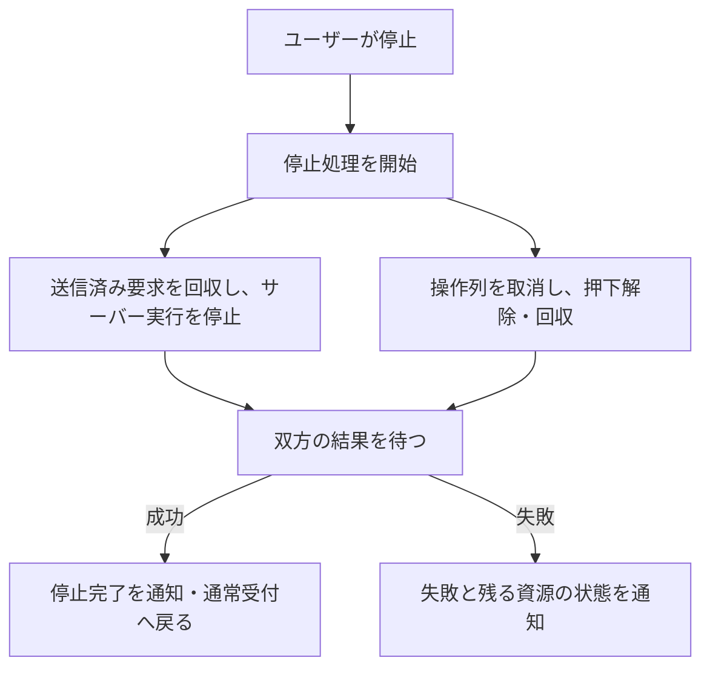

# 09-control-flows.md — 通常指示・Goal・停止の流れ

[文書一覧](README.md)

本書は部品間の処理順序を示す採用設計です。通常指示と共通の受付・停止・資源所有は[unit_061](../complete/unit_061/CONVERSATION_EXECUTION_MODEL.md)、Goal操作と状態は[unit_062](../complete/unit_062/GOAL_EXECUTION_MODEL.md)、画面操作は[10](10-ui-interaction.md)を正本とします。今回の設計改訂を、製品統合や実接続・実機受入の完了とは扱いません。

## フローと所有者

| フロー | 判断・処理の所有者 | 詳細 |
|---|---|---|
| 通常指示・追加指示 | Gigasが同じturn/startへ配送し、app-serverが開始／介入を選ぶ | unit_061第2節 |
| Goal作成・目的編集・再開・削除 | Gigasが指定されたGoal操作を送り、app-serverが継続・turn開始を管理する | unit_062第3節 |
| 機器操作・事後観測 | Gigasが操作列を一件実行して解除し、観測画像を返す | unit_061第3節 |
| 明示停止 | Gigasがサーバー実行の停止と操作列の解除・回収を調整する | unit_061第4節・unit_062第4節 |
| 切断・アプリ終了 | サービスが所有資源の終了を調整し、各所有者が回収する | unit_061第6節 |

Goal状態、turn状態、機器の状態は別の事実です。それらの組合せをGigas独自の攻略状態へ変換しません。通知は表示・記録へ反映し、沈黙からの停滞推定、自動修復、自動再投入を行いません。

## S01 — 通常指示・追加指示・自然終了

1. ユーザーがMessageを送る。会話実行は共通の送信処理一件を使い、初回だけ必要なthread・MCP・記録先を準備する。
2. 本文をturn/startで一度送る。既存turnへ介入するか新turnを始めるかはapp-serverが決める。Gigasは特定turnを宛先に固定しない。
3. 受付結果を返し、公開された本文・item・turn通知を表示・記録する。受付後は応答生成中でも同じ経路で追加指示を送れる。
4. turn/completedで対象turnの表示・本文を締める。自然終端では機器入力を閉じず、次の指示のための再開操作も要求しない。

質問・承認への回答は元の要求IDへ返し、通常指示へ変換しません。回答配送は共通の指示送信枠に並べません。質問待ちを理由に通常指示や機器操作を禁止しません。詳細な通知順序・要求の寿命・配送失敗はunit_061第2節に従います。

## S02 — 操作列と事後観測

app-serverのtools/callはstateless MCPから会話の受付を通り、機器入力へ届きます。受付と操作taskの登録の間に処理を譲らず、停止と操作開始の間に未所有の操作を残しません。停止・切断処理中は新規操作を拒否し、機器入力が実行中ならBUSYを返します。操作の待ち行列は設けません。

機器入力は有限の操作列を一件実行し、完了・中断・失敗のいずれでも必要な押下解除を行ってからtaskを終えます。その後に最新画像を取得し、操作結果とともに返します。画像取得・符号化・保存の失敗を、実行済み入力の取消しにはしません。画像処理を待つために入力枠を占有し続けず、次の操作より先に画像を取得する順序も保証しません。

run・Grant・入力世代やGoal状態に基づく許可切替は設けません。MCPの認証、引数検証、機器の対応入力・使用可否の確認は各所有者に残します。

## S03 — 計画的終了（初期版対象外）

[U07](../planned/unit_012/PLANNED_STOP.md)の専用終了フロー・専用受入は初期版から外します。「保存して終えて」もS01の通常指示として配送し、作業の順序とゲーム内の区切りはモデルへ任せます。Gigasは本文を終了命令へ分類せず、終了専用の状態・Goal・結果判定を持ちません。

公開された作業報告、Goal休止、turn終了はそれぞれの事実として表示します。Goal休止を必須結果にせず、これらの通知からセーブ成功・全活動終了・機器停止を推定しません。今の動作を直ちに止めたい場合はS04の共通停止を使います。

## S04 — 共通の明示停止

停止は通常指示とGoalに共通の一つの処理です。送信枠へ並ばず割り込み、処理中は新しい指示・Goal操作・回答・機器操作を受け付けません。繰り返し押された停止は同じ処理へ合流し、切断操作は停止の待機中も受け付けます。

図の箱は手順であり、保存する状態の列挙ではありません。既知turnの中断と入力解除は、送信中のGoal操作の結果待ちで遅らせません。送信済み変更を反映したGoalがactiveなら目的を保持してpausedを要求し、既に非activeならその状態・理由を維持します。停止中に始まったturnも同じ停止処理で中断し、終端を確認します。

正常終了で同じMCP入口の通常受付へ戻ります。再受付専用の状態、機器の再許可操作、停止前の操作列の再送は設けません。機器だけの解除失敗は機器を使用不能にし、通常指示まで禁止しません。サーバー側停止が失敗した場合は共通の資源終了へ渡し、確認できない停止を成功にしません。失敗時の詳細はunit_061第4.2節に従います。

Goalの休止通知や自然終端から、この停止処理を自動的に起動しません。停止はゲーム時間の停止、ゲーム内セーブ、任意の背景プロセス・外部書込み全般の終了を保証しません。

## S05 — Goal操作と明示再開

| 操作 | Gigasが送るもの | app-serverに任せる判断 |
|---|---|---|
| Goalがない状態で目標を送信 | 目的とstatus=activeを指定するgoal/set | Goal開始と必要なturnの開始 |
| 既存Goalの目的を編集 | 目的だけを指定するgoal/set | 現在turnへの反映。非activeならその状態を維持 |
| 目標欄の再開 | objective・tokenBudgetを省略したstatus=active | active要求の可否と、現在turnへの反映／turn開始 |
| 目標欄の削除 | goal/clear | 次の自律継続対象からの除去 |

Goal削除は現在turn・操作列を中断しません。Goalの再開は目的文を変えず、停止後の機器受付を解禁する操作にも使いません。通常文の「再開して」はS01のturn/startへ渡し、Goal操作へ読み替えません。

操作後のGoal表示はサーバーの公開状態に従います。active要求が拒否された場合や、成功応答でも制限状態が変わらない場合、共通の送信処理が終われば同じ状態から再開を再び要求できます。turn実行中・質問待ちだけを理由に再開や削除を禁止しません。ボタンの活性条件は[10](10-ui-interaction.md)とunit_062第3.5節に定めます。

[U08](../planned/unit_013/RESUME.md)が扱う保存参照の読込・再起動後の復帰は後続工程です。同一接続内のGoal再開を作り直さず、必要な準備を終えて共通経路へ渡します。U07の完了は前提にしません。

## 切断・アプリ終了と検証の境界

切断では接続・MCPを閉じ、残る操作列・回答配送・保存を各所有者で回収します。停止失敗時にも同じ閉鎖処理を使い、閉鎖処理から停止taskを待つ循環を作りません。会話専用資源と、映像・入力デバイス・選択プロジェクトの寿命は分けます。具体的な呼出し関係と寿命はunit_061第6節で定めます。

検証は通常送信・追加指示・元要求への回答、通知と受付応答の順序、操作列の中断・解除、Goal変更と停止の競合、停止後の通常受付、資源終了をそれぞれの所有仕様へ集約します。終了を求める通常文のためだけの専用受入や、文書の状態語を製品契約とするテストは追加しません。旧構成の実接続結果は過去の根拠として保持し、新構成の受入完了とは区別します。
