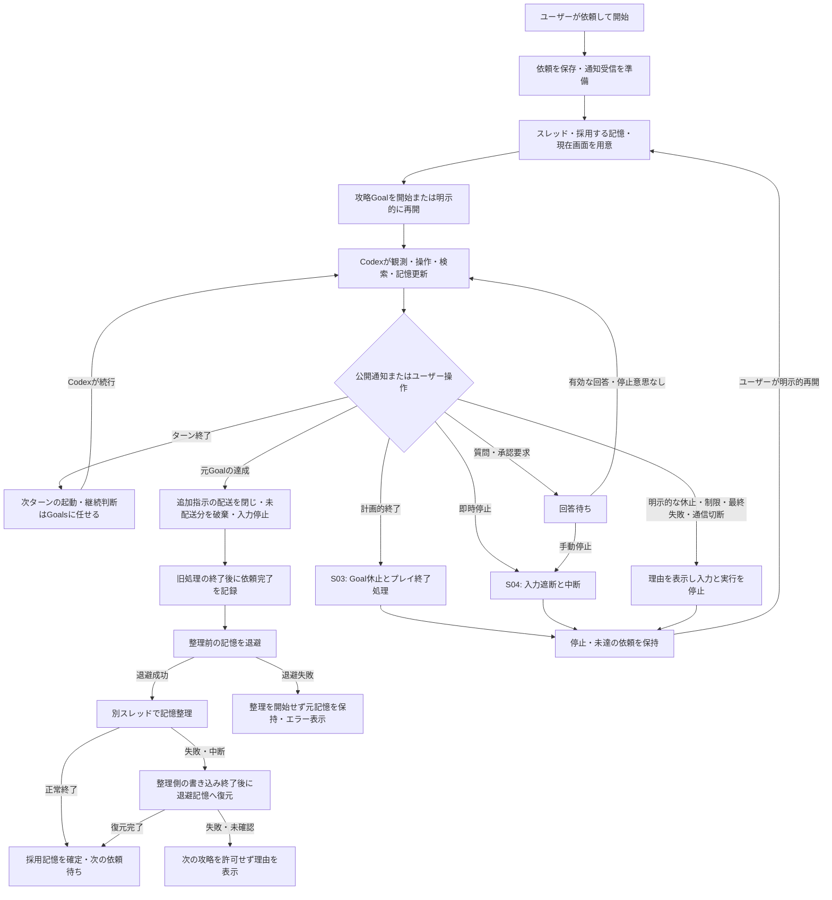
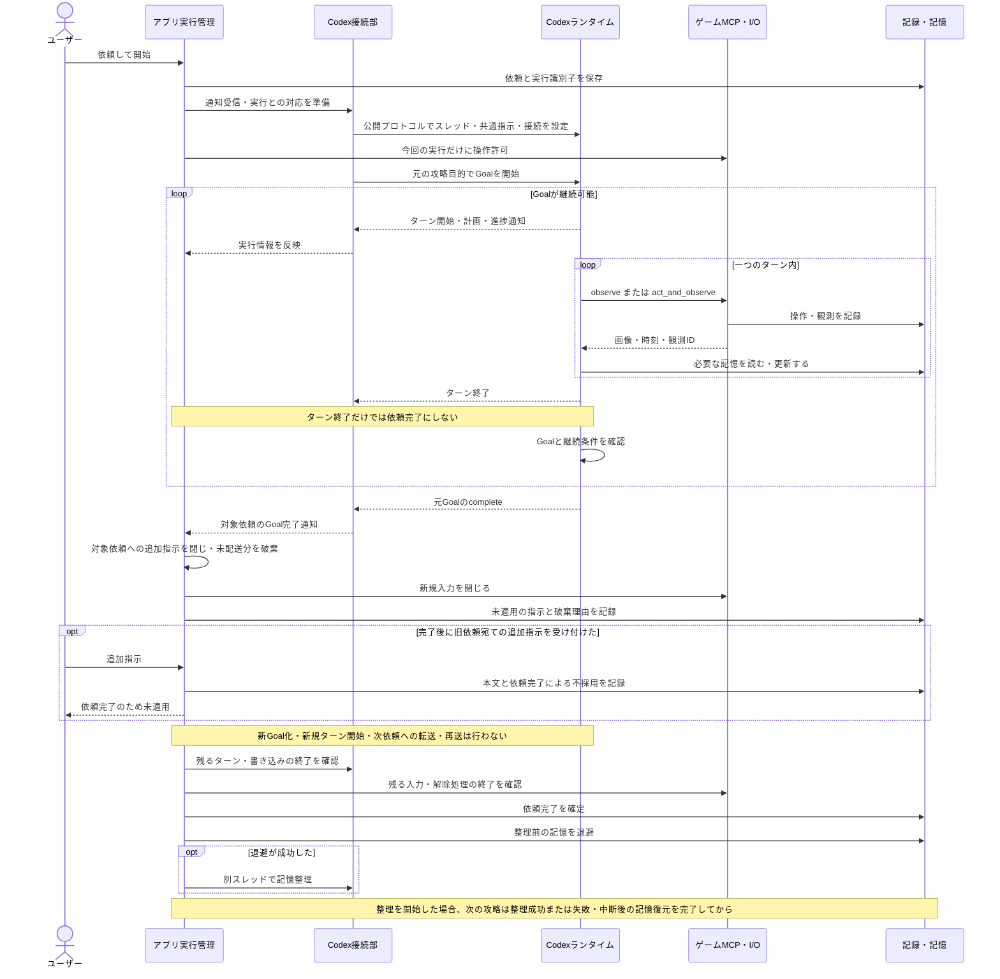
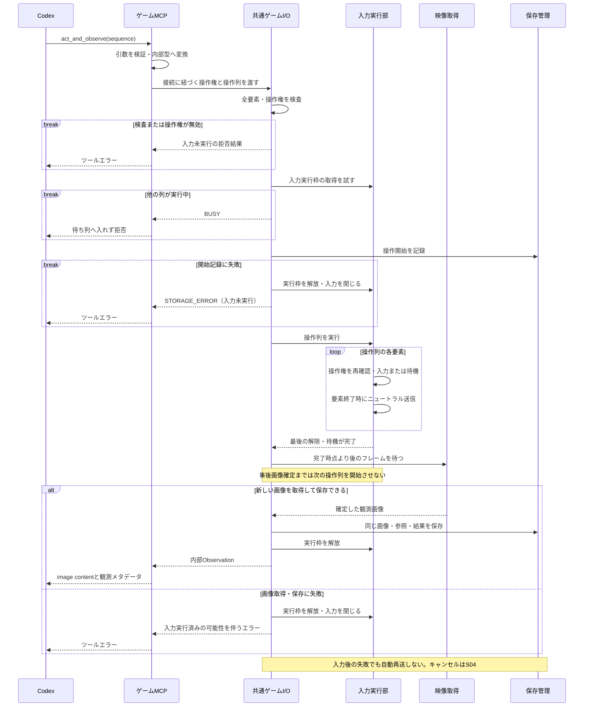
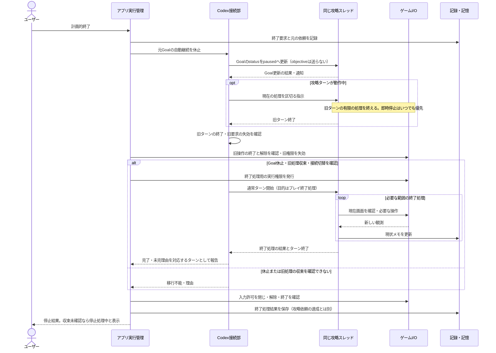
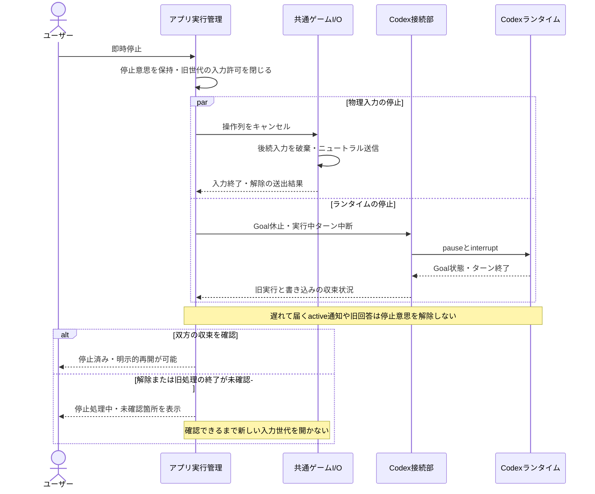
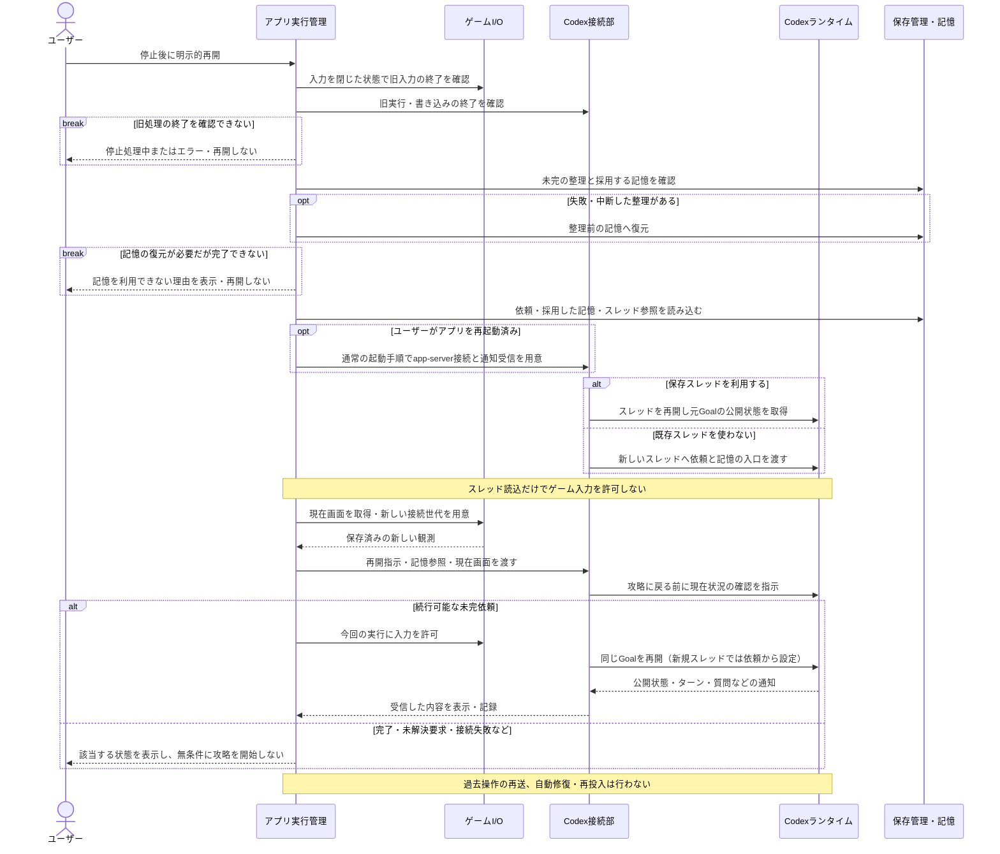
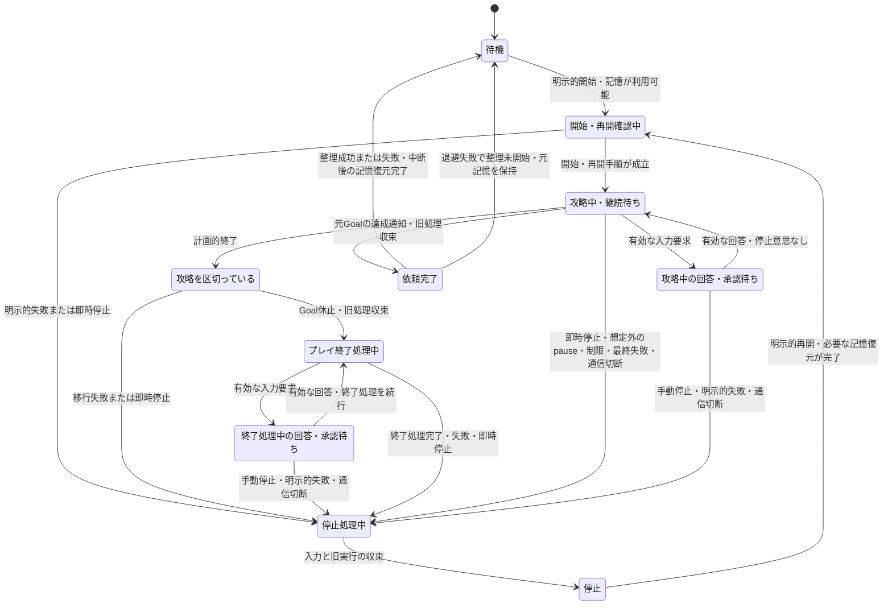
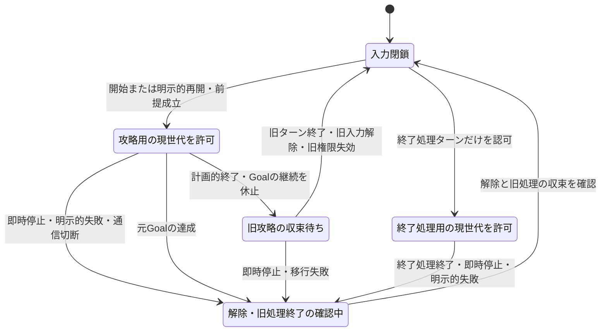

# 09-control-flows.md — Goal中心の処理フロー・停止・再開

[文書一覧](README.md) · [実行管理](02-runtime.md) · [SDK調査](08-sdk-compatibility.md)

処理フローの初版は2026-11-10、工程参照の改訂は2026-11-11です。本書はGoalを中心とした攻略、計画的終了、即時停止、明示的再開、記憶整理について、複数部品にまたがる処理順序を示します。図は編集可能なMermaidです。これらのGoal・機器フローの実行確認は未実施です。通常ターン接続はU02で別に確認します。

## 読み方と設計上の区分

攻略Goalを主軸に継続し、即時停止はモデルの応答を待ちません。計画的終了では元Goalを休止し、同じスレッドの通常ターンで処理します。元Goalの目的を終了用へ置き換えません。

呼称は**プレイ終了処理**とします。この処理を行う通常ターンを**終了処理ターン**と呼びます。ゲーム内で区切りを付ける、必要ならセーブする、現状メモを更新する、といった作業です。アプリのプロセス終了・デバイスの解放とは別で、元の攻略依頼の達成も意味しません。

攻略の継続・再試行・休止・完了はCodexの判断と公開状態に従います。アプリは通知を受けて表示・記録・要求の受け渡しを行い、実行中の状態整合性検査、無通知からの停滞推定、自動修復、自動再投入は行いません。明示的な失敗・通信切断では入力を停止し、ユーザーの明示的再開を待ちます。独立した復帰操作は設けません。

## 図の索引

| 図 | 抽象度・種類 | 読み取る内容 |
| --- | --- | --- |
| F01 | 全体・処理フロー | ユーザー依頼、Goal、介入、完了、記憶整理の関係 |
| S01 | 通常系・シーケンス | 開始、ターン内のツール利用、ターン間継続、自然完了 |
| S02 | 入出力・シーケンス | 操作列、解除、事後観測、保存、応答の順序 |
| S03 | 計画的終了・シーケンス | Goal休止と終了処理ターンの切り替え |
| S04 | 即時停止・シーケンス | 入力遮断の優先順位と旧処理の終了確認 |
| S05 | 再開・シーケンス | ユーザーの明示的再開、アプリ再起動後の読込、コールドスタート |
| M01 | 利用者向け状態遷移 | 公開通知とユーザー操作から導く表示状態 |
| M02 | 入力制御の状態遷移 | 攻略権限、終了処理権限、世代更新、停止処理 |

図中のメソッド名は公開プロトコル上の意味を示す例であり、製品APIの確定した呼び出しコードではありません。U02のユーザー承認に基づき公開app-serverプロトコルの単一stdio接続で通信を管理します。非公開APIや二重受信で不足を補いません。開始・明示的再開・計画的終了の状態取得と応答確認は操作手順の一部であり、実行中の診断・補正ループではありません。

図は初期版全体の契約を表し、前半工程の完了条件へ全分岐を一括で課すものではありません。U02は通常ターンの接続、U03は映像、U04は記録付き観測、U05は短い操作と停止を作り、U06でGoal継続、U07で終了処理、U08で再開、U09で整理・復元を結合します。F01・S01・M01の記憶整理への遷移はU09まで未提供であり、それ以前の依頼完了後は入力を閉じて次の依頼を待ちます。

## F01 — 依頼の全体フロー

アプリのイベント処理は常時動きますが、攻略を毎ターン再投入するループではありません。次のターンが始まらず、失敗の通知もない場合は、最後に受け取った状態と更新時刻を表示し続けます。原因の診断、定期的な状態照合、時間経過だけによる停止や再起動は行いません。

## S01 — 開始・通常攻略・自然完了

ループを抜ける理由はcompleteだけではありません。pause、blocked、利用制限、エラー、ユーザー要求は別の分岐へ移ります。二つのループ枠は反復の担当を表し、アプリがその回数を決める意味ではありません。追加指示は依頼に紐付け、完了通知で未配送分を破棄します。既にランタイムへ送信した指示を遡って取り消せるとはせず、受付不明なら未確認と記録し、再送しません。詳細は[02の追加指示の扱い](02-runtime.md)に従います。

## S02 — 操作列と事後観測

途中キャンセルはS04の経路で入力実行部へ届きます。画像保存に失敗した場合も実行枠を必ず解放し、保存障害として入力を停止します。同期保存・非同期保存の具体方式は別途設計しますが、停止通知が保存待ちの後ろに詰まる構成にはしません。

## S03 — 計画的終了：Goal休止と終了処理ターン

元Goalを保持してpausedにし、同一スレッドの通常ターンでプレイ終了処理を行います。`pause`の受付だけを旧ターン終了や入力解除とみなしません。通常ターンへの移行は、旧ターン、入力、ファイル更新が収束してから行います。アプリが終了処理への移行のために発行したpauseの確認は、この移行への応答として扱い、通常攻略中に外乱でpauseされた場合の停止処理と区別します。

終了処理ターンの終了状態と、実施内容・未完理由を対応付けて記録します。構造化結果には`outputSchema`を候補とし、公開プロトコル・結果項目・待機期限は採用版で確認します。結果を確認できなければ未確認として停止します。ゲーム内セーブの成功は別に扱い、失敗・中断から元Goalへ自動復帰しません。切替中に元Goalが達成した場合も、その達成記録と終了処理結果を分けます。

## S04 — 即時停止と再開を許可するまで

この図はPythonプロセスが生存して停止通知を処理できる場合の契約です。PC異常終了時のMCUの解除保証は別です。ランタイムの中断応答を待ってから入力を止める順序にはしません。

## Codexの公開状態に従う制御

Codexを実行状態の正本とし、アプリは受け取った通知を表示・記録します。Goalがactiveでも操作や通知がないことを異常と推定せず、Codexの継続判断を待ちます。通知が欠けた場合に表示が古いまま残ることや、Codexが自力で解消できない停滞にユーザーの停止・再開が必要となる制約を受け入れます。

アプリに残すのは、要求と通知の受け渡し、表示と記録、明示的な停止・再開、実機入力と保存処理の管理です。実行状態を定期取得して整合させる処理、停滞検知、通知から失われた状態を再構築する処理、自動再接続・自動再起動による攻略復帰は追加しません。

| 受け取った通知・操作 | アプリの扱い |
| --- | --- |
| ターン・計画・進捗の通知 | 公開された状態と最終更新時刻を表示・記録します |
| Codexが内部再試行中 | 再試行中と表示して待ちます。別のターンや操作列を再送しません |
| 質問・承認要求 | 要求IDに対応する回答を待ちます。停止後の古い回答では続行しません |
| 元Goalのcomplete | 入力を閉じ、旧処理の終了後に依頼完了を記録します |
| 想定した移行以外のpause・blocked・制限、最終失敗、通信切断 | 理由を表示して入力を停止し、明示的再開を待ちます。終了処理への移行用pauseはその手順に従います |
| 新しい通知がない | 最後に受け取った状態を維持します。沈黙を契機に診断・状態修復・再投入をしません |

開始・明示的再開・プレイ終了処理に必要な状態取得、応答と要求の対応付け、旧実行の終了確認は、それぞれの操作手順として残します。これらを実行中の健康監視へ拡張しません。即時停止、旧世代の要求拒否、デバイス切断・保存失敗への対処も、アプリ自身の責務として維持します。

## S05 — ユーザーの明示的な再開

これは既存の明示的再開の手順です。独立した復帰操作や、自動的にランタイムを再構築する機構ではありません。接続が利用不能なら理由を表示し、必要に応じてユーザーがアプリを再起動して再開します。スレッドを使えない場合はコールドスタートとして扱います。現在画面と記憶の照合はCodexの攻略再開作業であり、アプリによるランタイム状態の整合性修復ではありません。

同じGoalの明示的再開には、目的文を送らない`thread/goal/set(status=active)`を候補とします。目的・予算を置き換えず、APIの受付と実際のターン開始は受け取った通知どおりに扱います。開始が起きなくてもアプリから繰り返し再設定しません。再開指示と現在画面を渡す公開経路は採用版で確認します。

一回のユーザー操作に対して再開要求を重複送信しません。通信失敗などで結果を確認できなければ成功扱いにせず、入力を閉じて停止・エラーを表示します。過去の入力を再送したり、課金先・モデル・予算を自動変更したりしません。

## M01 — 公開通知とユーザー操作による表示状態

これは独立した攻略判断の状態機械ではなく、公開通知とユーザー操作に対する表示分類です。新しい通知がなければ表示を維持し、最終更新時刻を示します。「状態照合中」や自動修復への遷移は設けません。終了処理中の質問への回答では終了処理へ戻ります。即時停止はすべての実行フェーズに優先し、停止処理中は新しい入力を許可しません。

記憶整理・復元は補助状態として表示します。整理失敗で攻略依頼の完了を取り消しませんが、整理前の記憶への復元が終わらなければ次の攻略を許可しません。手動の記憶整理やアプリ再起動後の未完整理にも同じ条件を適用し、記憶内容をモデルへ読み直させます。詳細な退避・復元手順は[04](04-agent-memory.md)に従います。

## M02 — 入力権限の切り替え

操作権限はGoalがactiveであることだけから計算しません。終了処理ではGoalがpausedでも、認可した終了処理ターンには入力が必要です。逆に古いactive通知が届いても旧世代へ許可を戻しません。Drain中は現ターンが区切りまでに必要とする処理を許し、新しい攻略ターンは開始させない方針です。この図は入力権限の所有先を示し、質問・承認待ち中の一時保留は別の受付条件として重ねます。権限が現世代にあっても、回答待ちなら新しい入力を受け付けません。MCP接続とターン／実行世代の対応付けは08の接続確認項目です。

## 本実装で確認する接続条件

| 対象 | 採用した設計 | 採用版・実装で確認すること |
| --- | --- | --- |
| プレイ終了処理への切り替え | 元Goalを休止し、同じスレッドの通常ターンを使う。目的置換なし | 旧ターン・旧書き込み終了、通常ターン開始、意図しない再活性化の防止 |
| プレイ終了処理の結果 | ターンの結果と機器処理の終了を分ける | 構造化結果、失敗・中断・取得不能、元Goal達成と競合した際の通知順序 |
| 継続制御への委任 | Codexに従い、アプリ側の整合性検査・停滞推定・自動修復は行わない | 通知の表示・記録、内部再試行を重ねないこと、無通信で再投入しないこと |
| Codex接続 | 公開機能を主体とし、一つの接続実装で通信と要求を扱う | 回答待ちで受信・停止を塞がない公開経路、失効処理 |
| 追加指示 | 完了時の未配送・完了後の指示を破棄し、新Goal化・再送しない | 配送との競合、既送信・受付不明との区別、次の依頼へ混ぜないこと |
| 整理失敗 | 整理前へ復元してから次の攻略を許可する | 書き込み終了後の復元、追加・削除・改名、再起動後の未完整理、復元失敗 |
| 明示的再開 | 既存の再開操作を利用する | 記憶復元の前提、現在画面の受け渡し、同じGoalの再開とコールドスタート |
| 停止優先 | 遅い通知や回答で停止意思・入力閉鎖を覆さない | 要求待ち中の停止、旧入力と旧書き込みの終了確認 |

設計方針の確定と、採用版での動作確認は別です。公開APIとファイル操作の具体化・試験は各工程の冒頭から行います。保存はU04の観測、U05の操作、U06の継続、U07・U08の終了・再開、U09の整理・復元に必要な分を実行フローと一緒に実装します。工程と完了条件は[05](05-implementation.md)、保存契約は[04](04-agent-memory.md)、外部仕様の確認期限は[08](08-sdk-compatibility.md)に従います。

## 根拠

Codexの継続・再試行・状態取得の調査根拠は[08の継続制御への委任と制約](08-sdk-compatibility.md)にまとめます。公開資料は[Goals](https://developers.openai.com/cookbook/examples/codex/using_goals_in_codex)と[app-server](https://learn.chatgpt.com/docs/app-server)、ソースはコミット`0811df39768427445b9730c039d6c04020670e04`の[Goal runtime](https://github.com/openai/codex/blob/0811df39768427445b9730c039d6c04020670e04/codex-rs/ext/goal/src/runtime.rs)、[ライフサイクル処理](https://github.com/openai/codex/blob/0811df39768427445b9730c039d6c04020670e04/codex-rs/ext/goal/src/extension.rs)、[外部Goal更新](https://github.com/openai/codex/blob/0811df39768427445b9730c039d6c04020670e04/codex-rs/ext/goal/src/api.rs)です。ソースの存在と、採用配布版・実機での動作実証は区別します。

