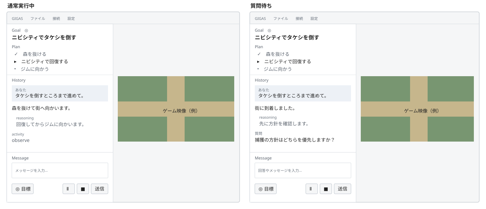

# 10-ui-interaction.md — 主画面とメッセージ操作

[文書一覧](README.md)

2026-11-11から12日の実装整理後のUI/UX議論をまとめた採用要求です。主画面の構成と利用者操作を本書、APIの根拠・未確認事項を[08](08-sdk-compatibility.md)、実装の担当・受入条件を[U06](../planned/unit_011/GOAL_EXECUTION.md)・[U07](../planned/unit_012/PLANNED_STOP.md)で所有します。

## 状態と対象範囲

画面モックで、左右配置、共通入力欄、目標トグル、設定内のreasoning表示切替、通常実行と質問待ちを比較しました。これはHTML上の操作確認であり、PySide6の描画・性能や実ランタイムの接続成功の根拠ではありません。最新要求のGoal識別、一時停止／Goal破棄の分離、再開アイコンは本書に反映し、既存モックへの反映・受入は未実施です。

今回の作業は要求の整理と既存工程計画の更新です。U06・U07はplannedのままとし、M0の接続方式調査・子仕様作成・製品実装へは着手しません。U06 M0の後に共通対話UIの子工程を置き、Goal制御と変更単位を分けます。設定・機器選択の整理をやり直したり、独立した大きなUIマイルストーンや汎用チャット基盤を追加したりしません。

## 画面構成と情報源

この図は配置と情報の強弱を残す静的な設計資料です。GoalとPlanの内容、履歴、映像は例であり、製品の固定文言や実際のゲーム画面ではありません。Ⅱは一時停止、■はGoal破棄の仮アイコンで、最終選定はU06 M0で行います。一時停止後は再開アイコンへ切り替える仕様ですが、その状態の図は未作成です。実機やPySide6の描画結果ではありません。

| 領域 | 採用する表示 | 表示元・制約 |
| --- | --- | --- |
| 左上のGoal | `Goal`見出し、目標アイコン、現在の目的本文 | 現在のGoalを識別できる表示にする。目的本文だけを画面タイトルのように置かない。入力欄の目標トグルとは別の役割。確定前の送信原稿で現在のGoalを上書きしない |
| Plan | Goalの下に読み取り専用の縦リスト | 公開された計画項目と状態。Goal全体の永続的なTODO一覧であることは求めない |
| History | 左中央の単一の時系列履歴 | ユーザー発言、途中の説明・応答、公開推論要約、実際のツール活動、質問と回答 |
| Message | 左下に固定した一つの入力欄 | 通常メッセージ、質問への自由文回答、目標の入力で共用 |
| 右側 | 映像を縦横比を保って表示 | 既存の映像取得元。AIの一時停止・Goal破棄だけで映像を切断しない |

`Plan`・`History`・`Message`は明示的に許可された見出しです。Goalの識別には上表の短い見出しを採用します。「実行中」「回答待ち」の常設バッジ、同じ内容の補足文、映像に重ねる取得情報は追加しません。必要な失敗理由・未確認の操作結果は消さず、再確認できる既存の診断導線へ接続します。状態や時刻を記録する要件を、主画面への常設表示の要件とは扱いません。

## Historyの表現

ユーザー発言は名前と控えめな背景で識別し、エージェントの途中説明と応答は通常本文にします。同じ発言の続きで発言者名と時刻を繰り返しません。質問も履歴の一部として表示し、質問専用の入力欄・回答ボタンを常設しません。送信した回答は質問とともに読み返せるようにします。

公開推論要約の小ラベルは`reasoning`、ツール活動の小ラベルは`activity`とします。reasoningは字下げ・文字の濃淡で本文と区別し、斜体だけには依存しません。表示切替は設定ダイアログへ置き、主画面にチェックボックスを置きません。初期表示はオン、個別の折りたたみは初期の採用範囲に含めません。設定は既存の適用／OK／キャンセルの契約に合わせ、表示の変更で記録や受信を停止しません。

activityは公開されたツール名・確認できた対象・結果等を簡潔に示します。モックの「移動・画面確認」「3回」、ゲーム名・地名・目的文・時刻・模擬映像は例示資材であり、製品の初期値・固定表示・汎用の成功説明へ転用しません。実データなしに操作内容や回数を推測しません。複数操作の集約・折りたたみは実通知と必要性を見てU06 M0で判断し、独立した操作履歴パネルは増設しません。

PySide6では単一のリッチテキスト履歴を第一候補とします。左右分割と固定入力は標準レイアウトで構成し、HTMLモックのCSSやブラウザ機能を製品に持ち込む前提にしません。長文追記中の選択・コピー、閲覧位置、末尾にいる場合だけの追従、表示切替時の位置、長時間の履歴量はGUI実装前に確認します。既存Transcriptの閲覧保持を退行させず、表示単位ごとの大量の独立ウィジェットやWebEngineへの移行を先に決めません。

## Messageと目標トグル

| 操作 | 意味 |
| --- | --- |
| 目標トグルがオフで送信 | 通常メッセージ・実行中の追加指示・質問への回答を、会話の文脈と対応する要求へ届ける。自動で新Goalにしない |
| 目標トグルがオンで送信 | Goalとして明示的に依頼する。トグルの名前と目標アイコンはオン・オフで固定し、押下状態で区別する |
| トグルの切替 | 下書きを保持する。切替自体はGoalの作成・更新・破棄、ターン開始を行わない |
| 送信受付が確認された後 | 下書きを消去し、目標送信ならトグルをオフへ戻す。失敗・受付不明で送信成功とみなしたり、自動再送したりしない |

送信は一つのボタンとCtrl+Enterに揃えます。Enterは改行とし、日本語入力の変換確定を送信にしません。質問中も同じ入力欄を表示し、質問待ちだけを理由に自由文送信を禁止しません。「回答と追加指示を一文で送る」操作を要件とします。質問は曖昧な指示等で必要になったときの例外的な導線であり、頻繁な質問や承認待ちを前提とする主画面にはしません。

入力欄の共通化は通信要求の共通化を意味しません。通常送信、実行中の介入、要求ID付きの回答、Goal設定はCodex接続部で対応付けます。UIが文章を解析して回答部分と指示部分を分割したり、同じ全文を複数経路へ二重送信したりしません。複数質問・自由回答不可の要求・質問への回答を含まない指示・Goal完了との競合は[08のUI/API未確認事項](08-sdk-compatibility.md#ui-api-open)を先に解消します。

承認は自由文回答とは別です。公開要求が指定する許可・拒否等を明示操作で返し、通常メッセージを許可の代わりに使いません。承認待ち・一時停止後のメッセージ送信が、機器入力やGoalを暗黙に再開する契約にはしません。承認時に共通入力をどう扱うかはU06 M0の対象です。

既存Goalがある状態でオンにして送った場合の新規／更新／置換の手順は、公開経路の確認後に決定します。モックが直ちに目的欄を差し替える動作は、そのまま製品契約にしません。

## 一時停止・停止・計画的終了

Messageの操作列は、左に目標トグル、右に一時停止アイコン・停止アイコン・送信ボタンを配置します。一時停止と停止は別のボタンとし、短いアクセシブル名をそれぞれ「一時停止」「停止（Goalを破棄）」とします。アイコンの最終選定と押下可能条件はU06 M0で詰めます。説明文の常設で区別を補いません。

| 意図 | Goalの扱い | 実行・記録の扱い |
| --- | --- | --- |
| 一時停止（pause） | 目的と参照を保持して自律継続を止める | 区切りやセーブを待たず、直ちに推論の中断を要求し、ゲーム入力を遮断・解除する。再開は利用者の明示操作を要する |
| 停止（stop、Goalを破棄） | 現在のGoalを継続対象から外す | 一時停止と同じく直ちに推論中断と入力遮断・解除を要求し、ランタイム上の破棄を確認する。攻略達成として記録せず、会話・原記録・記憶・プロジェクトを削除しない。破棄したGoalを再開ボタンや遅い通知で復活させない |
| U07の計画的終了 | 元の攻略Goalを休止・保持する方針 | ユーザーがMessageから「区切りまで進めて保存して終える」等の追加指示を送る。エージェントが必要な推論・操作を続けて終了する。第三の停止ボタン、終了専用ターン・権限・アプリ状態は設けず、共通配送・公開通知・停止経路で成立するかをU07 M0で確認する |

一時停止・停止はゲーム自体の時間停止ではありません。どちらもCodex応答を待ってから入力を遮断する順序にはせず、[02](02-runtime.md)・[09](09-control-flows.md)の旧入力拒否・解除・収束の原則を使います。旧仕様の「即時停止」はこの機器入力側の優先処理を指し、Goalを保持するか破棄するかは利用者の操作に従います。Goalのpauseだけで解除完了とみなしたり、clear受付だけで実行中ターンの終了まで確認できたとみなしたりしません。

「即座に」は終了作業や次の自然なターン終了を待たず中断・遮断に着手する意味です。通信往復や機器解除の完了時間をゼロと保証せず、要求受付と停止完了を分けます。計画的終了の自然文はエージェントが解釈し、アプリのキーワード検出や独自の意図分類で停止処理へ切り替えません。意図的に終了作業を続ける経路と、利用者がボタンで割り込む経路を分けます。

同一セッションで保持しているGoalの再開はU06へ含めます。一時停止後は一時停止アイコンを再開アイコンへ切り替え、利用者の明示操作で戻ります。停止完了の確認前には再開させず、旧入力の終了・失効と現在画面の確認を省略しません。自由文の「再開してください」をアプリが解析してこの操作へ変換せず、回答と再開を別の操作として扱います。Goalを破棄した場合は再開対象にしません。

[U08](../planned/unit_013/RESUME.md)は保存参照からの読込、アプリ・接続の再起動後の復帰、既存スレッドを使わない再構成を担当します。U06の再開経路を共用し、同一セッション向けと復帰向けの独立した再開制御を二重に作りません。Goalなしの通常ターンでの停止、pause中の通常メッセージ、既存Goalへの新しい目標送信の操作可否はU06 M0で確定します。メッセージ本文の分類で不足を埋めません。

## Planの更新契約

`turn/plan/updated`の`plan`を受信順の読み取り専用リストへ対応付けます。`step`の本文は受信内容を使い、`completed`はチェック、`inProgress`は印と太字、`pending`は通常の箇条書きで区別します。操作できるチェックボックスや、独自の進捗率にはしません。

対象thread／turnを対応付けた最新の一覧で置き換えます。項目に安定したIDがないため、本文の類似性で同一項目を推測して合成しません。`explanation`があれば履歴の説明として扱い、計画欄へ同じ本文を重ねません。計画が届いていない場合は見出しを含むPlan領域を出さず、「計画なし」「取得待ち」で埋めません。

Goal全体の永続的TODOとの一致は不要です。現在のターンで未受信の計画を、前ターンの計画や`memory/current.md`から補いません。前ターン・旧Goal・停止前の遅延通知を現在の計画と混ぜず、ターン終了だけで全項目を完了にしません。履歴から過去計画を読む範囲とターン切替時の更新順はU06 M0で実通知を使って確定します。

## 工程への反映と検証

| 担当 | この合意から受け持つもの |
| --- | --- |
| U06 M0 | Goal・共通入力・公開表示・一時停止／同一セッション再開／破棄のAPIと操作契約、リッチテキストの実現性を確認する |
| U06 M1 | 左右配置、共通Message、History、公開Plan・reasoning・activity、質問・承認を実通知へ接続する。旧質問入力経路を置換し、Goal機能の仮表示は作らない |
| U06 M2 | 目標トグルと現在Goalを結合し、Goalと依頼の対応、継続・達成・介入、一時停止／同一セッション再開／破棄と記録を完成させる |
| U06 M3 | 認証・次ターンのモデル／エフォート変更と利用制限を結合し、配送競合・実ランタイム・実機で工程全体を確認する。UI置換と設定変更は別の変更単位にする |
| U07 M0 | 共通の追加指示・公開通知・休止で終了作業と結果確認を行えるか確認する。成立しない場合は制約と必要な設計差分を記録し、旧専用経路を既定の代替にしない |
| U07 M1 | 必要な指示資材・記録の差分だけを反映し、質問・承認、pause／stop割込み、終了結果と同一セッション再開を結合検証する。既存経路で成立する場合は新たな制御実装を完了条件にしない |

既存テストの書き換え・統合・経路廃止に伴う削除を優先します。削除済み試験の一律復活や、「ラベル／ボタンが消えたこと」だけの新規試験は予約しません。配送・下書き保持・要求寿命・入力遮断・通知の対応は現存する試験を確認して再利用します。閲覧保持の専用試験19件はunit_030で削除済みであり、既存試験で検証できるとみなしません。新しい履歴の追記中の選択・コピー、閲覧位置、末尾追従、reasoning表示切替を実Qt画面で確認し、結果をM1子仕様へ記録します。自動化が必要な代表条件は既存試験への統合を先に検討します。具体的なTDD項目は実装する子仕様で決めます。

未実施: 固定runtimeでのGoal継続・介入・pause／同一セッション再開／clear、共通入力の実配送、U07の追加指示による終了作業、PySide6での新画面・長時間履歴、物理機器との停止結合。既存モックを製品の成功応答・実装済みAPIの証拠にはしません。

## U04のプロジェクト操作

メニューバーに「プロジェクト」を新設し、配下の操作は「新規作成」「開く」の2項目とする。観測ごとの保存操作は設けず、選択先へ自動保存する。未選択時もチャットからゲームMCPで観測でき、アプリ管理の記録先に会話との対応・画像を残す。保存失敗は既存の通知・詳細で扱い、保存完了待ちのパネルは追加しない。前回選択したプロジェクトは起動時に復元し、失敗時は未選択で起動して既存の通知・詳細に理由を残す。会話・Goalは自動再開しない。選択後のパスはタイトルで識別し、専用パネルや常設説明を追加しない。取消し・失敗時の選択維持、接続中の操作制限は[U04の詳細契約](../complete/unit_031/RECORDED_OBSERVATION_DESIGN.md#プロジェクト選択と未選択時の契約)に従う。M2で製品へ結合し、自動Qt試験で検証した。実画面ではメニュー、新規作成ダイアログの表示・取消しに続き、通常権限での再試験で新規作成・読込に成功した。保存先のタイトル表示、原記録用ファイルの作成、TOMLの前回選択、通常終了後の再起動で選択が復元されることを確認した。再度の通常終了と別writerによる再読込も成功した。未選択チャットの実モデル観測・保存・後参照は別の製品サービス試験で確認している。

## U05 入力設定と共通停止

U05の入力設定・接続・停止は[U05 M0](../complete/unit_036/INPUT_AND_STOP_DESIGN.md)で設計しました。既存I/Oタブにポート・プロトコル・通信速度を置きます。入力専用の接続・切断ボタンは設けず、OK／適用の保存成功後に接続先を反映します。「未接続」の適用で切断し、同条件で接続済みなら維持します。操作中の変更は旧列を停止・解除して旧接続を閉じてから切り替えます。取消しでは未適用編集だけを破棄し、保存失敗では旧接続を保持します。接続失敗は保存失敗と分けて既存通知詳細へ残します。通常ターンの既存中断と、設定・通知・確認モーダル内の「入力を停止」は同じ共通停止actionを呼び、設定保存・Codex応答を待たず入力を止めます。U06のpause/stopへこの処理を引き継ぎ、仮のGoal状態や説明本文を増やしません。配置と実Qtの受入はU05 M2、共通対話UIは引き続きU06の担当です。

## U04 観測解像度の設定

既存の設定画面・I/Oタブの映像入力グループへ「観測解像度」を一項目だけ追加し、オリジナル／FullHD（既定）／HDから選ぶ。取得解像度・プレビュー方式とは独立し、既存の適用・取消し・保存経路を使う。観測設定だけの適用で取得元・Codexを再接続せず、次の観測から使う。観測専用画面・説明文・状態ラベルは増やさない。寸法・TOML契約は[unit_034](../complete/unit_034/CHAT_OBSERVATION_PERSISTENCE.md)に従う。

M2の実画面で3候補の表示、HD選択・適用、検証先TOMLの`observation.resolution = "hd"`、設定と検証用メインウィンドウを閉じた後の正常終了を確認した。この試験ではsandbox起動により機器列挙が失敗した。その後、通常権限で保存済みのUSB Video Deviceを使い、FullHD・60 fps設定の実映像を未選択チャットから観測した。MCP応答と保存PNG・観測IDの対応、実保存中のプレビュー描画、回答生成中のメニュー表示、映像取得中の設定開閉、Codex切断後の取得継続と通常終了を確認した。遅延注入や他機器・長時間運転の確認ではない。詳細は[M2子仕様](../complete/unit_035/MCP_OBSERVATION_INTEGRATION.md)に記録する。

「接続 → 入力」にポート（未接続を含む）とプロトコルの選択を置く。選択値を保存後、入力だけへ適用する。プロトコル変更時は既定通信速度へ戻す。通信速度の個別変更は設定画面で行う。映像メニューの再選択も映像だけへ適用する。
