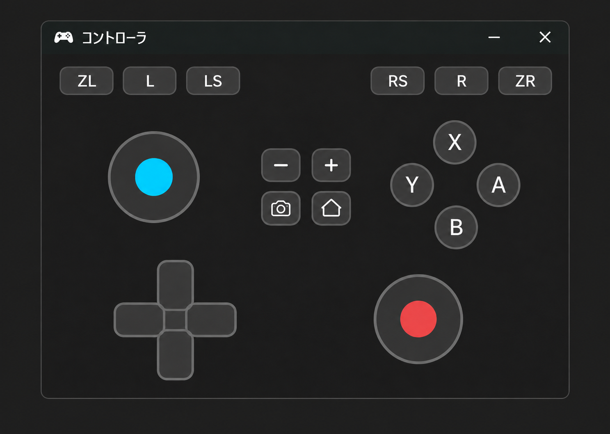
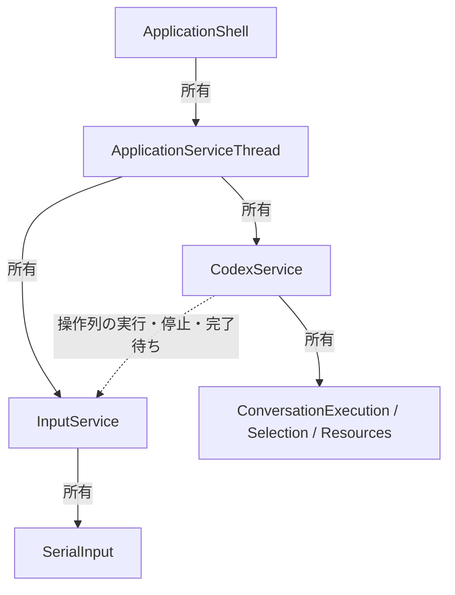

# 仮想コントローラとアプリサービスの責務分離 仕様書

## 1. 概要

### 1.1 目的・状態

状態は **planned（製品工程未着手）**。Codexと入力サービスの所有を分け、別ウィンドウの仮想コントローラを追加するまでの3段階を束ねる親仕様である。2026-11-15の設計合意を記録する。親仕様とGUI配置資料の作成は完了したが、実装、TDD cycle、実接続・実機検証には着手していない。

利用者がエージェントを停止した後、同じ入力機器で手動の疎通確認・ゲーム操作を行えるようにする。MCP経由で観測された疎通問題の原因は未確定であり、本機能を原因の修正や機器障害からの復旧保証とは位置付けない。

本書は到達点、責務、操作契約、段階の依存順と受入観点を所有する。コード照合レビューを反映した設計基準とし、具体的な関数シグネチャ・細分化したTDD項目は、着手する段階の子仕様で確定する。子仕様の雛形・番号は先行作成しない。

### 1.2 起点 / source

| source | 内容 | path |
|---|---|---|
| ユーザー依頼・設計合意（2026-11-15） | Codexと入力の並列所有、3段階の移行、停止中だけの手動操作、別ウィンドウの採用配置。今回は文書化のみ | 本書第4・5・7節 |
| 現行GIGASのコード読取 | 調査基準はcommit `efa4237`。Qt配送、Codex処理、入力接続適用が同じクラスにある | [codex.py](../../../src/gigas/services/codex.py)、[input.py](../../../src/gigas/services/input.py) |
| NyXPyの参考実装 | 操作部の配置、押下・解放、スティック、手動入力モデル。マクロ実行中は手動操作を無効化する | [pane](https://github.com/niart120/Project_NyX/blob/master/src/nyxpy/gui/panes/virtual_controller_pane.py)、[model](https://github.com/niart120/Project_NyX/blob/master/src/nyxpy/gui/models/virtual_controller_model.py)、[main window](https://github.com/niart120/Project_NyX/blob/master/src/nyxpy/gui/main_window.py) |

NyXPyは参考であり、その接続管理を移植する決定ではない。リンクのmasterは可変のため、実装着手時に参照版を確認する。NyXPyのコード読取・保存済み画面の確認を、今回のGIGASの実機検証とは扱わない。

### 1.3 use case

| actor / boundary | 入力または状態 | 期待する観測結果 | 制約 |
|---|---|---|---|
| 利用者 | エージェントを停止し、ボタン・スティックを手動操作 | 接続済みの同じ機器へ操作を送り、離すと解除する | 停止・解除の完了後に受付 |
| 利用者 | Codex未接続でコントローラを開く | 入力機器が利用可能なら手動操作できる | 会話や記録先の準備を接続条件にしない |
| 利用者 | エージェント実行中に小窓を開閉 | 表示だけが変わる | エージェント・ゲーム入力・接続状態は変わらない |
| アプリ終了 | 手動保持または操作列の実行中 | 入力解除・接続終了を待って終了 | 送信処理の完了と実機反映を区別 |

## 2. 対象範囲

- 現CodexServiceThreadのバックグラウンド実行・Qt橋渡しと、Codex固有処理の分離。
- アプリによるCodexServiceとInputServiceの並列所有、入力設定・接続適用の入力側への移動。
- 別ウィンドウのマウス操作、手動状態の更新・解除、エージェント実行との排他。
- 関連する初期設計、利用手順、必要な公開API説明と検証の更新。

## 3. 対象外

今回の文書化では製品コード・テスト・依存を変更せず、接続・実機操作を行わない。工程全体でもキーボード実装、キー割当設定、グローバルなキー取得、物理ゲームパッド、タッチ入力、Bluetooth対応は対象外とする。

エージェント実行中の手動割込み・入力合成、専用の操作権切替、押下固定・連打・マクロ、入力専用サービススレッドは追加しない。入力調整役、受付世代、汎用的な操作権管理、汎用イベント基盤は先に導入しない。具体的な不足が再現・説明できた場合だけ、子仕様で必要最小限の変更を検討する。

手動入力による新規会話・記録先の自動生成、シリアル書き込みの期限や実機ACKの追加、長時間運転の受入、疎通問題そのものの原因究明は本工程に含めない。

## 4. 関連docs・着手条件・工程

- [Agent Guide](../../../AGENTS.md)
- [初期設計一覧](../../initial/README.md)、[責務・所有](../../initial/02-runtime.md)、[ゲームI/O](../../initial/03-game-io.md)
- [工程計画](../../initial/05-implementation.md)、[検証方針](../../initial/07-verification.md)、[処理順序](../../initial/09-control-flows.md)、[UI契約](../../initial/10-ui-interaction.md)
- [会話実行モデル](../../complete/unit_061/CONVERSATION_EXECUTION_MODEL.md)、[Goal操作](../../complete/unit_062/GOAL_EXECUTION_MODEL.md)
- [U08親仕様](../../complete/unit_013/RESUME.md)、[入力構築境界](../../complete/unit_066/INPUT_CONSTRUCTION_BOUNDARIES.md)

### 4.1 前提・着手条件

現行の停止・切断・会話管理・入力接続が基準となる。着手時にrepo状態、上記正本、実装・既存テストを再確認する。本書は採用予定の差分であり、初期設計の現行構成を実装済みとして置き換えない。段階ごとの実装時に第8節の初期設計へ反映する。

段階1→段階2→段階3の順に進める。次の実行候補は段階1の調査・子仕様化のみである。実装開始の依頼を受け、その調査・設計へ着手するときに本親仕様をwipへ移す。U10の連続運転やBluetooth対応を本工程の前提にはしない。

### 4.2 冒頭の調査・設計と未決事項

| 確認・具体化すること | 担当・期限 |
|---|---|
| 抽出先のファイル名・API、既存テストの移動・不足、GUIへの結果通知と既存接続世代の引継ぎ | 段階1担当。段階1実装前 |
| 接続適用の受付と実行のAPI、重複変更・停止失敗・切替取消し時の結果通知 | 段階2担当。段階2実装前 |
| 開始前の解除を既存送信要求へ含める呼出し方式、実行を始める要求の識別、小窓イベントの配送と手動更新の送信頻度 | 段階3担当。段階3実装前。第5節の契約を満たす最小の変更を選ぶ |
| 実際の小窓寸法・最小寸法、フォント/DPI、画面端への配置、対応protocol別のボタン表示 | 段階3担当。GUI実装前。配置の合意は第5節を維持 |
| 手動入力の診断記録を既存通知・ログのどこへ残すか | 段階3担当。実装前。会話・recordsの自動生成は行わない |
| 接続・実機受入に使える機器、protocol、操作対象、未検証として残す範囲 | 各段階担当。受入計画時に決定し、段階3完了前に結果を記録 |

上記は詳細化する事項であり、並列所有、実行中の手動拒否、小窓開閉の無干渉という合意を再選択するものではない。

### 4.3 工程内の分割

| 段階 | 到達点・変更範囲 | 維持・制限 | 検証観点 |
|---|---|---|---|
| 1: Codex固有処理の抽出 | 現CodexServiceThreadからCodexServiceを抽出。Qt配送・スレッド寿命とCodexの処理・結果解釈を分離 | ConversationExecution / Selection / Resourcesを維持。入力の振る舞い・接続切替順を変えず、手動入力は加えない | 認証・送信・Goal・停止・切断・会話切替・履歴・記録の回帰。古い結果の扱い、未送信と結果不明の区別、終了待ち |
| 2: 入力所有・接続管理の独立 | アプリ側で両サービスを生成。機器生成、適用済み・変更先設定、接続適用をInputServiceへ移す。アプリ側に短い停止連携を残す | 入力側へturn/Goalの知識を入れない。Codex切断は入力接続を閉じない。新しい入力方式は加えない | Codexなしでの接続、設定切替、同一設定、停止待ち中の変更、失敗時の所有、アプリ終了。停止完了後に新機器へ進む順序 |
| 3: 仮想コントローラ | 採用GUI、手動入力モデル、InputServiceの手動更新・解除、実行開始前の解除と実行中の拒否を結合 | キーボードは拡張可能な境界だけ。Codex側の入力回収を有限操作列に限定し、MCPの観測・記録契約を維持 | マウス操作、実行中の小窓開閉、開始と編集の区別、解除失敗時の未送信、Codex切断、終了要求の取消し、実画面・実機による通し受入 |

現行 `_accept_input` はCodex停止と入力接続適用を並行に開始する。到達点では停止完了を待ってから新接続へ進む。この順序変更は段階2の振る舞い変更であり、段階1の構造整理へ混ぜない。各段階の後も製品として起動・停止・終了できる区切りにする。

## 5. 振る舞い仕様

### 5.1 GUI構成・採用配置

同一プロセスの非モーダルな別ウィンドウを一つだけ開く。入口は「表示 → コントローラ」。既に開いていれば前面へ移動し、主画面の会話・映像・Goal・Planの領域を削らない。入力接続は主画面の設定を共有し、小窓の開閉で接続・再接続しない。



この画像は2026-11-15にImage Genで作成した配置資料であり、製品の実画面・動作確認の証拠ではない。比較したNyXPy継承型、横長型、十字キー優先型のうち、三つ目を基に左スティックと十字キーを交換し、ラベルとステータスバーを削除したものを採用した。下記の配置・表示要件を正とし、画像の画素寸法・装飾・余白を固定値にはしない。

| 領域 | 採用配置 |
|---|---|
| 上端 | 左にZL・L・LS、右にRS・R・ZR |
| 中段左・右 | 左スティック、ABXYの菱形（上X・左Y・右A・下B） |
| 中央 | −・＋、キャプチャ・HOMEを2×2に配置 |
| 下段左・右 | 十字キー、右スティック |

「左スティック」「右スティック」のラベル、小窓内のステータスバー、接続先表示、説明文・説明用ツールチップは置かない。停止・再開・接続設定を小窓に重複配置しない。操作不可は操作部の無効表示で示し、接続状態と再確認できるエラー詳細は主画面の既存導線へ返す。

初回は主画面と同じモニター内に配置し、少なくともアプリ起動中は移動後の位置を保持する。閉じた小窓の再表示だけでは入力を発生させない。常時最前面や終了後の位置保存は今回の必須要件にしない。小窓を閉じてもアプリは終了せず、入力接続も保持する。

画像はSwitch系の操作部を示す。表示・送信可能なボタンは既存protocolの能力に従う。3DSのSTART/SELECTなどは段階3で具体化し、非対応ボタンを送信しない。タッチ操作は追加しない。

### 5.2 マウス操作

| 対象 | 操作契約 |
|---|---|
| ボタン | 押している間保持し、離すと解除する。押下固定・連打を追加しない |
| 十字キー | 8方向。保持中の方向変更を許し、離すと中央へ戻す |
| 左右スティック | 中心からの方向・距離を既存InputStateの値域へ変換し、外周で最大値に制限。離すと中央へ戻す |
| 閉じる・最小化・小窓の非アクティブ化 | 保持していた手動入力だけ解除。再表示・再フォーカスで保持を復元しない |

マウスだけで別々の操作部を同時保持する機能は追加しない。将来のキーボード入力も同じ手動入力モデルからInputStateを渡せる境界を残すが、キー割当やマウスとの合成規則を今から実装しない。

### 5.3 受付・停止・小窓の開閉

エージェントの実行準備・実行・質問／承認待ち・停止中は手動入力を受け付けない。実行対象のactive Goalによるターン間も含む。保存済み会話を閲覧して得たGoalの値だけで、ローカル実行中とは扱わない。機器が未接続・使用不能・接続切替中、またはアプリ終了中も拒否する。GUIの無効表示だけでなく、サービス側で受付を確認する。

アプリ側の配送境界がCodex側の実行状態とShellから受けた終了要求を確認し、InputServiceは機器・接続切替・入力所有の条件を確認する。InputServiceへturnやGoalの判定を移さない。受付不可へ移るときはGUI側の保持状態・押下表示も空へ戻し、受付再開時に以前の押下を再送しない。既存の `sending` は編集・設定にも使われるため、それだけで実行準備と判定しない。開始対象は第5.4節で区別する。

| 場面 | 契約 |
|---|---|
| エージェント実行中に小窓を開閉 | 表示だけが変わる。エージェント・ゲーム入力・接続状態へ影響しない |
| 手動可能だが保持入力なしで小窓を閉じる | 小窓を隠すだけ。不要な解除送信を行わない |
| 手動入力を保持して小窓を閉じる | その手動入力を解除する。エージェント用stopを呼ばない。小窓が隠れても入力側が解除完了を所有する |
| Codex未接続・切断後 | 入力機器が利用可能なら手動操作できる。会話・記録先を新規作成しない |

有限操作列または手動入力のどちらか一つをInputServiceが所有し、解除完了まで所有を解かない。手動保持中の状態更新は同じ手動操作に属し、自分の保持を「別の入力が実行中」として拒否しない。小窓を開くこと自体を入力操作の開始にしない。手動更新・解除は同じ配送経路で順に処理し、短い押下・解放の順序を失わない。受付不可の入力を後から実行するために保存しない。

MCPの入力受付に手動入力の活性条件をそのまま流用しない。Goal非activeだけでMCP入力を閉鎖するなど、既存の会話・有限操作列の契約を変更しない。

### 5.4 開始・停止・接続変更・終了の境界

| 場面 | アプリ側の連携 | サービス側の処理・完了条件 |
|---|---|---|
| 実行開始 | 開始要求を配送し、手動受付を閉じて解除を待つ順序を組み込む | 開始要求が取消し可能な状態で解除完了を待ち、停止・切断を再確認して実行へ進む。実際の解除はInputServiceが所有 |
| 明示停止 | Codex停止と、手動入力があればその解除を進め、双方を待つ | Codex側は既存のturn中断・Goal一時停止・操作列終了を扱う。入力側は解除まで所有。サーバー応答待ちで入力解除の開始を遅らせない |
| 入力接続変更 | 変更先受付後、必要ならCodex停止を開始し、完了後に接続適用を進める | 入力側は新規入力を拒否し、現在入力の解除、旧機器close、新機器openと初期解除を所有。変更先の正本も入力側 |
| Codex切断 | Codex側の切断処理を呼ぶ | Codex資源と対象の有限操作列だけを収束。手動保持を解除せず、InputService.close()も呼ばない |
| アプリ終了要求 | 設定保存・確認待ちに入る前に手動受付を閉じ、共通停止を要求する | 停止・手動解除は待機中も進める。終了要求が取り消されるまで手動受付を再開しない |
| アプリ終了確定 | shutdownを要求し、両サービスの終了を待つ | 各サービスが内部タスクを収束させる。一方の失敗でも他方の後処理を飛ばさず、ループ終了を先行させない |

開始前の解除待ちは既存の `_Submission` の取消し・完了待ちに含め、停止が開始要求を見失う区間を作らない。親仕様ではこの契約だけを固定する。既に借用しているInputServiceをCodex側から直接呼ぶか、アプリ側から開始前処理を渡すかは、段階3の子仕様で変更量と取消し経路を比較して決める。汎用フックや別の開始要求管理は追加しない。

| 操作・状態 | 手動入力との関係 |
|---|---|
| 通常送信、Goal新規作成、Goalの明示再開 | 受付を閉じ、保持していた手動入力の解除完了後に会話準備・実行へ進む。実行中の追加送信では既に手動受付が閉じており、不要な解除送信をしない |
| 保存済み会話に対する上記操作、または会話の読み込みを伴うGoal編集 | thread/resumeより前に解除を完了する。現行の再開処理は応答前にも動作し得るため、turn/startの直前だけに解除を置かない |
| 読み込み済み会話の既存Goal編集・削除、モデル変更、実行設定の保存 | その操作だけを理由に手動保持を解除しない。既に実行中なら手動拒否を維持する |
| 会話の閲覧・選択 | 実行開始として扱わない。会話切替の既存の入力busyによる拒否は維持し、手動保持を強制解除して切り替えない |

開始対象の判定はCodex側の要求種別と会話状態から行う。InputServiceへ判定を移したり、独立した実行フェーズ管理を作ったりしない。GUIのフォーカス移動による解除は第5.2節の別の契約であり、編集やCodex切断のサービス処理が解除することとは区別する。

Codex切断の入力回収は、その切断で終了させる有限操作列を対象として保持し、その完了だけを待つ。非同期の後処理から「現在の入力」を取り直して停止・待機しない。入力側の操作所有と、既存の停止時にtaskを捕捉する方式を利用する。小窓を閉じる場合も手動入力だけが対象であり、共通停止へ流さない。

アプリ終了要求の正本はShellの既存の `_exit_requested` / `committed` とし、小窓とアプリ側配送境界へ反映する。新しい終了フェーズ管理は作らない。確認の取消しや設定保存失敗で終了要求を撤回した場合、停止・解除と他の受付条件が整ってから新たな手動操作を受け付ける。既に止めたエージェントや手動押下は復元しない。

同一設定で正常接続中なら停止・再接続は不要。変更中に追加された接続先は入力側に保持する最新値へ反映し、進行中の後処理は完了させる。明示停止だけで提出済み設定適用を撤回せず、終了要求中も既存の保存・適用手順を維持する。終了確定後は新たな接続を開始しない。接続成功後にエージェントや過去の手動押下を自動再開しない。

### 5.5 失敗・競合時の原則

解除失敗を成功扱いにせず、入力側の使用不能と診断として通知する。実行開始前の解除に失敗したら会話準備・開始へ進まず、Codexへの要求は未送信として通知する。通常送信・Goal新規作成では既存のMessageResultをnot_sentにし、unknownや一般的な「Codex操作に失敗」へ潰さない。Goal再開等でMessageResultを持たない操作は、既存の結果通知に開始前の入力解除失敗を示す。全操作用の新しい結果型は要求しない。

機器未接続で保持入力もなければ解除不要であり、未接続だけを理由に通常の会話開始を禁止しない。過去の解除失敗を後続の送信へ繰り返し適用せず、入力機器の使用不能と通常会話の受付を分ける。

旧接続を閉じられなければ所有を保持し、新接続を開かない。接続変更の前提となる停止・解除に失敗した場合も、新接続へ進まず結果を返す。Codex側の停止失敗時の切断・MCP回収は既存経路を維持し、サーバー停止確認とローカル入力回収の結果を混同しない。

開始の解除待ち中に停止された要求は後から復活させない。入力の解除中はその所有を保持するため、小窓の再表示だけで新しい入力へ切り替わらない。これを既存の要求取消し、操作所有、完了待ちと配送順で検証する。小窓の寿命ごとの受付世代や、古い解除を判別する別の管理機構は設けない。

送信完了は実機受信・ゲームへの反映確認ではない。開始済みシリアルwriteが戻らない場合の固定時間内の解除は保証せず、疎通不良の原因を手動操作の成否だけで断定しない。

## 6. TDD Test List（親の受入観点）

全項目は未実施。子仕様化時に既存テストの再利用・改訂を先に確認し、着手範囲だけを小さい振る舞いへ分ける。GUIの表示要件は実画面でも確認し、固定ラベル・文書文字列の一致を製品契約の代用にしない。

| status | item | type | layer | notes |
|---|---|---|---|---|
| todo | 認証・通常送信・Goal・回答・停止・切断の結果と取消しが抽出前の契約を維持する | regression | integration | 段階1 |
| todo | 会話切替・履歴・記録の帰属と、古い通知・結果の破棄が維持される | regression | integration | 段階1 |
| todo | Codex未接続で入力接続でき、Codex切断では入力接続が閉じない | regression | integration | 段階2。既存の接続独立性を維持 |
| todo | Codex切断が手動保持を解除せず、旧Codexの入力回収が後から受理した入力を停止・待機しない | new | integration | 段階3。GUIフォーカス移動とは分けてサービス境界で確認 |
| todo | 接続変更は旧入力を解除し、必要なCodex停止完了後に新接続へ進み、同一設定では再接続しない | new | integration | 段階2 |
| todo | 停止・解除・接続終了の失敗を成功扱いにせず、新接続や実行へ進まない | edge | integration | 段階2・3 |
| todo | ボタン・十字キー・左右スティックを保持中に更新でき、短い押下・解放を失わず、離す・小窓を閉じる等で手動保持だけ解除される | new | unit / integration | 段階3。protocol適合も確認 |
| todo | 実行準備・実行・回答待ち・active Goalのターン間・停止中に手動入力を受け付けない | new | integration | 段階3。閲覧Goalと区別 |
| todo | 送信・Goal新規作成・再開と保存済み会話の実行は解除後に進み、実行を始めない編集・設定では不要な解除をしない | new | integration | 段階3。第5.4節の操作分類。thread/resume応答前の動作と、追加送信が既存の操作列を止めないことも確認 |
| todo | 開始前の解除失敗では開始要求を送らず、未送信の結果と入力側の診断を保持する | edge | integration | 段階3。not_sentとunknownを区別。保持のない未接続時・失敗後の通常会話も確認 |
| todo | エージェント実行中の小窓開閉が、出力・停止・接続へ作用しない | new | integration | 段階3 |
| todo | 開始待ち中の停止で開始が復活せず、解除中の再表示でも解除完了前に次の入力を受け付けない | edge | integration | 段階3。時間待ちだけに頼らずイベント同期 |
| todo | 終了要求後の設定保存・確認待ち中は手動入力を拒否し、取消し・保存失敗後も旧押下を復元せず、条件が整えば新たな操作を受け付ける | new | integration | 段階3。小窓と既存の終了要求・確定経路を結合 |
| todo | アプリ終了が入力解除・接続終了・Codex資源回収を待ち、失敗した所有者の後処理を放棄しない | regression | integration | 全段階 |

## 7. 設計メモ

### 7.1 到達構成・所有

```text
ApplicationShell
└─ ApplicationServiceThread（仮称）
   ├─ CodexService（現CodexServiceThreadから抽出）
   └─ InputService（既存を拡張）
      └─ SerialInput
```



両サービスは既存の一つのバックグラウンドスレッド／asyncioループで動く。SerialInputの同期通信workerは既存のものを維持する。Codex側は注入されたInputServiceを利用できるが、生成・接続設定・アプリ終了時の破棄を所有しない。

| 担当 | 責務 |
|---|---|
| ApplicationShell | GUI、設定、サービススレッドの起動・終了 |
| ApplicationServiceThread | GUI依頼の配送、結果通知、両サービスの寿命、開始・停止・接続変更の短い連携手順 |
| CodexService | Codex接続・認証、会話・Goal・履歴・プロジェクト・記録。既存の会話関連クラスを使用 |
| InputService | 入力設定、機器生成・接続切替、有限操作列、手動入力、送信・解除・接続終了 |
| GUI側の手動入力モデル | マウス・将来のキーボード操作を入力状態へ変換し、押下表示へ反映 |

ApplicationServiceThreadは単純な改名ではない。Codex応答解釈、機器固有処理、GUIの座標・キー変換を持たせない。両サービスは結果値・コールバックで通知し、QtのGUI配送はアプリ側で行う。

### 7.2 現行メソッド・状態の移動先

| 現行処理 | 移動先・分割境界 |
|---|---|
| run / _enqueue / _dispatch | アプリ側のスレッド・ループ・依頼配送 |
| shutdown / _serve / _signal_shutdown | アプリ側はサービス終了を呼んで待つ。内部資源の終了は各サービスへ |
| GUI向けsend、Goal、認証、管理などの窓口 | アプリ側には配送だけ残し、Codex処理本体はCodexServiceへ |
| _connect / _make_execution / _invoke_connection / _invoke | Codex側。会話不在時の全入力停止だけアプリ側へ |
| _select_model / _clear_goal / _apply_execution_settings / Codex受付判定 | Codex側 |
| _submit_management / _manage / 会話選択・履歴・Project処理 | Codex側 |
| _receive / _record_event | 解釈・記録はCodex側、Qt配送はアプリ側 |
| _execute / _complete / _reject_submission | Codex応答の解釈・結果生成はCodex側。未配送要求の拒否はアプリ側が既存の結果型で通知し、終了済みのCodex側へ再配送しない |
| _close_connection / _begin_close / _release_connection | Codex側。対象の有限操作列だけを停止・回収し、手動保持・後から受理した入力・入力接続を終了しない |
| _accept_input | Codex停止との連携はアプリ側、変更先設定の保持・適用は入力側 |
| _apply_input / 機器生成 / ポート列挙の実処理 | InputService。列挙関数は既存を利用 |

| 移動先 | 状態 |
|---|---|
| アプリ側 | _lock、_loop、_queued、_ending、_done、shutdown_error、両サービスの参照と短い連携処理 |
| Codex側 | _factory、_connection、_closing、_conversation、_resources、_resources_lock、_selection、_execution_settings、Codex操作の管理情報 |
| 入力側 | _input_factory、_input_config、_input_target、_input_pending、_input_apply_task、既存の機器・操作・接続状態 |

既存の接続世代は、GUIへ返す要求番号の発行をアプリ側、現在接続との照合をCodex側へ分けて維持する。selected_target等の正本はCodex側で、アプリ側は読み取り用の値を通知・公開する。

状態表は現行の責務の移動先であり、全フィールドをそのまま複製する要求ではない。入力接続の既存taskと設定適用taskは、それぞれの寿命を確認した上で子仕様で整理できる。

現行の_tasksは会話切替時に操作種別を参照するため、丸ごとアプリ側へ移さない。Codex固有の整合待ち、入力機器の回収待ち、アプリの配送・連携終了待ちをそれぞれの所有者へ分ける。タスクの終了責任と、外側からその完了を待つことを区別し、汎用タスク管理クラスは追加しない。サービス終了から、その終了を呼んだ親の停止・配送タスクを待つ循環も作らない。

InputConnectionResultは入力側へ、Codexの送信・回答・会話管理結果型はCodex側へ置く。入力失敗を「Codex操作に失敗」へ一括変換しない。アプリ側は連携全体の完了条件を確認するが、RPC結果の解釈は行わない。

### 7.3 複雑さを増やさないための境界

現行コードで確認できた点と、手動入力を加える際の設計判断を分ける。手動入力は未実装であり、下記を現行製品で再現済みの不具合とは扱わない。

| コードで確認したこと | 採用する最小の対応 |
|---|---|
| Codex切断は共有入力をstopし、別の終了待ちの後でdrain_inputする。InputService.stopと会話の停止処理には対象taskを捕捉する仕組みがある | Codex側の回収対象を有限操作列へ限定し、捕捉した対象を待つ。操作権台帳や入力世代は追加しない |
| _Submissionとsendingは送信・Goal操作・モデル変更で共用される | 開始対象を第5.4節で区別し、既存要求の取消し範囲で解除を待つ。コールバック注入を必須にせず、独立した実行フェーズを作らない |
| Shellは終了要求と確定を既に分け、確認取消し・保存失敗で要求を撤回する | 既存状態を小窓・配送境界へ反映する。終了確認の新しい状態機械や管理役を追加しない |
| 一般例外はCodex側でunknownへ変換されるが、未送信を表す既存結果がある | 開始前の入力失敗を未送信として通知し、入力診断を保持する。全サービス共通のエラー型体系を作らない |

小窓の再表示と古い解除の競合は、解除完了まで入力側が所有する契約で扱う。将来のキーボードや複数入力源を理由に、受付世代・汎用的な操作権管理・入力調整役を先行導入しない。必要な検証を追加することと、新しい機構を追加することを分ける。

## 8. 対象ファイル

以下は実装段階で変更する候補であり、今回の製品変更一覧ではない。新しいファイル名は各子仕様で決める。

| path | change | 内容 |
|---|---|---|
| [services/codex.py](../../../src/gigas/services/codex.py)、[codex_models.py](../../../src/gigas/services/codex_models.py)、新しいアプリサービスの配置先 | modify / new | 段階1・2。抽出、結果型、所有・配送 |
| [services/input.py](../../../src/gigas/services/input.py) | modify | 段階2・3。設定・接続適用、手動状態と解除 |
| [services/_conversation_execution.py](../../../src/gigas/services/_conversation_execution.py) | modify | 既存送信要求内の開始前処理、操作列停止との結合 |
| [app/shell.py](../../../src/gigas/app/shell.py)、[app/conversations.py](../../../src/gigas/app/conversations.py) | modify | アプリサービスへの接続、通知・終了の結合 |
| [ui/main_window.py](../../../src/gigas/ui/main_window.py)、追加する小窓・手動入力モデル | modify / new | 段階3。入口・配置・表示・マウス操作 |
| [tests/unit](../../../tests/unit)、[tests/integration](../../../tests/integration) | modify / new | 段階ごとの回帰・新規契約。既存test_codex_service、test_input_service等を優先 |
| [02](../../initial/02-runtime.md)、[03](../../initial/03-game-io.md)、[09](../../initial/09-control-flows.md)、[10](../../initial/10-ui-interaction.md)、[docs](../../../docs) | modify | 各段階で所有・操作順・GUI・利用手順を反映 |

今回の変更は本親仕様、同梱の採用モック、[初期設計一覧](../../initial/README.md)と[工程計画](../../initial/05-implementation.md)からの入口に限る。

## 9. 検証

### 9.1 製品実装時の検証計画

各段階で既存テストを照合し、対象のunit・integrationを実行する。該当するintegration treeは既に存在する。公開APIの型・docstringを変更する段階ではtype-boundary-review / docstring-styleを適用し、利用者向け説明も更新する。

| command / 方法 | 検査対象 | 現在の結果 |
|---|---|---|
| uv sync --dev / uv lock --check | 開発環境と依存lockの整合 | not run。製品工程未着手 |
| uv run ruff format --check . / uv run ruff check . | Python書式・静的規約 | not run。今回は文書のみ |
| uv run ty check --no-progress | 抽出後の型境界・公開API | not run。今回は文書のみ |
| uv run pytest tests/unit / uv run pytest tests/integration | 第6節の回帰・新規契約 | not run。実装・テスト変更なし |
| uv build | 公開API・追加GUI資材を含む配布成立 | not run。実装段階で実施 |
| Windows実画面・実app-server | 段階1・2の開始／停止／切断、段階3の採用配置・無効表示・小窓開閉 | not run。各段階の受入で結果を分離して記録 |
| 実機操作 | ボタン・左右スティック・十字キー、手動解除、実行開始・停止・接続変更・終了 | not run。段階3で対象機器と観測範囲を明記 |

### 9.2 今回の文書検証

製品の実装・実接続・実機は未検証。文書の意味・合意との一致は本文を読んで確認し、ローカル参照先とunit配置は機械的に検査する。GUIモックは画像を開いて採用配置と照合する。変更対象を検査しない製品テスト・型検査・ビルドは今回の文書品質の根拠にしない。

| command / 方法 | result | notes |
|---|---|---|
| 本文・差分レビュー | pass | 切断の回収対象、終了要求と確定、解除失敗の未送信、開始と編集の区別を第5・6節へ反映。呼出し方式の先決めを外し、第7.3節で既存機構による対応を確認 |
| 現行コード・既存テストとの静的照合 | pass | codex.py、input.py、会話実行・準備、shell.pyと、停止・Goal編集・既存会話再開・終了取消しの既存テストを読取。段階1は挙動維持、手動入力との結合は段階3。製品テストは未実行 |
| 採用モックの画像確認 | pass（初版） | 配置交換、ラベル・ステータスバー削除、中央・肩ボタンを画像で確認済み。今回の修正では画像・採用配置を変更していない |
| uv run --no-sync python -X utf8 - | pass | 変更Markdown 3件のローカル参照先74件、77個のunit配置の一意性、画像、末尾改行・空白・仮テキスト残り、親仕様の表の列数とコードブロックの閉じを再検査 |
| git diff --check | pass | 追跡済み差分の空白エラーなし。新規文書の空白は上記Pythonでも検査 |

外部URLと既存文書内のanchor全体は今回再検証していない。画像は1487×1058のPNGとして同梱した。製品テスト・型検査・ビルドは文書のみの変更に対してnot applicableであり、第9.1節は将来の実装時に行う検証を示す。

## 10. 先送り事項

キーボード対応は本工程完了後の独立候補。GUI手動入力モデルへ追加する方向だけ残し、キー割当・自動リピート・同時保持・競合規則は採用時に別仕様で決める。タッチ入力・常時最前面・終了後の窓位置保存も必要性が確認された時点で扱う。

Bluetoothは[unit_037](../unit_037/BLUETOOTH_INPUT.md)、長時間運転とドライバー待機等の観測は[U10](../unit_015/CONTINUOUS_OPERATION.md)を参照する。本工程の疎通確認だけでそれらの受入を完了にしない。

## 11. チェックリスト

### 文書化

- [x] 到達構成・責務・所有関係と、操作契約を記録した
- [x] GUIの採用配置と不要なラベル・ステータスバーを明記した
- [x] 3段階の変更範囲・依存・受入観点と未決事項の担当・期限を記録した
- [x] 製品工程未着手と、実装・接続・実機未検証を区別した
- [x] レビュー4点と複雑さの見直しを反映し、本文・参照先・unit配置・差分を再確認した

### 工程全体の完了条件

- [ ] 段階1の回帰確認とCodex抽出を完了した
- [ ] 段階2の並列所有・接続管理・停止連携を完了した
- [ ] 段階3の仮想コントローラと操作契約を結合した
- [ ] 初期設計・公開API説明・利用手順を実装に合わせた
- [ ] 各段階の品質gate、実接続・GUI・実機の結果と未検証範囲を記録した
- [ ] 全体の受入条件を満たしてから親仕様をcompleteへ移す
